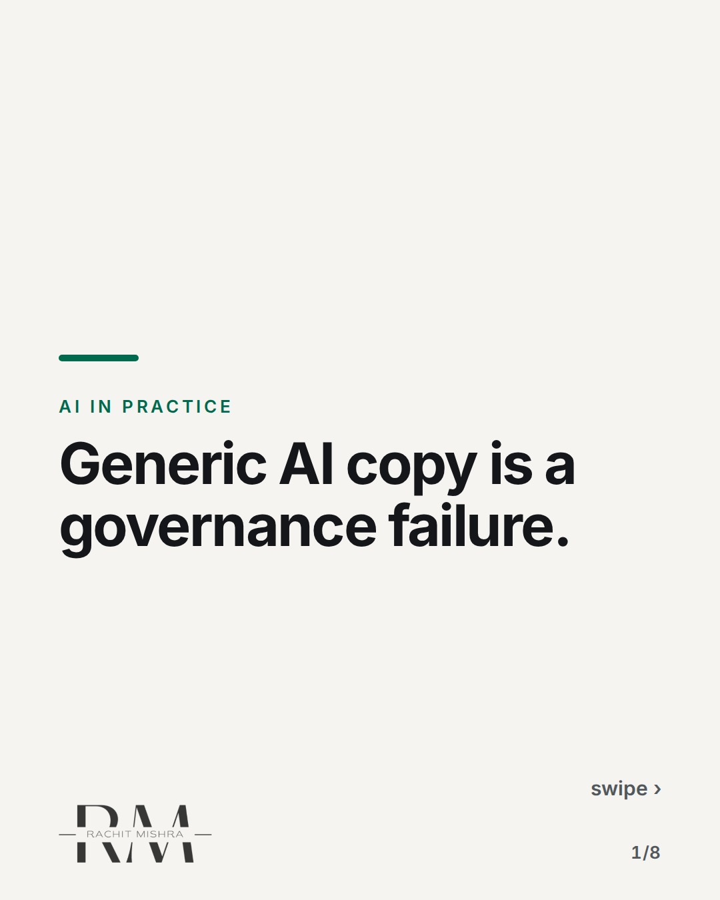
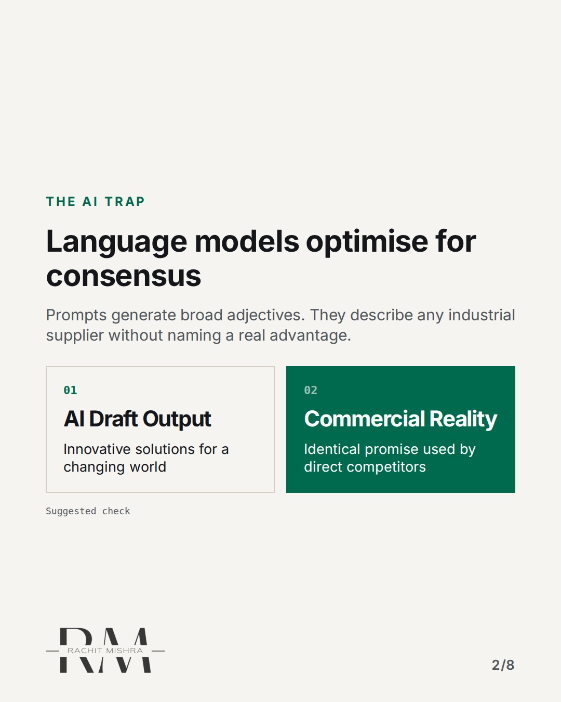
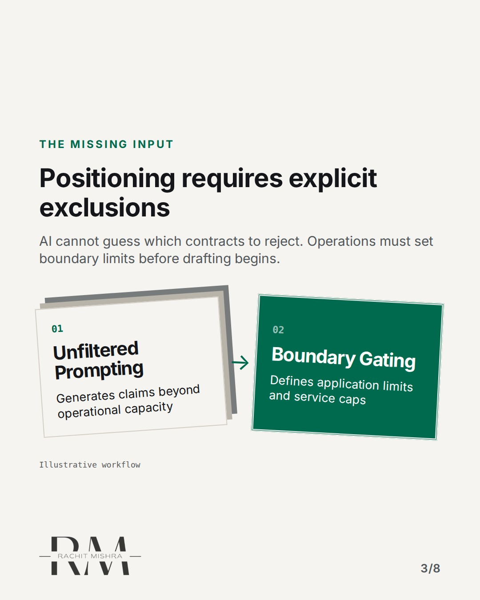
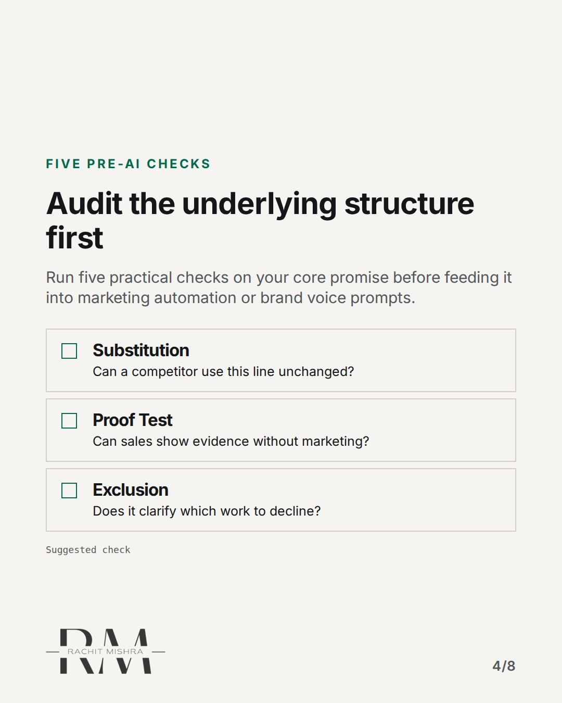
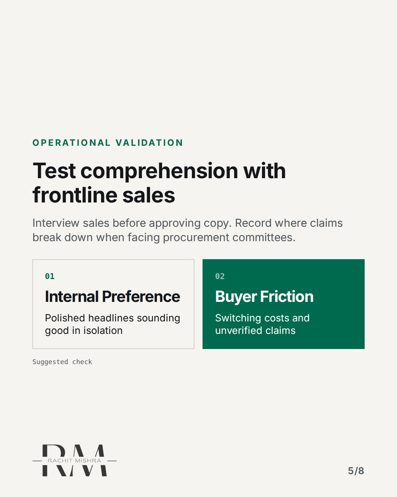
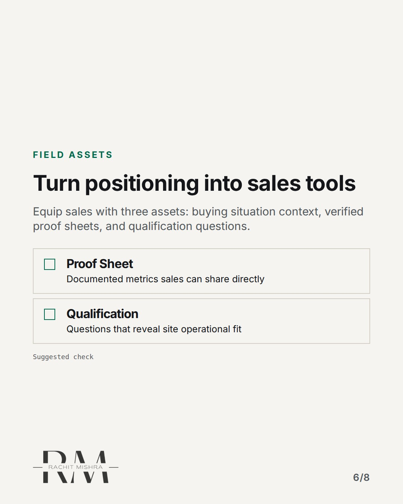
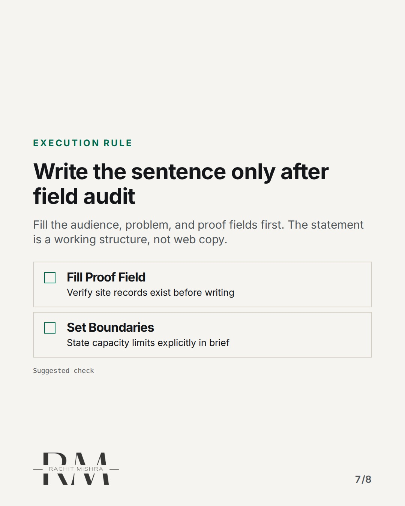
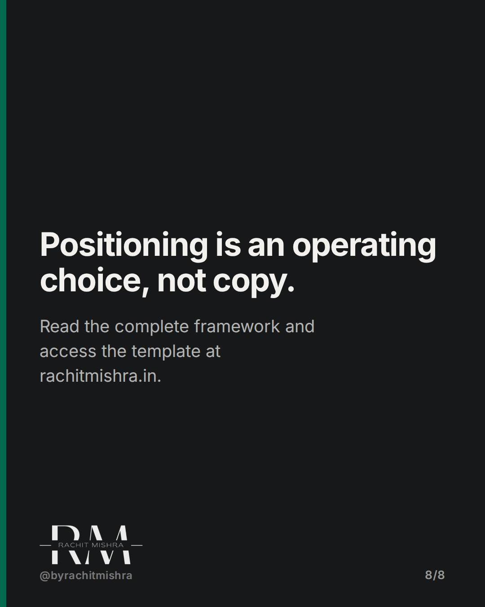

# ai_positioning_boundary_checks

**CAROUSEL** · ai_in_practice · goes live **2026-11-20T19:00:00+05:30**

> Targeting: `what AI cannot do in brand work`
>
> Claim: AI copy generators cannot define operational boundaries, forcing teams to set exclusion criteria before using automated drafts.
>
> Proof (source): Framework published in 'B2B Positioning Statement: A One-Page Template That Sales Can Use', demonstrating that positioning requires defining audience, proof, and explicit boundaries before writing.
> Source: https://www.rachitmishra.in/2026/10/16/b2b-positioning-statement-template/
>
> Source preflight: reachable (HTTP 200)
>
> Rendered infographics: 6 — comparison, bottleneck, checklist, comparison, checklist, checklist

## Slides

8 rendered images sit in this folder — upload them in filename order.

**1.** 
### Generic AI copy is a governance failure.



**2.** The AI Trap
### Language models optimise for consensus
Prompts generate broad adjectives. They describe any industrial supplier without naming a real advantage.



**3.** The Missing Input
### Positioning requires explicit exclusions
AI cannot guess which contracts to reject. Operations must set boundary limits before drafting begins.



**4.** Five Pre-AI Checks
### Audit the underlying structure first
Run five practical checks on your core promise before feeding it into marketing automation or brand voice prompts.



**5.** Operational Validation
### Test comprehension with frontline sales
Interview sales before approving copy. Record where claims break down when facing procurement committees.



**6.** Field Assets
### Turn positioning into sales tools
Equip sales with three assets: buying situation context, verified proof sheets, and qualification questions.



**7.** Execution Rule
### Write the sentence only after field audit
Fill the audience, problem, and proof fields first. The statement is a working structure, not web copy.



**8.** 
### Positioning is an operating choice, not copy.
Read the complete framework and access the template at rachitmishra.in.



## Caption — copy from here

```
Generic AI copy is a governance failure.

When understanding what AI cannot do in brand work, start with context. Generative models default to broad, pleasant phrasing because they are trained on statistical consensus. Ask a tool to write positioning for a logistics or manufacturing firm, and it produces variations of innovative solutions for a changing world.

That copy sounds positive while saying nothing. It fails because AI cannot decide which deals your business should decline, or what proof your operations team can actually deliver to a procurement committee.

Positioning is an operational choice. If you do not define the target audience, the specific buying problem, verified proof, and explicit operational boundaries upfront, automated drafts simply hide missing commercial decisions.

Fill the structural constraints first. Write the sentence last.

Full framework and template are available on my site: https://www.rachitmishra.in/2026/10/16/b2b-positioning-statement-template/

Send this to whoever is setting up your marketing automation rules this quarter.

[what AI cannot do in brand work, b2b positioning, ai governance, brand architecture, marketing operations]

#aimarketing #aigovernance #b2bmarketing
```

## Alt text

```
Diagram showing pre-AI positioning checks, comparing generic text with operational boundaries.
```

## How this post could fail

The post could be misread as anti-AI rhetoric rather than a practical workflow constraint for B2B brand teams.

## Sources

- [B2B Positioning Statement: A One-Page Template That Sales Can Use](https://www.rachitmishra.in/2026/10/16/b2b-positioning-statement-template/)
