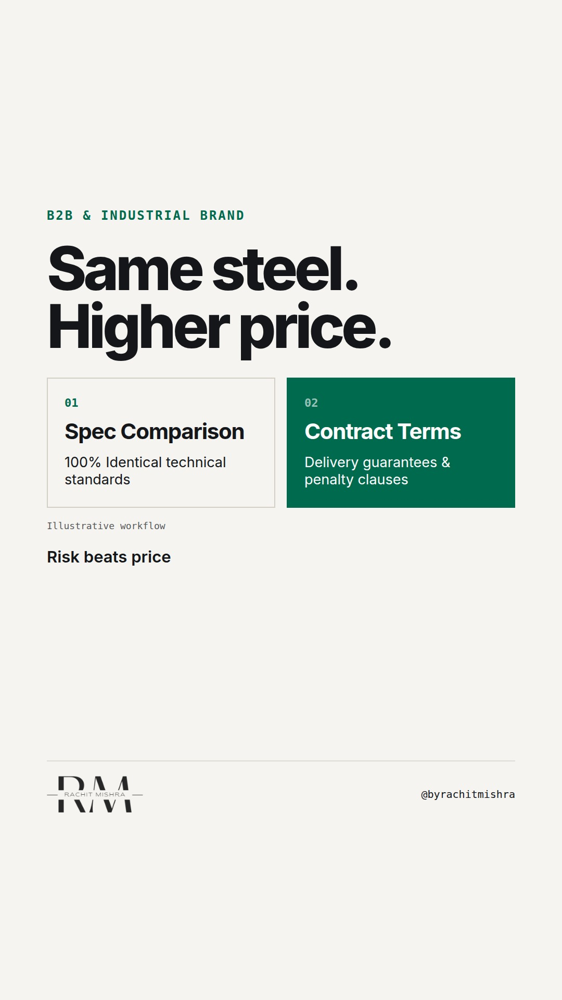

# b2b_commodity_pricing_framework

**REEL** · b2b_brand · goes live **2026-11-16T08:30:00+05:30**

> Targeting: `how to brand a commodity product`
>
> Claim: In B2B commodity markets, brand value is built on contract risk reduction rather than product differentiation.
>
> Proof (framework): A three-part operational risk audit that B2B brand teams use to defend price premiums when technical specifications between suppliers are identical.
>
> Rendered infographics: 3 — comparison, checklist, comparison
>
> Reel assets: image `designed_gradient` · music `bed-something (1).mp3`

## Cover



## Reel script

`reel.mp4` has been generated from this script and will publish automatically. To use your own footage instead, replace that file and delete `.generated-reel` from this folder.

| Time | On screen | Voiceover | Direction |
|---|---|---|---|
| 0:00-0:03 | **Why pay more for identical steel?** | Why pay more for identical steel? When technical specs are identical, procurement defaults to price. | Clean technical overlay showing identical chemical composition specs for two industrial steel grades. |
| 0:03-0:07 | **Commodities sell on risk, not specs** | Understanding how to brand a commodity product starts with acknowledging that buyers rarely pay for product differentiation. | Split graphic contrasting product specifications against supply chain delivery risks. |
| 0:07-0:14 | **Contract Risk Audit** | They pay to lower contract risk. Here is the three-part framework to defend your margin. | Checklist animation building the three operational risk factors. |
| 0:14-0:22 | **Check 1: Delivery SLA Guarantees** | First, map your delivery SLA guarantee. A plant shutdown costs vastly more than a raw material price premium. | Comparison graphic evaluating unit material price savings against factory downtime costs. |
| 0:22-0:30 | **Check 2: Regulatory Traceability** | Second, verify audit-ready regulatory traceability. Procurement pays to protect their governance record. | Document flow graphic highlighting compliance certification steps. |
| 0:30-0:38 | **Check 3: Guaranteed Volume** | Third, formalise capacity allocation guarantees during supply crunches. Availability beats price during shortage. | Graph showing volume reservation stability against market spot-price volatility. |
| 0:38-0:45 | **Brand is risk mitigation** | Industrial brand strength is measured by the operational risk you remove from the buyer's committee. | Summary text screen framing brand identity as operational insurance. |

## Caption — copy from here

```
Why pay more for identical steel?

Learning how to brand a commodity product is rarely about finding a unique product feature. In heavy manufacturing, two suppliers often produce exact chemical and structural equivalents under identical national standards.

When brand advice tells you to find emotional differentiation, it fails in a procurement committee. A plant manager does not care about your brand story; they care about line stoppage.

Your margin lives in the operational terms surrounding the product. The brand is the guarantee that protects the procurement buyer from downside risk.

If your marketing team spends time trying to make standardized raw materials look unique, pivot the work to document and package your operational reliability.

Industrial brand strength is measured by the operational risk you remove from the buyer's committee.

Send this to the brand manager preparing for the next commodity contract review.

[how to brand a commodity product, b2b branding, industrial marketing, manufacturing marketing, b2b brand strategy]

#b2bmarketing #industrialmarketing #b2bbranding
```

## Alt text

```
Diagram comparing steel product specifications against contract risk terms in B2B sales.
```

## How this post could fail

If the viewer works in specialized capital goods rather than true standardized commodities, framing brand purely as contract risk reduction might read as overly narrow.
