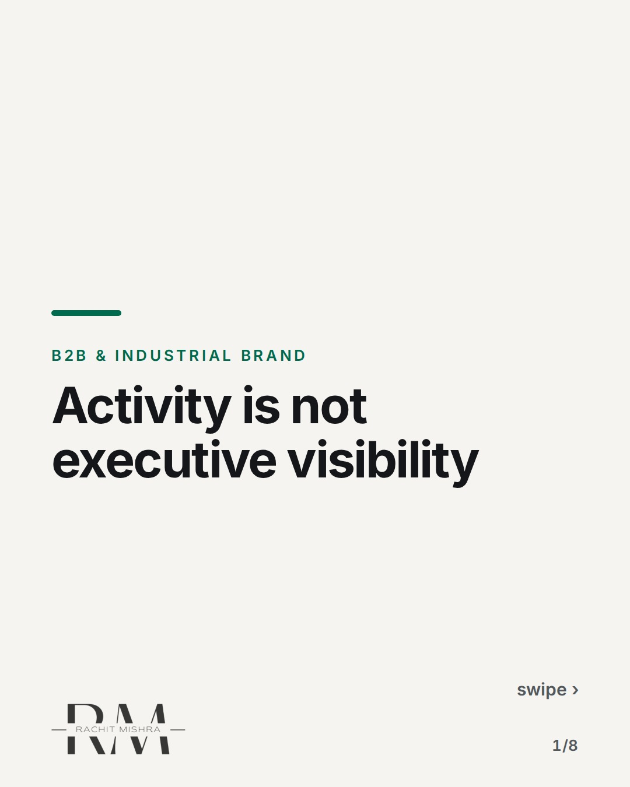
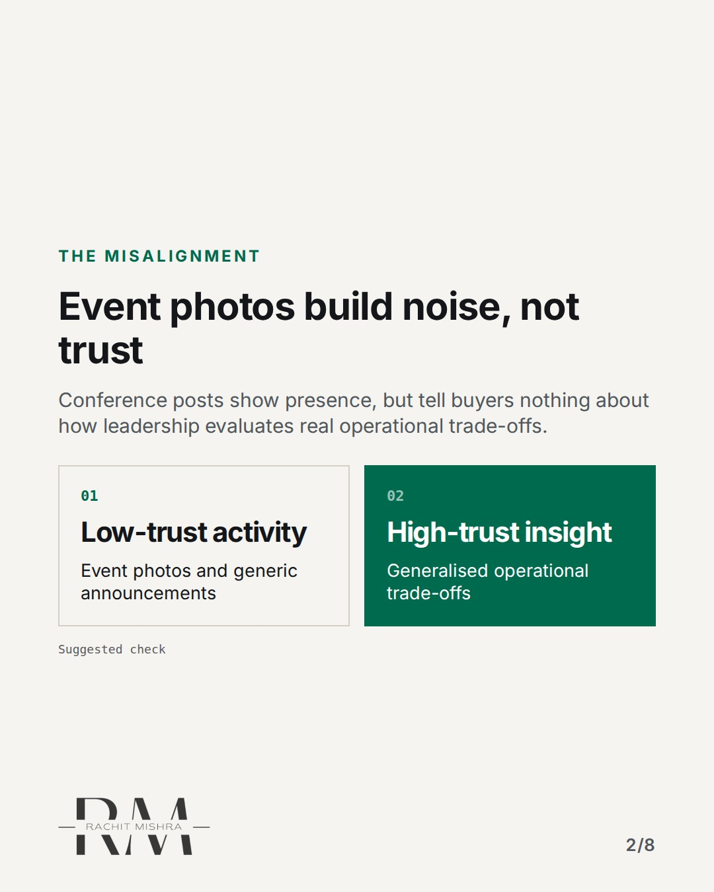
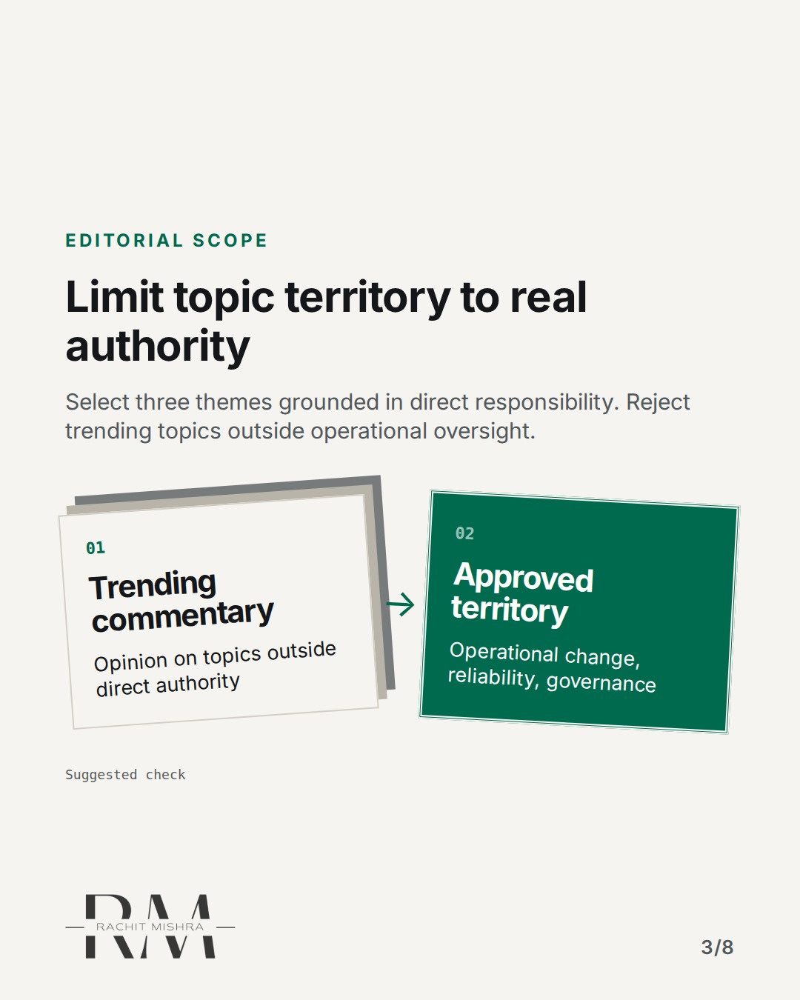
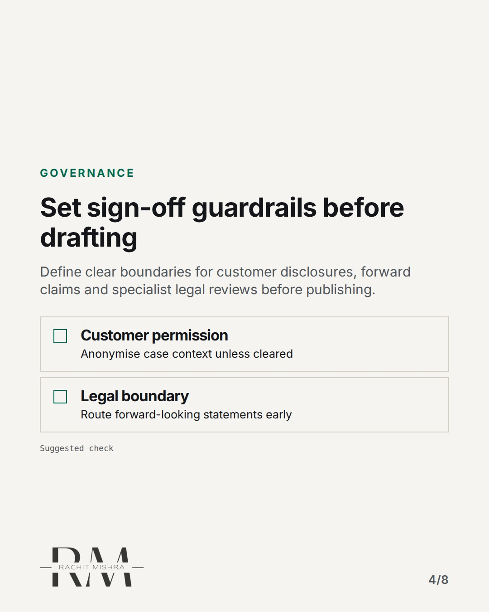
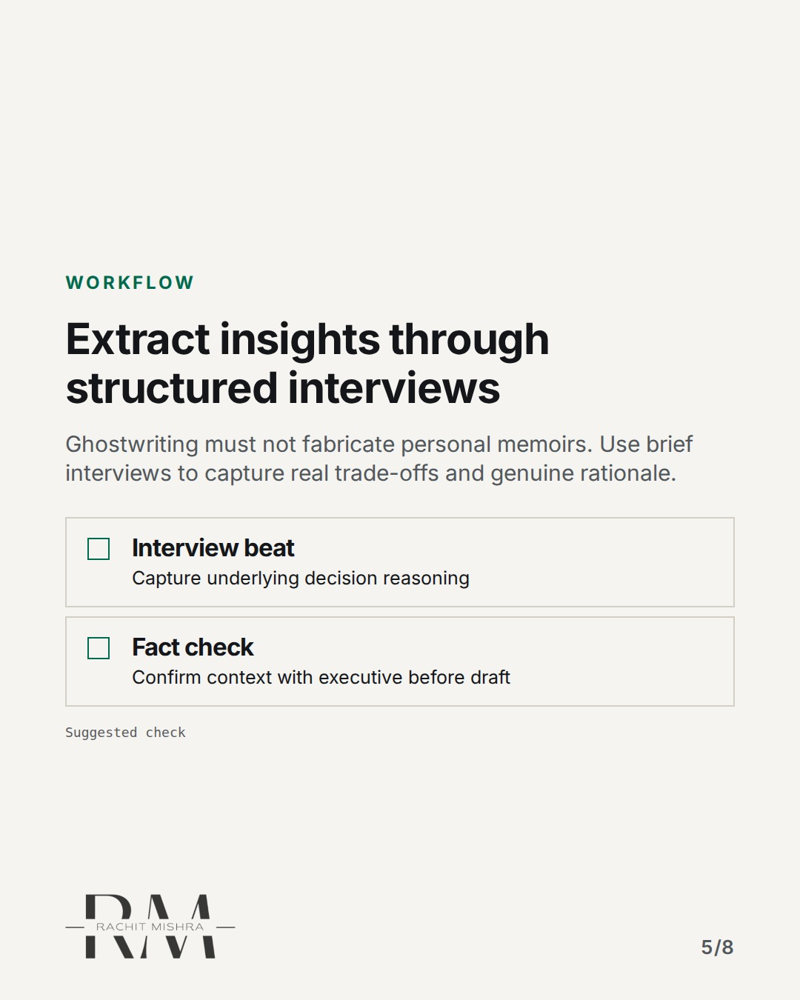
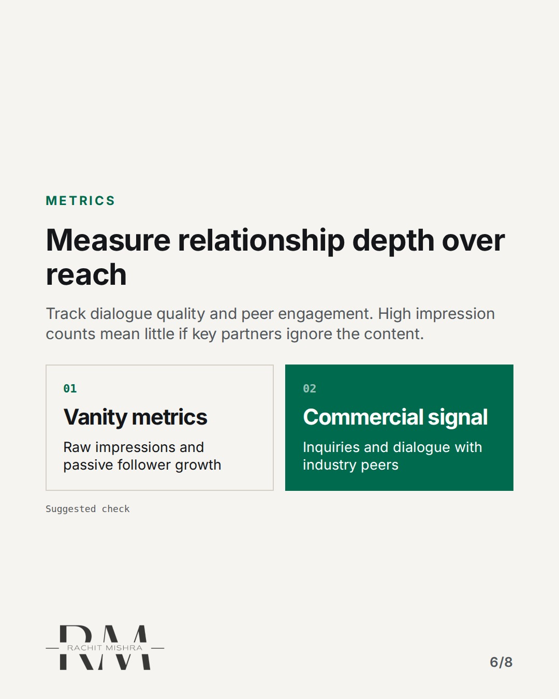
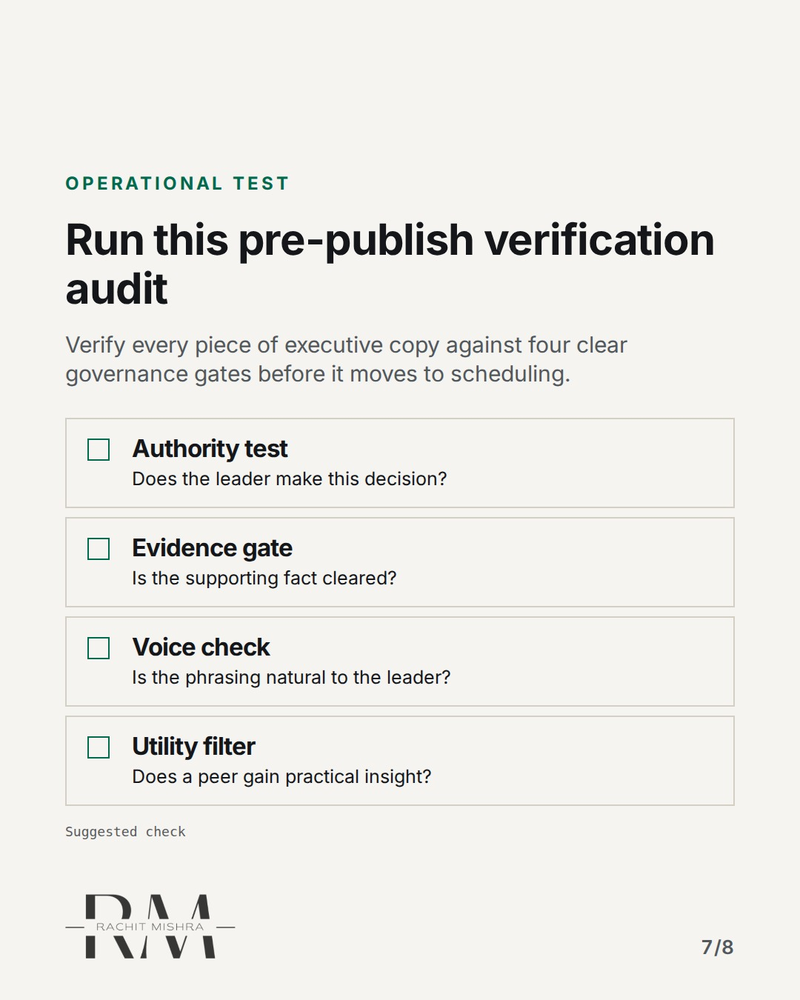
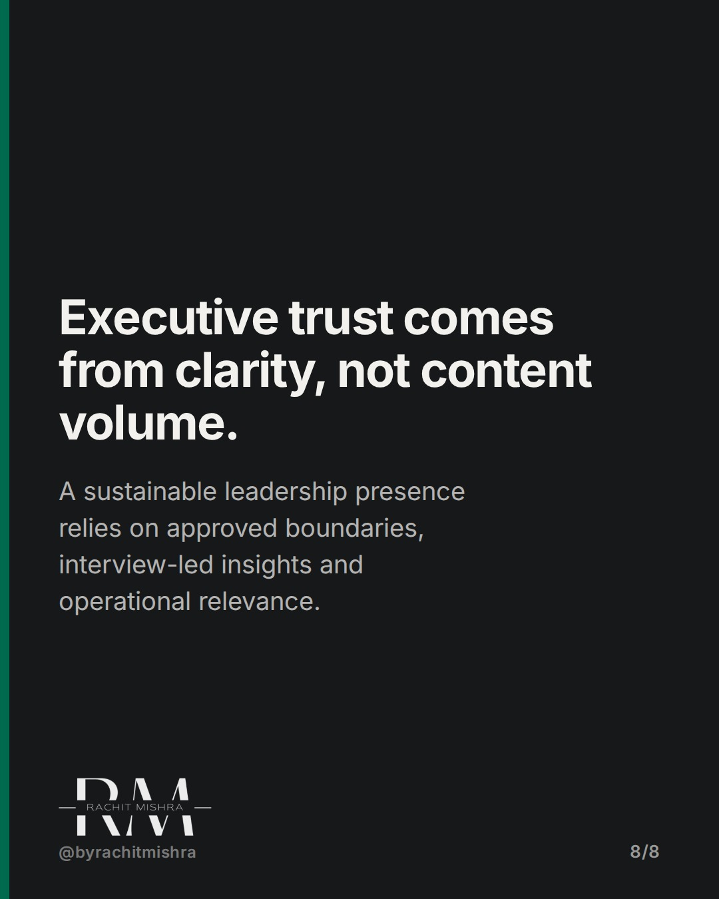

# executive_linkedin_governance

**CAROUSEL** · b2b_brand · goes live **2026-11-16T19:00:00+05:30**

> Targeting: `B2B brand strategy`
>
> Claim: Executive visibility without approved decision boundaries damages corporate trust faster than total silence.
>
> Proof (source): Executive LinkedIn Strategy: Build Trust Without Becoming a Content Machine outlines an interview-led framework and clear governance boundaries for leadership communications.
> Source: https://www.rachitmishra.in/2026/10/23/executive-linkedin-strategy/
>
> Source preflight: reachable (HTTP 200)
>
> Rendered infographics: 6 — comparison, bottleneck, checklist, checklist, comparison, checklist

## Slides

8 rendered images sit in this folder — upload them in filename order.

**1.** 
### Activity is not executive visibility



**2.** THE MISALIGNMENT
### Event photos build noise, not trust
Conference posts show presence, but tell buyers nothing about how leadership evaluates real operational trade-offs.



**3.** EDITORIAL SCOPE
### Limit topic territory to real authority
Select three themes grounded in direct responsibility. Reject trending topics outside operational oversight.



**4.** GOVERNANCE
### Set sign-off guardrails before drafting
Define clear boundaries for customer disclosures, forward claims and specialist legal reviews before publishing.



**5.** WORKFLOW
### Extract insights through structured interviews
Ghostwriting must not fabricate personal memoirs. Use brief interviews to capture real trade-offs and genuine rationale.



**6.** METRICS
### Measure relationship depth over reach
Track dialogue quality and peer engagement. High impression counts mean little if key partners ignore the content.



**7.** OPERATIONAL TEST
### Run this pre-publish verification audit
Verify every piece of executive copy against four clear governance gates before it moves to scheduling.



**8.** 
### Executive trust comes from clarity, not content volume.
A sustainable leadership presence relies on approved boundaries, interview-led insights and operational relevance.



## Caption — copy from here

```
Activity is not executive visibility

A clear B2B brand strategy relies on executive positioning that explains business decisions rather than generating noise.

Most leadership communication programmes fail because they turn executives into general content creators. They post conference photos, award acceptances, and generic industry commentary. None of these demonstrate how a leadership team actually handles commercial or operational trade-offs.

A governed approach defines precise boundaries first. You do not need to disclose confidential figures or customer contracts to build credibility. Explaining a generalised decision framework is often far more useful to procurement committees and strategic partners.

Establish a brief, interview-led drafting routine to extract genuine operational reasoning. Run every draft through a strict approval gate before scheduling.

Visibility without utility degrades institutional reputation.

Send this to whoever manages corporate communications or leadership positioning for your organisation.

Read the full framework on executive communication strategy: https://www.rachitmishra.in/2026/10/23/executive-linkedin-strategy/

[b2b brand strategy, executive communications, industrial marketing, corporate reputation, brand governance]

#b2bmarketing #industrialmarketing #brandstrategy
```

## Alt text

```
Carousel slides illustrating an executive LinkedIn governance framework focusing on B2B trust.
```

## How this post could fail

It could be read as generic social media advice if the emphasis on strict approval gates and operational trade-offs is missed.

## Sources

- [Executive LinkedIn Strategy: Build Trust Without Becoming a Content Machine](https://www.rachitmishra.in/2026/10/23/executive-linkedin-strategy/)
