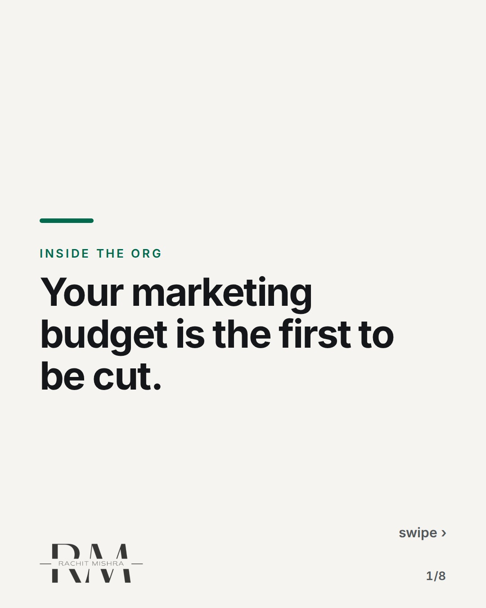
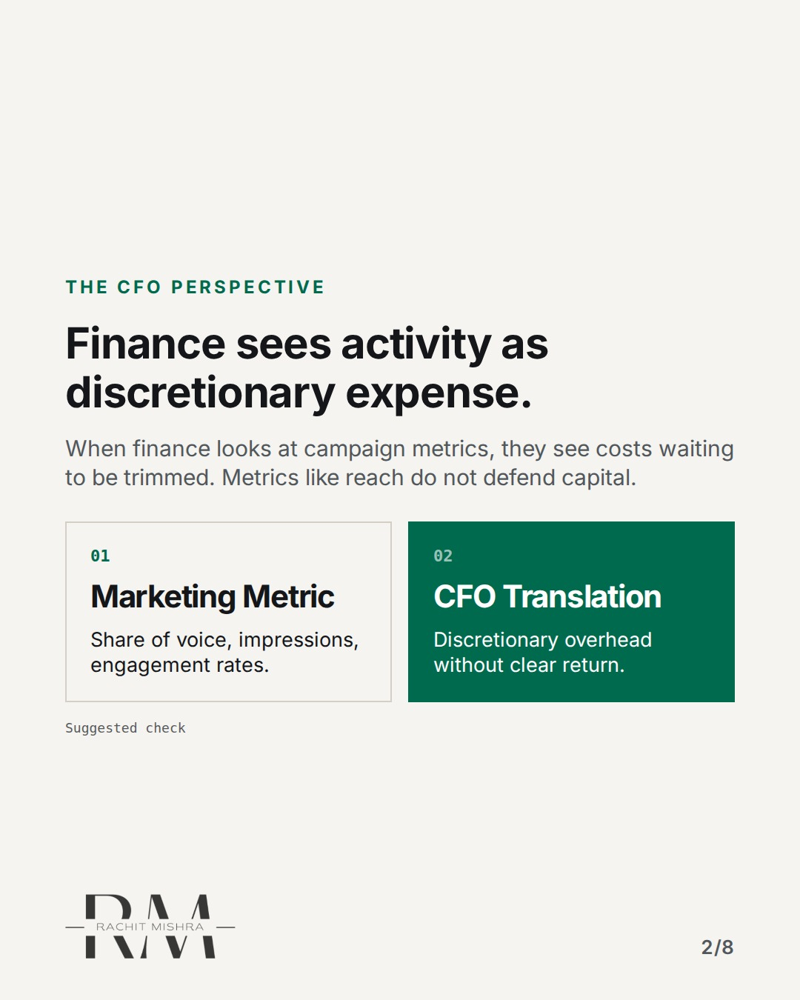
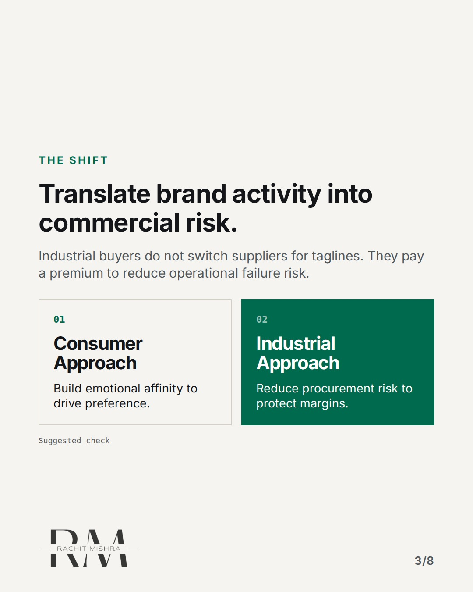
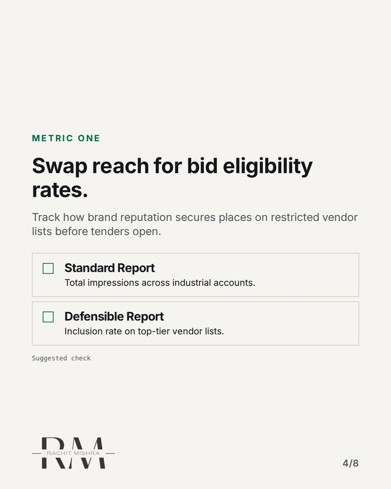
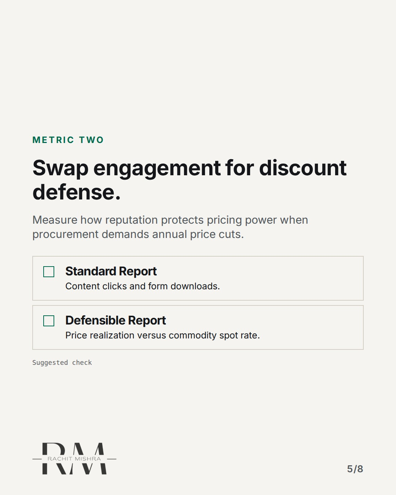
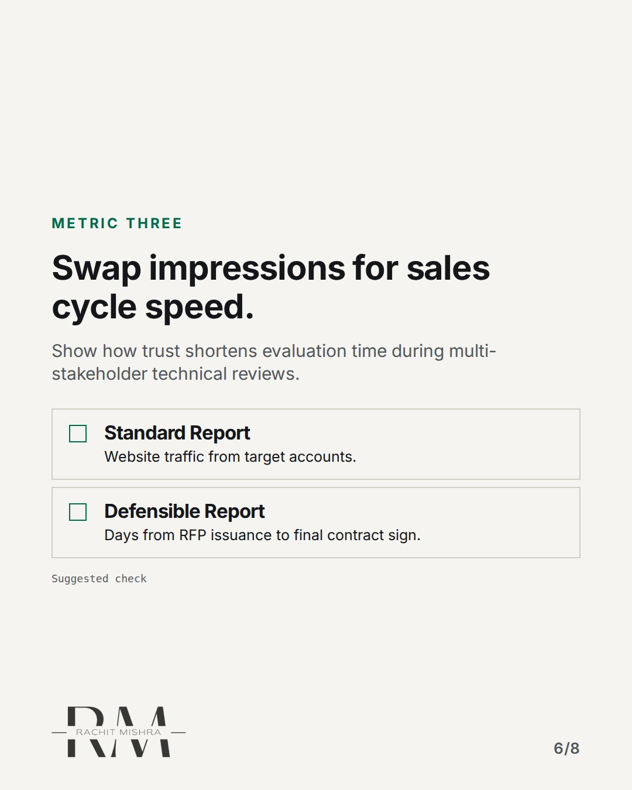
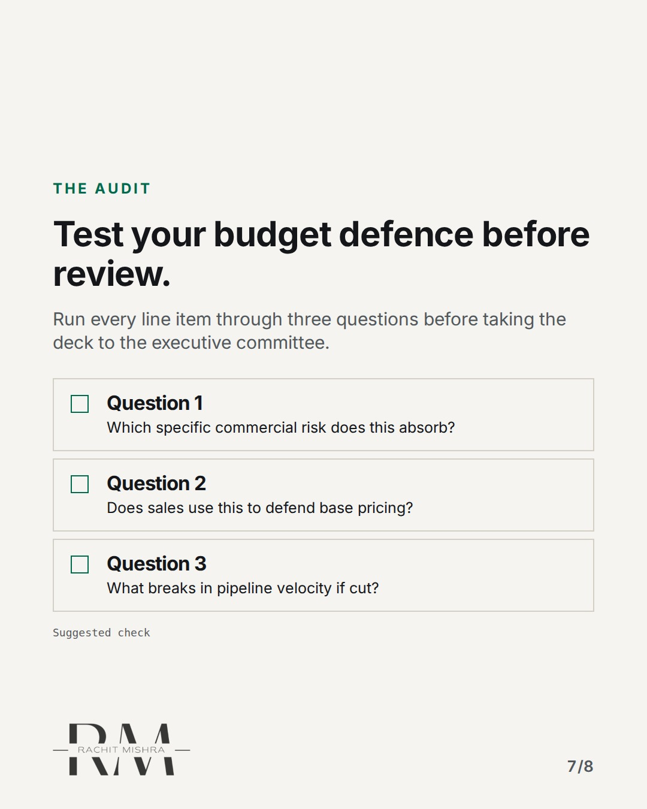
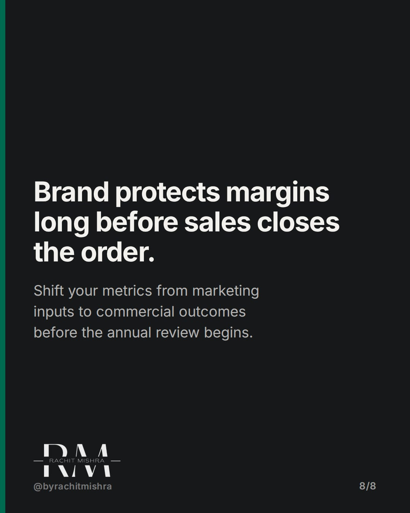

# defending_marketing_budget_commercial_metrics

**CAROUSEL** · inside_the_org · goes live **2026-11-21T10:30:00+05:30**

> Targeting: `defending a marketing budget`
>
> Claim: Marketing budgets get cut in industrial firms because marketers report activity metrics instead of commercial risk absorption.
>
> Proof (framework): A three-part metric translation framework for industrial brand leads: converting reach, engagement, and impressions into bid eligibility, margin defence, and sales cycle velocity.
>
> Rendered infographics: 6 — comparison, comparison, checklist, checklist, checklist, checklist

## Slides

8 rendered images sit in this folder — upload them in filename order.

**1.** 
### Your marketing budget is the first to be cut.



**2.** The CFO Perspective
### Finance sees activity as discretionary expense.
When finance looks at campaign metrics, they see costs waiting to be trimmed. Metrics like reach do not defend capital.



**3.** The Shift
### Translate brand activity into commercial risk.
Industrial buyers do not switch suppliers for taglines. They pay a premium to reduce operational failure risk.



**4.** Metric One
### Swap reach for bid eligibility rates.
Track how brand reputation secures places on restricted vendor lists before tenders open.



**5.** Metric Two
### Swap engagement for discount defense.
Measure how reputation protects pricing power when procurement demands annual price cuts.



**6.** Metric Three
### Swap impressions for sales cycle speed.
Show how trust shortens evaluation time during multi-stakeholder technical reviews.



**7.** The Audit
### Test your budget defence before review.
Run every line item through three questions before taking the deck to the executive committee.



**8.** 
### Brand protects margins long before sales closes the order.
Shift your metrics from marketing inputs to commercial outcomes before the annual review begins.



## Caption — copy from here

```
Your marketing budget is the first to be cut.

When defending a marketing budget in a B2B or industrial company, reporting consumer metrics like impressions or engagement is an invitation to get slashed. Procurement committees and CFOs do not care about reach; they care about commercial risk.

In heavy engineering and manufacturing, marketing rarely creates instant demand. Its actual function is absorbing risk for the buyer so sales does not have to discount to close the deal.

If your board deck relies on agency vanity metrics, you are asking finance to treat brand building as a discretionary cost center instead of a margin defense mechanism.

The hardest part of in-house marketing leadership is translating long-term reputation into terms the CFO accepts. Stop reporting how many people saw the campaign and start reporting how reputation protects your price realization.

Send this to whoever is defending the brand budget this quarter.

[defending a marketing budget, b2b marketing, brand governance, in-house marketing]

#marketingleadership #inhousemarketing #brandgovernance

#marketingleadership #inhousemarketing #brandgovernance
```

## Alt text

```
Slide sequence explaining how to defend a B2B marketing budget using commercial risk metrics.
```

## How this post could fail

If the metrics sound too theoretical, the reader might view this as abstract positioning advice rather than a pragmatic framework for board meetings.
