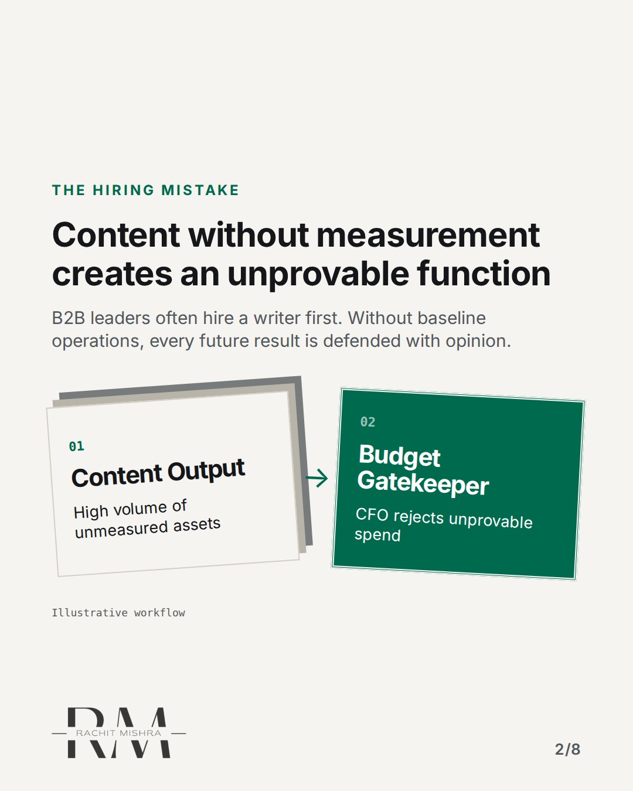
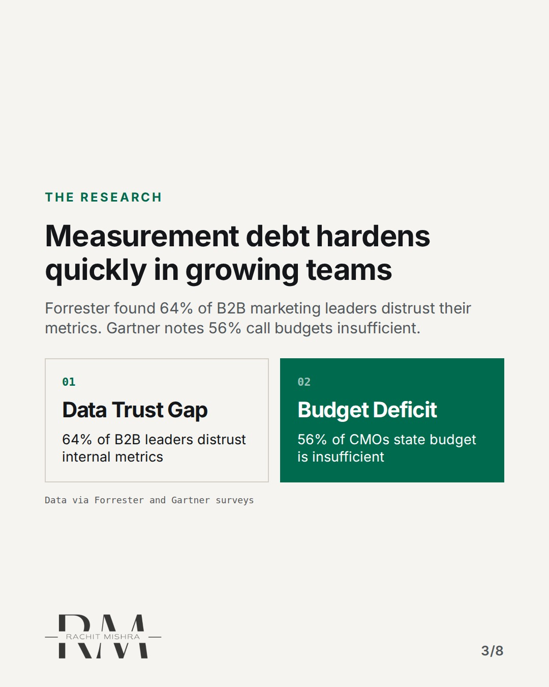
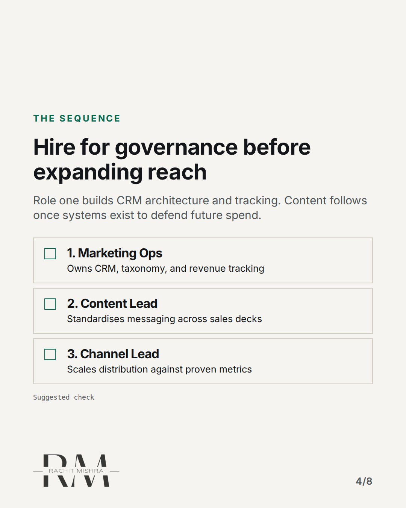
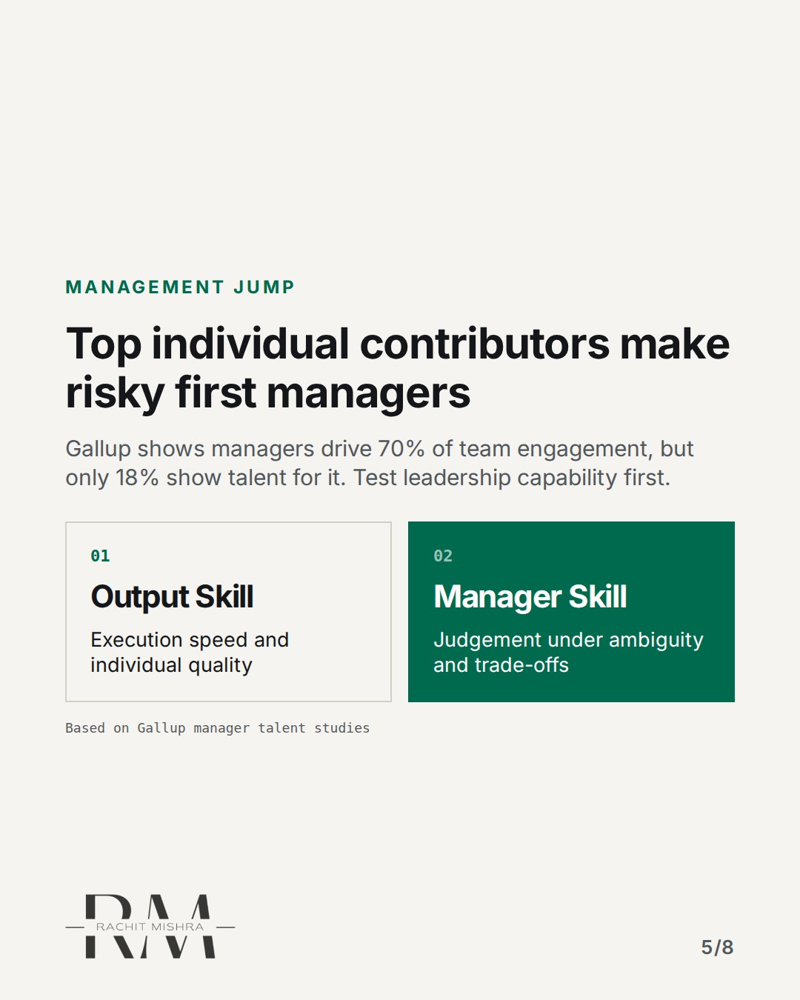
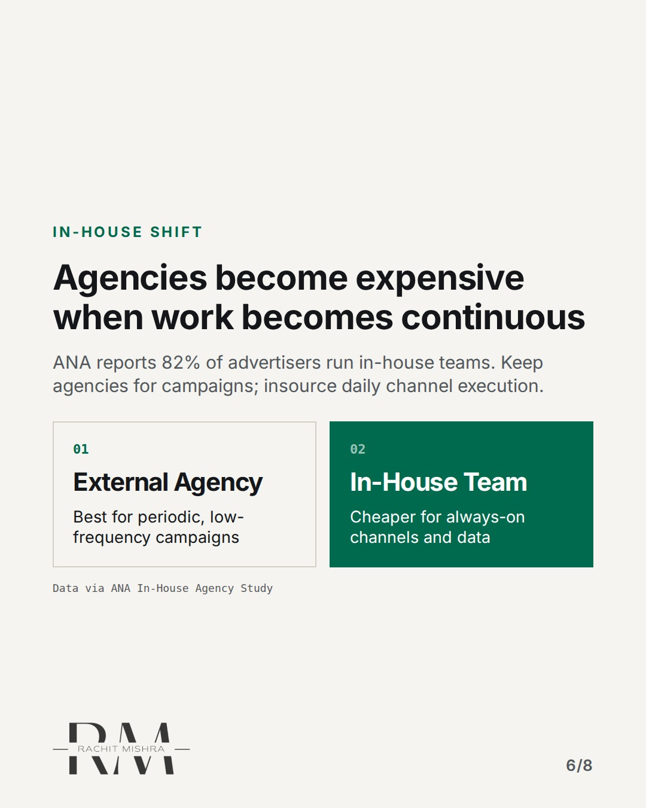
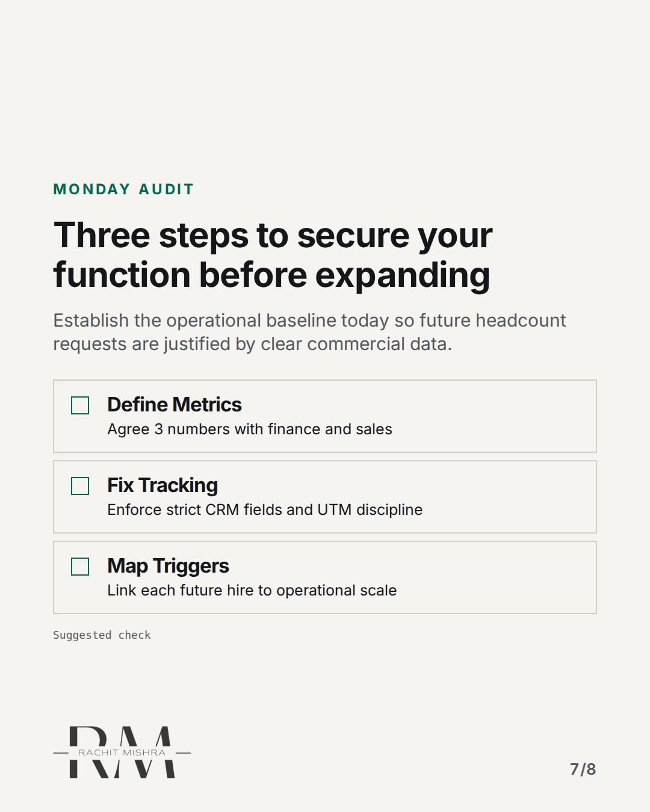

# firsthiringorderb2b

**CAROUSEL** · inside_the_org · goes live **2026-11-22T10:30:00+05:30**

> Targeting: `marketing leadership`
>
> Claim: The first marketing hire in a B2B organisation must own operations and measurement to create a defensible foundation for all future headcount.
>
> Proof (source): Forrester research found 64% of B2B marketing leaders do not trust their own measurement enough to make decisions, while Gartner reported 56% of CMOs considered their 2026 budget insufficient.
> Source: https://www.rachitmishra.in/2026/09/08/building-marketing-team/
>
> Source preflight: reachable (HTTP 200)
>
> Rendered infographics: 6 — bottleneck, comparison, checklist, comparison, comparison, checklist

## Slides

8 rendered images sit in this folder — upload them in filename order.

**1.** 
### First hires fix your budget ceiling.


**2.** The Hiring Mistake
### Content without measurement creates an unprovable function
B2B leaders often hire a writer first. Without baseline operations, every future result is defended with opinion.



**3.** The Research
### Measurement debt hardens quickly in growing teams
Forrester found 64% of B2B marketing leaders distrust their metrics. Gartner notes 56% call budgets insufficient.



**4.** The Sequence
### Hire for governance before expanding reach
Role one builds CRM architecture and tracking. Content follows once systems exist to defend future spend.



**5.** Management Jump
### Top individual contributors make risky first managers
Gallup shows managers drive 70% of team engagement, but only 18% show talent for it. Test leadership capability first.



**6.** In-House Shift
### Agencies become expensive when work becomes continuous
ANA reports 82% of advertisers run in-house teams. Keep agencies for campaigns; insource daily channel execution.



**7.** Monday Audit
### Three steps to secure your function before expanding
Establish the operational baseline today so future headcount requests are justified by clear commercial data.



**8.** 
### Proof precedes budget in industrial organisations.
A function that cannot prove its contribution is not small, it is temporary. Read the full essay at rachitmishra.in


## Caption — copy from here

```
First hires fix your budget ceiling.

Strong marketing leadership inside an engineering organisation requires building an operational foundation before chasing visibility. Most leaders hire a writer or designer first because creative output is easy to see. 

The trade-off is brutal. Without clean CRM fields, clear attribution rules, and agreed pipeline definitions, every subsequent campaign is evaluated on subjective opinion. When budget cuts arrive, unprovable functions are trimmed first.

Building the operations layer early feels slow. It means spending the first two quarters on data hygiene instead of launching major campaigns. But that unglamorous plumbing is what buys the authority to defend your team when board room scrutiny tightens.

The full breakdown on structuring B2B marketing teams is on my site: https://www.rachitmishra.in/2026/09/08/building-marketing-team/

Send this to whoever is structuring their marketing headcount for next year.

[marketing leadership, brand governance, b2b marketing, in-house marketing]

#marketingleadership #inhousemarketing #brandgovernance
```

## Alt text

```
Slide deck detailing the sequence for hiring a B2B marketing team based on measurement capability.
```

## How this post could fail

Could be misread as dismissive of creative roles if the reader ignores the sequencing emphasis.

## Sources

- [Building a Marketing Team From One Person to Twelve](https://www.rachitmishra.in/2026/09/08/building-marketing-team/)
