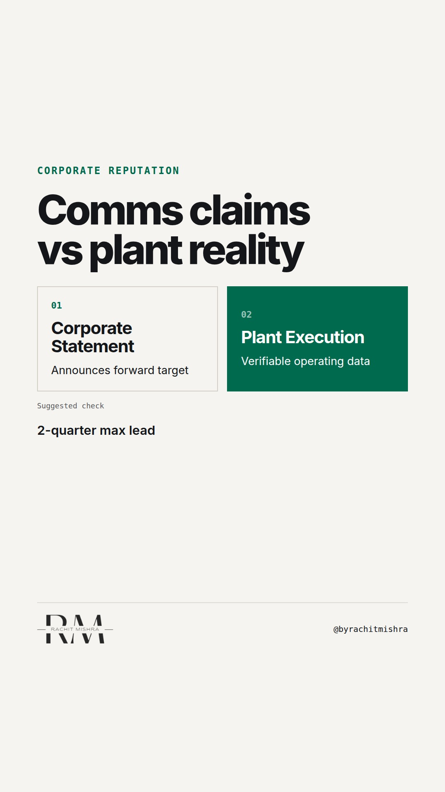

# stakeholder_trust_audit_thresholds

**REEL** · reputation · goes live **2026-11-19T17:00:00+05:30**

> Targeting: `corporate reputation management`
>
> Claim: Industrial stakeholder trust erodes when corporate statements lead plant-level operational reality by more than two quarters.
>
> Proof (framework): A quarterly audit framework for corporate communications teams comparing published commitments against operational verification thresholds.
>
> Rendered infographics: 3 — comparison, checklist, bottleneck
>
> Reel assets: image `designed_gradient` · music `bed-something (11).mp3`

## Cover



## Reel script

`reel.mp4` has been generated from this script and will publish automatically. To use your own footage instead, replace that file and delete `.generated-reel` from this folder.

| Time | On screen | Voiceover | Direction |
|---|---|---|---|
| 0:00-0:03 | **Trust breaks when claims outpace plant ops.** | Trust breaks when claims outpace plant ops. In heavy industry, reputation is lost in the gap between corporate comms and the shop floor. | Dark background with high-contrast text overlay displaying the opening hook. |
| 0:03-0:08 | **Auditors test operations, not promises.** | Regulators, communities, and commercial buyers do not evaluate your brand through press releases. They look at operating logs. | Text transition emphasizing the divergence between external claims and operational evidence. |
| 0:08-0:15 | **3 Audit Checks for Industrial Comms** | Before publishing any forward commitment, run this three-point audit against actual plant data. | Graphic intro introducing the audit framework card. |
| 0:15-0:22 | **Check 1: Require a verified data trail** | First: require a verified data trail. If environmental metrics cannot be pulled from an internal log today, do not release them. |  |
| 0:22-0:29 | **Check 2: Cap statement lead time** | Second: cap your lead time. Communications should never announce a capability more than two quarters before site execution. |  |
| 0:29-0:36 | **Check 3: Mandatory plant sign-off** | Third: demand plant-level sign-off. The head of operations must approve the claim, not just legal. | Visual breakdown of the approval gate bottleneck. |
| 0:36-0:42 | **Reputation is operational consistency.** | Reputation is operational consistency made visible. Close the gap before you publish. |  |

## Caption — copy from here

```
Trust breaks when claims outpace plant ops.

Effective corporate reputation management inside industrial companies requires keeping corporate comms anchored to physical operations.

When external narratives move faster than plant implementation, regulators and commercial buyers notice the gap long before board members do.

The cost of closing that gap after an investigation or public query is always higher than delaying the announcement.

Good governance means refusing to publish forward statements that operations cannot demonstrate on a site walk.

Send this to whoever approves corporate releases before plant sign-off.

[corporate reputation management, corporate communications, stakeholder trust, industrial brand]

#corporatecommunications #reputation #publicrelations

#corporatecommunications #reputation #publicrelations
```

## Alt text

```
Text graphic showing a three-part corporate communications audit checklist on a dark background.
```

## How this post could fail

Could be misread as basic advice on corporate compliance rather than a practical governance gate for industrial comms teams.
