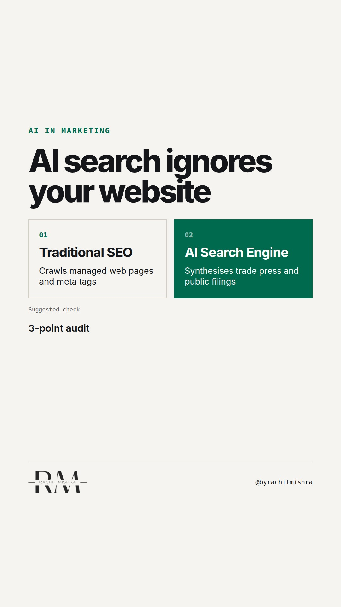

# generativeengineoptimisationb2bstack

**REEL** · ai_marketing · goes live **2026-11-17T19:00:00+05:30**

> Targeting: `generative engine optimisation for B2B`
>
> Claim: B2B brand reach in AI search engines depends on unstructured third-party references rather than managed website copy.
>
> Proof (framework): A three-part audit for generative engine optimisation for B2B: testing brand citations across trade press, regulatory filings, and technical forums instead of owned web copy.
>
> Rendered infographics: 4 — comparison, checklist, checklist, checklist
>
> Reel assets: image `designed_gradient` · music `bed-something (10).mp3`

## Cover



## Reel script

`reel.mp4` has been generated from this script and will publish automatically. To use your own footage instead, replace that file and delete `.generated-reel` from this folder.

| Time | On screen | Voiceover | Direction |
|---|---|---|---|
| 0:00-0:03 | **AI search ignores your official website.** | AI search ignores your official website when answering buyer queries. | Clean typography displaying the hook over an industrial background graphic. |
| 0:03-0:08 | **LLMs crawl third-party citations first.** | Large language models build brand summaries from unstructured third-party sources, not your polished homepage. | Diagram showing an AI model extracting text from news reports and regulatory databases. |
| 0:08-0:14 | **Optimising owned copy offers zero reach.** | If you are adapting generative engine optimisation for B2B, tweaking metadata on your own domain changes almost nothing. | Graphic comparing owned blog posts against independent industry benchmarks. |
| 0:14-0:20 | **Check 1: Trade coverage depth.** | First, audit trade publication coverage. AI engines look for consensus across independent reporting. | On-screen checklist displaying the three verification steps. |
| 0:20-0:26 | **Check 2: Public technical documentation.** | Second, verify public documentation. Engines index regulatory filings and technical sheets to verify capabilities. | Highlighting step two on the checklist interface. |
| 0:26-0:32 | **Check 3: Unsolicited user forums.** | Third, monitor professional forums. Customer discussions carry higher weight in answer generation than corporate blogs. | Highlighting step three on the checklist interface. |
| 0:32-0:38 | **AI visibility is earned off-site.** | Visibility in AI search is earned off-site through documented operational presence, not on-page optimization. | Final summary frame showing off-site ecosystem feeding into an engine response. |

## Caption — copy from here

```
AI search ignores your official website.

When enterprise buyers use generative engine optimisation for B2B discovery, language models rely on unmanaged external sources.

Most teams treat search visible content as an editing exercise for their own website. They rewrite landing pages, adjust headers, and publish whitepapers on their own domain.

AI models parse the web differently. They cross-reference trade press reporting, regulatory submissions, and technical discussions across independent communities to establish authority.

If your product only exists on your own website, it does not exist in an AI synthesis.

Visibility is built in the public record long before an engine indexes it.

Send this to whoever manages your search strategy this year.

[generative engine optimisation for b2b, ai in enterprise marketing, b2b search, marketing technology stack, organic discovery]

#geo #martech #b2bmarketing
```

## Alt text

```
Diagram showing AI search indexing trade press and public records over managed company websites.
```

## How this post could fail

May sound like search engine optimization basics if the distinction between owned web copy and third-party citation parsing is not stated sharply.
