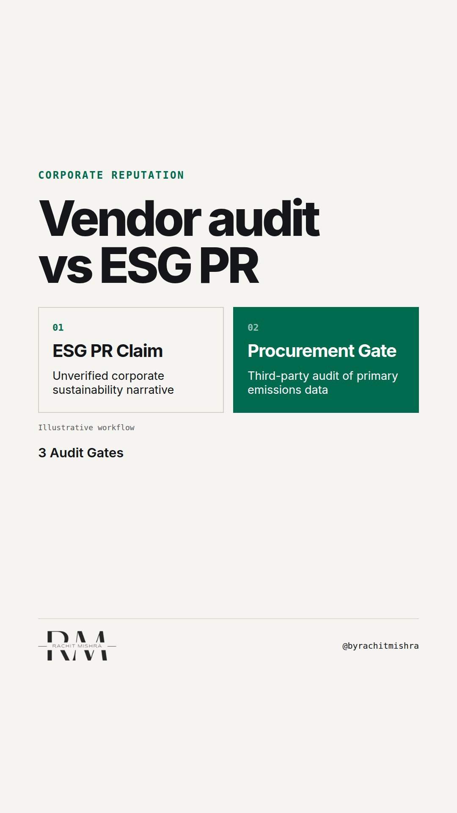

# esg_vendor_audit_gate

**REEL** · reputation · goes live **2026-11-18T08:30:00+05:30**

> Targeting: `ESG communication that is not greenwashing`
>
> Claim: In industrial supply chains, corporate reputation is defended by audit checklists, not public sustainability reports.
>
> Proof (framework): A three-part supply chain ESG verification gate used in industrial procurement to validate vendor compliance before contract renewal.
>
> Rendered infographics: 3 — comparison, checklist, checklist
>
> Reel assets: image `designed_gradient` · music `bed-something (12).mp3`

## Cover



## Reel script

`reel.mp4` has been generated from this script and will publish automatically. To use your own footage instead, replace that file and delete `.generated-reel` from this folder.

| Time | On screen | Voiceover | Direction |
|---|---|---|---|
| 0:00-0:03 | **Your PR release won't survive a vendor audit.** | Your PR release won't survive a vendor audit. Procurement committees do not read press releases. | Dark minimalist background showing the phrase 'Vendor Audit Gate' in bold typography. |
| 0:03-0:08 | **Reputation is verified at procurement gates.** | In industrial B2B, corporate reputation is decided by audit teams checking regulatory compliance and supply chain data. | Text transition emphasizing procurement verification over marketing copy. |
| 0:08-0:15 | **Gate 1: Tier-1 Primary Emissions Data** | Gate one: Primary emissions data. If your sustainability report relies on industry averages rather than site-level metering, procurement rejects it. | Onscreen checklist graphic highlighting primary data requirement. |
| 0:15-0:22 | **Gate 2: Sub-tier Safety Audits** | Gate two: Sub-tier safety logs. Corporate comms publishes policy guidelines, but auditors verify lost-time injury rates across sub-contractors. | Onscreen graphic displaying safety audit checks. |
| 0:22-0:29 | **Gate 3: Downstream Waste Tracking** | Gate three: Chain of custody waste logs. Broad pledge statements fail without manifest records from secondary processors. | Visual showing waste tracking manifest requirement. |
| 0:29-0:35 | **Reputation is operational, not aspirational.** | Build ESG communication that is not greenwashing by grounding claims in documentation your procurement team already submits to regulators. | Final summary card displaying the core operational principle. |

## Caption — copy from here

```
Your PR release won't survive a vendor audit.

Executing ESG communication that is not greenwashing requires aligning corporate communications with operational proof.

In B2B and heavy industry, enterprise buyers do not read slick CSR brochures. Procurement committees run vendor audits using strict compliance checklists.

If your comms team publishes targets that operations cannot back up with site-level logs, you create commercial risk. The auditor spots the gap, the vendor score drops, and contract renewal stalls.

Stop writing broad pledge statements. Use the exact datasets your regulatory teams submit during compliance reviews.

Reputation is an operational record, not a promotional campaign.

Send this to whoever is reviewing your corporate comms strategy before the next audit cycle.

[corporate reputation, esg communication, b2b marketing, corporate communications, procurement]

#corporatecommunications #reputation #esg
```

## Alt text

```
Text graphic showing a vendor audit checklist comparing ESG PR claims with procurement compliance.
```

## How this post could fail

If the viewer works in consumer D2C where vendor procurement gates do not exist, the framework will feel overly technical and corporate.
