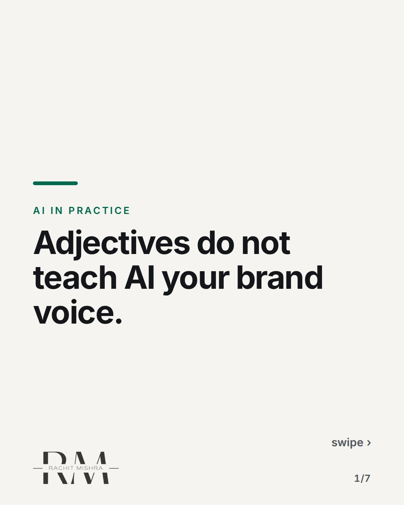
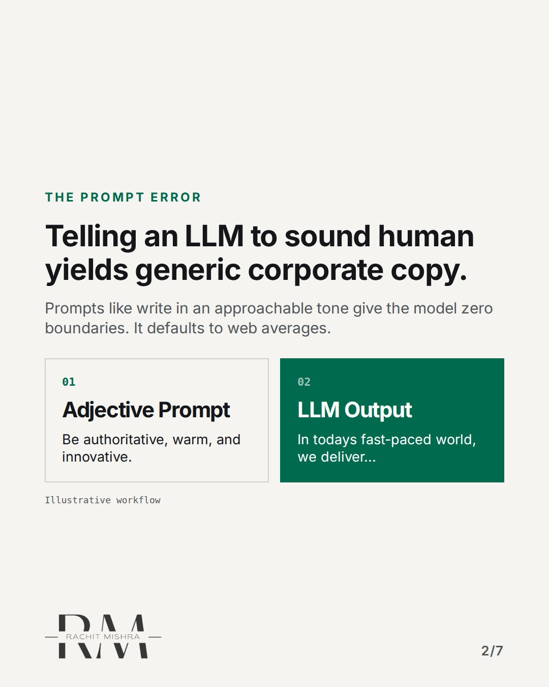
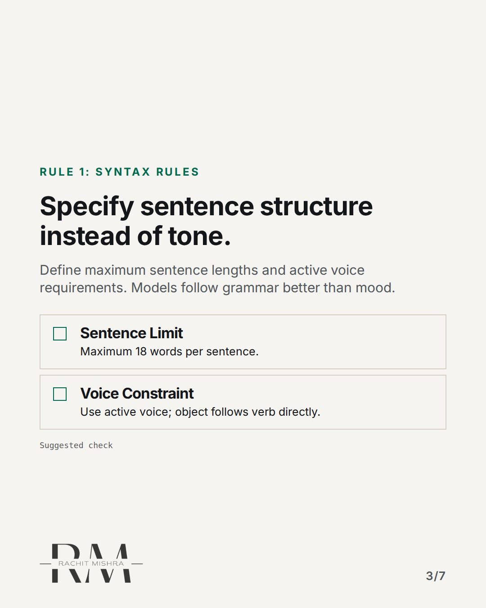
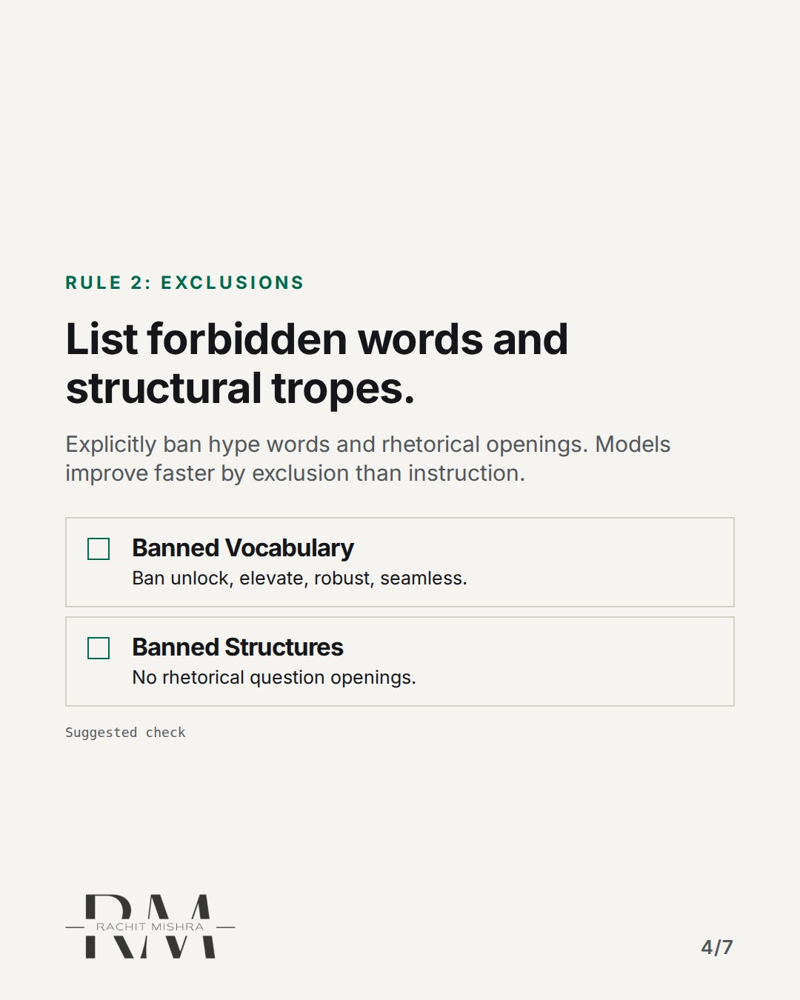
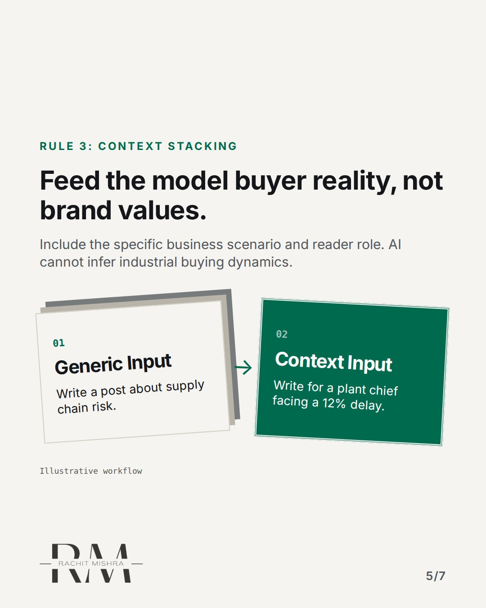
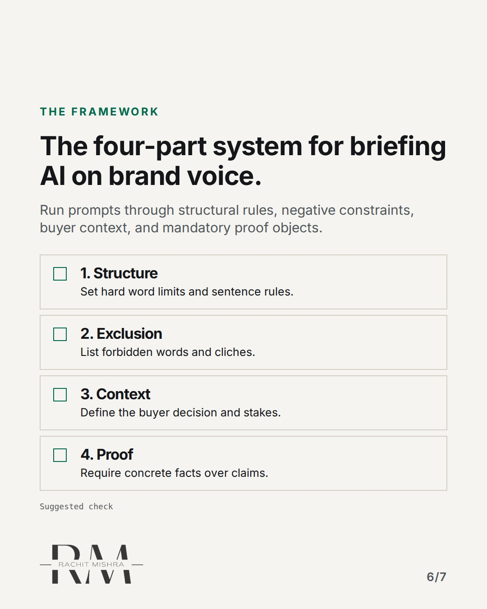
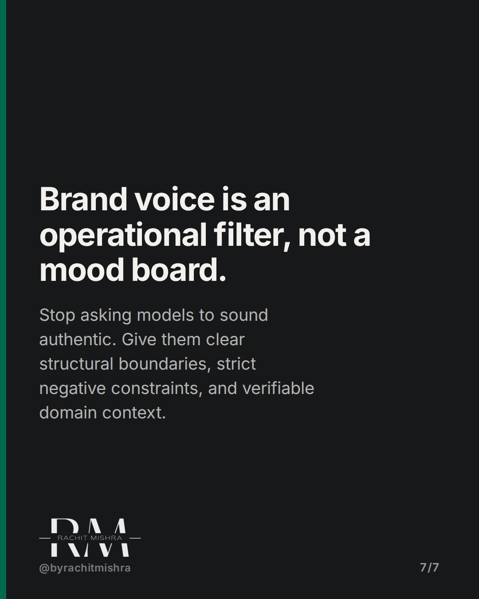

# ai_briefing_brand_voice_guardrails

**CAROUSEL** · ai_in_practice · goes live **2026-11-18T20:00:00+05:30**

> Targeting: `briefing AI on brand voice`
>
> Claim: Generic brand voice guidelines produce bland AI copy because LLMs need operational boundaries, not abstract adjectives.
>
> Proof (framework): A four-part prompt constraint framework that replaces tone adjectives with explicit syntax rules, structural limits, forbidden terms, and mandatory context.
>
> Rendered infographics: 5 — comparison, checklist, checklist, bottleneck, checklist

## Slides

7 rendered images sit in this folder — upload them in filename order.

**1.** 
### Adjectives do not teach AI your brand voice.



**2.** THE PROMPT ERROR
### Telling an LLM to sound human yields generic corporate copy.
Prompts like write in an approachable tone give the model zero boundaries. It defaults to web averages.



**3.** RULE 1: SYNTAX RULES
### Specify sentence structure instead of tone.
Define maximum sentence lengths and active voice requirements. Models follow grammar better than mood.



**4.** RULE 2: EXCLUSIONS
### List forbidden words and structural tropes.
Explicitly ban hype words and rhetorical openings. Models improve faster by exclusion than instruction.



**5.** RULE 3: CONTEXT STACKING
### Feed the model buyer reality, not brand values.
Include the specific business scenario and reader role. AI cannot infer industrial buying dynamics.



**6.** THE FRAMEWORK
### The four-part system for briefing AI on brand voice.
Run prompts through structural rules, negative constraints, buyer context, and mandatory proof objects.



**7.** STEAL THESE RULES
### Brand voice is an operational filter, not a mood board.
Stop asking models to sound authentic. Give them clear structural boundaries, strict negative constraints, and verifiable domain context.



## Caption — copy from here

```
Adjectives do not teach AI your brand voice.

When briefing AI on brand voice, typing adjectives like authoritative, human, or visionary into a prompt gets you the exact same corporate fluff everyone else produces.

Large language models operate on probability, not empathy. Telling a model to sound approachable forces it to draw on millions of generic internet samples. That is how you end up with filler phrasing across your drafts.

If you want usable draft copy in an enterprise environment, stop writing mood boards and start writing operational specifications.

Define the maximum words per sentence. Ban specific industry buzzwords. Tell the model what structural tropes it cannot use. Give it the exact buyer role and the operational stakes before asking for a single paragraph.

Structure governs tone far more effectively than adjectives ever will.

Send this to whoever is setting up your team's AI writing guidelines this quarter.

[briefing ai on brand voice, ai content workflow, ai governance, b2b marketing]

#aimarketing #marketingoperations #aigovernance
```

## Alt text

```
Slide deck showing how to brief AI on brand voice using operational rules instead of adjectives.
```

## How this post could fail

If the operational rules feel too abstract, it might read like basic prompt engineering advice rather than a brand governance standard.
