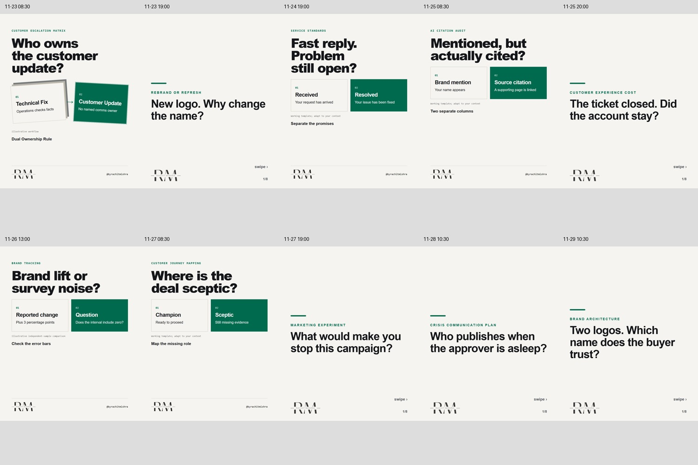

# Week of 23 November 2026 — reviewed batch

10 posts: 5 Reels and 5 carousels. Current green theme and existing scheduled slots retained.
All posts remain drafts. Merge the content PR only after approving the batch.

## Review outcome

Reviewed all ten captions, hooks, visible takeaways, source articles and rendered media. Each post has a different practical tool. Removed forced AI keywords, unsupported certainty and repeated budget/procurement arguments. Corrected survey-margin wording and the CX example arithmetic; examples are labelled and caveated.

All 10 passed schema, voice, duplicate-hook/claim, source, schedule and image checks. All five MP4s fully decoded with AAC audio and are under 90 seconds. Music is from the repository music folder. Green styling is unchanged. Reel timing includes infographic reading time.

## How this batch was completed

Live run 43885030408 produced five posts before provider quota/service errors. Recovery run 44053357731 stalled and was cancelled at six hours without additional completed posts. Codex rewrote the saved five drafts and authored the other five from the same assigned blog sources, then rendered and reviewed all ten. This is an editorially completed recovery batch, not evidence of a successful unattended ten-post generation run.

## Posts

| Slot (IST) | Format | Hook | Useful takeaway |
|---|---|---|---|
| 2026-11-23 08:30 | reel | [Nobody owns the next customer update.](mon-0830-customerescalationmatrix/POST.md) | Resolution owner: coordinates technical fix; Communication owner: owns customer updates; Escalation trigger: missed update window; Next update time: explicit customer commitment |
| 2026-11-23 19:00 | carousel | [New logo. Why change the name?](mon-1900-when-to-rebrand-a-company/POST.md) | Name the constraint a refresh cannot fix; Record what buyers recognise today; List which names actually need changing; Assign owner and budget for reintroduction |
| 2026-11-24 19:00 | reel | [Fast reply. Still no resolution?](tue-1900-editorial-review/POST.md) | For [request], we will [observable action].; Within [time] during [operating hours].; If blocked, [owner] explains the next step. |
| 2026-11-25 08:30 | reel | [Your AI mention isn't a citation.](wed-0830-editorial-review/POST.md) | Date, assistant and exact prompt; Which brands were named?; Which source URLs were linked?; Does the page support the answer? |
| 2026-11-25 20:00 | carousel | [The ticket closed. Did the account stay?](wed-2000-costofpoorcustomerexperienceb2b/POST.md) | Match ticket account codes to billing; Check similar accounts without failures; Apply the segment gross margin rate; Check price, renewal and other causes |
| 2026-11-26 13:00 | reel | [Is a 3-point brand lift just noise?](thu-1300-brandtrackingmarginoferror/POST.md) | Are waves independent or paired?; Show uncertainty around the change; If zero is included, call it inconclusive |
| 2026-11-27 08:30 | reel | [Your journey map forgot the sceptic.](fri-0830-editorial-review/POST.md) | What must this person decide?; Who will supply the missing evidence?; Which record supports this need?; Revise a cell when evidence contradicts it |
| 2026-11-27 19:00 | carousel | [What would make you stop this campaign?](fri-1900-editorial-review/POST.md) | If [action], then [measurable outcome]; Use [source] against [baseline]; At [date], continue, revise or stop |
| 2026-11-28 10:30 | carousel | [Who publishes when the approver is asleep?](sat-1030-firstsixtyminutesprotocol/POST.md) | We are aware of [verified incident].; Our next update is due at [time].; Name an alternate with written authority; Test the alternate can access the channel |
| 2026-11-29 10:30 | carousel | [Two logos. Which name does the buyer trust?](sun-1030-editorial-review/POST.md) | Customers choose [name] for [promise].; [Parent] adds [specific reassurance].; Ask buyers whether that relationship is clear. |

## Cover overview

Each POST.md contains the caption and visual previews; each Reel folder includes reel.mp4. The overview crops Reel covers to the central 4:5 area for a grid check.
