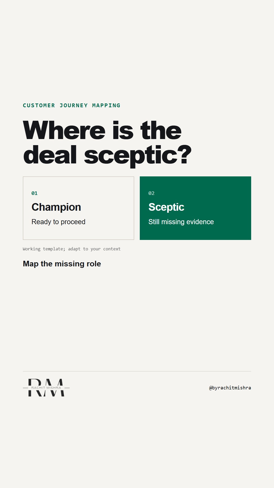

# your journey map forgot the sceptic

**REEL** · ai_marketing · goes live **2026-11-27T08:30:00+05:30**

> Targeting: `customer journey mapping`
>
> Claim: Map the role that could block a deal at its actual stage, then record the required evidence and an owner for supplying it.
> Useful takeaway (template): What must this person decide? / Who will supply the missing evidence? / Which record supports this need? / Revise a cell when evidence contradicts it
> Editorial review: passed novelty, visible payoff and source-fidelity checks
>
> Proof (source): Adapted practical tool from Customer Journey Mapping That Survives Contact With Reality. Map the role that could block a deal at its actual stage, then record the required evidence and an owner for supplying it.
> Source: https://www.rachitmishra.in/2026/08/19/customer-journey-mapping-b2b/
>
> Source preflight: reachable (HTTP 200)
>
> Rendered infographics: 6 — comparison, comparison, checklist, checklist, comparison, checklist
>
> Reel assets: image `designed_gradient` · music `bed-something (1).mp3`

## Cover



## Reel script

`reel.mp4` has been generated from this script and will publish automatically. To use your own footage instead, replace that file and delete `.generated-reel` from this folder.

| Time | On screen | Voiceover | Direction |
|---|---|---|---|
| 0:00-0:05 | **Your journey map forgot the sceptic.** | Your journey map forgot the sceptic. | Current green editorial design with a readable practical graphic. |
| 0:05-0:18 | **Map a buying group, not one friendly buyer.** | Map a buying group, not one friendly buyer. | Current green editorial design with a readable practical graphic. |
| 0:18-0:32 | **Start with one deal that stalled.** | Start with one deal that stalled. | Current green editorial design with a readable practical graphic. |
| 0:32-0:46 | **Give each role-stage cell three lines.** | Give each role-stage cell three lines. | Current green editorial design with a readable practical graphic. |
| 0:46-0:59 | **Make the cell specific enough to test.** | Make the cell specific enough to test. | Current green editorial design with a readable practical graphic. |
| 0:59-1:12 | **Book the review before the workshop.** | Book the review before the workshop. | Current green editorial design with a readable practical graphic. |
| 1:12-1:17 | **A useful map can be proved wrong.** | A useful map can be proved wrong. | Current green editorial design with a readable practical graphic. |

## Caption — copy from here

```
Your journey map forgot the sceptic.

Customer journey mapping gets more useful when it includes the person who can stop the deal.

Use CRM timestamps and interviews to test the map. The workshop is a starting hypothesis; a poster with no review date cannot learn from the next lost deal.

Send this to whoever runs your win/loss reviews.

Full article: https://www.rachitmishra.in/2026/08/19/customer-journey-mapping-b2b/

[customer journey mapping, practical marketing, b2b marketing]

#customerjourney #b2bmarketing #salesenablement
```

## Alt text

```
Practical customer journey mapping template shown in green-accented text and diagrams.
```

## How this post could fail

The tool needs adaptation to the reader's context; it must not be treated as a universal rule or a measured result.

## Sources

- [Customer Journey Mapping That Survives Contact With Reality](https://www.rachitmishra.in/2026/08/19/customer-journey-mapping-b2b/)
