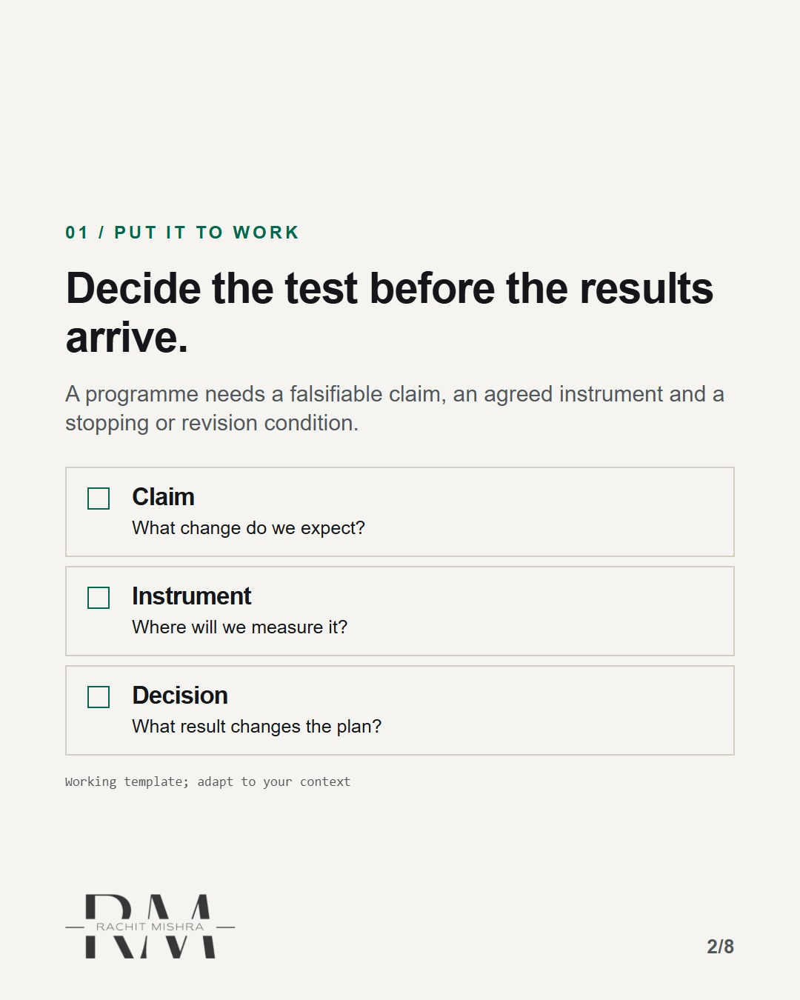
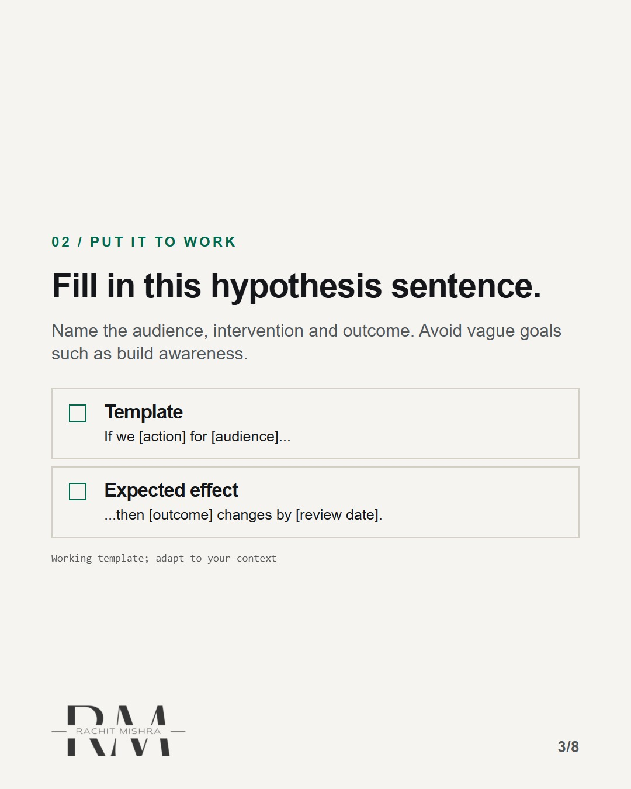
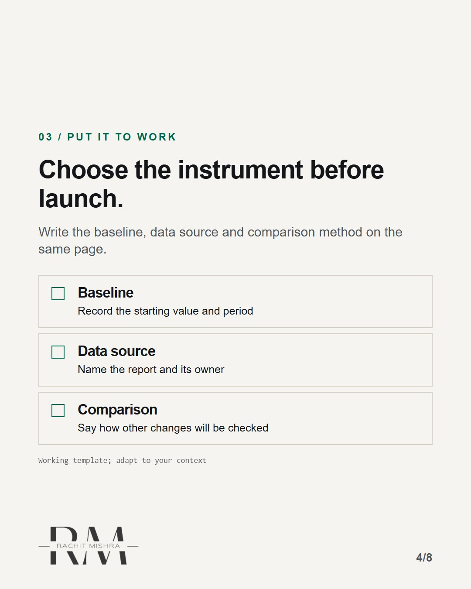
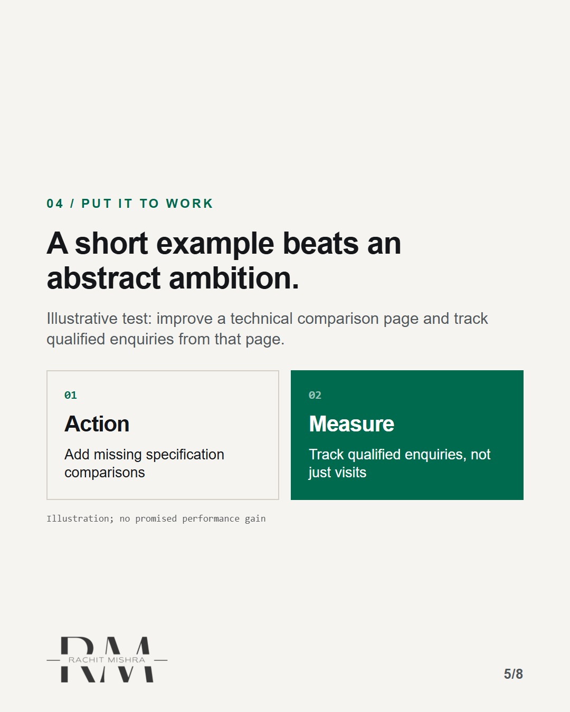
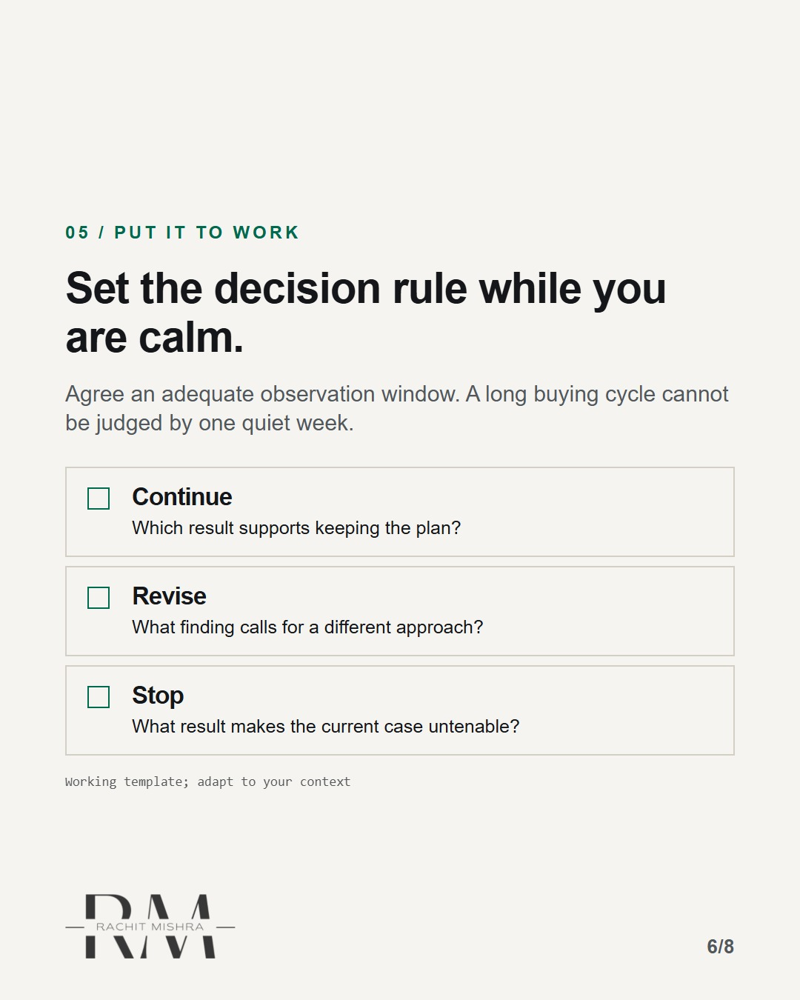
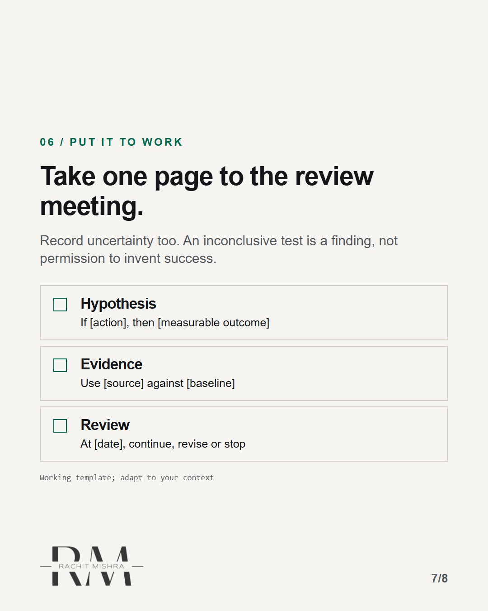
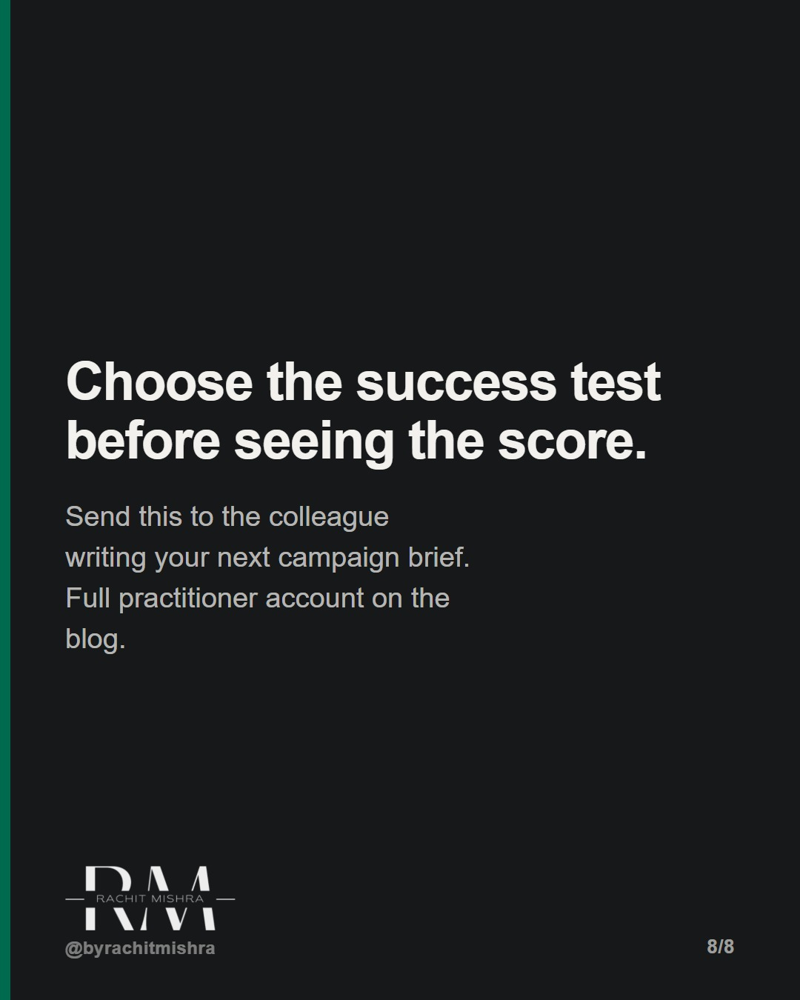

# what would make you stop this campaign

**CAROUSEL** · ai_in_practice · goes live **2026-11-27T19:00:00+05:30**

> Targeting: `marketing experiment`
>
> Claim: Write a testable programme hypothesis, measurement method and review decision before launch instead of choosing a success metric afterwards.
> Useful takeaway (template): If [action], then [measurable outcome] / Use [source] against [baseline] / At [date], continue, revise or stop
> Editorial review: passed novelty, visible payoff and source-fidelity checks
>
> Proof (source): Adapted practical tool from Marketing in a Manufacturing Company: What I Got Wrong. Write a testable programme hypothesis, measurement method and review decision before launch instead of choosing a success metric afterwards.
> Source: https://www.rachitmishra.in/2026/08/15/marketing-in-manufacturing-company/
>
> Source preflight: reachable (HTTP 200)
>
> Rendered infographics: 6 — checklist, checklist, checklist, comparison, checklist, checklist

## Slides

8 rendered images sit in this folder — upload them in filename order.

**1.**
### What would make you stop this campaign?


**2.** 01 / PUT IT TO WORK
### Decide the test before the results arrive.
A programme needs a falsifiable claim, an agreed instrument and a stopping or revision condition.



**3.** 02 / PUT IT TO WORK
### Fill in this hypothesis sentence.
Name the audience, intervention and outcome. Avoid vague goals such as build awareness.



**4.** 03 / PUT IT TO WORK
### Choose the instrument before launch.
Write the baseline, data source and comparison method on the same page.



**5.** 04 / PUT IT TO WORK
### A short example beats an abstract ambition.
Illustrative test: improve a technical comparison page and track qualified enquiries from that page.



**6.** 05 / PUT IT TO WORK
### Set the decision rule while you are calm.
Agree an adequate observation window. A long buying cycle cannot be judged by one quiet week.



**7.** 06 / PUT IT TO WORK
### Take one page to the review meeting.
Record uncertainty too. An inconclusive test is a finding, not permission to invent success.



**8.**
### Choose the success test before seeing the score.
Send this to the colleague writing your next campaign brief. Full practitioner account on the blog.



## Caption — copy from here

```
What would make you stop this campaign?

A marketing experiment needs an honest decision rule. Choose it before the dashboard gives you a flattering metric.

The review window must fit the buying cycle and sample size. Stop, revise and inconclusive are legitimate outcomes; none requires pretending that a slow week disproves long-term brand effects.

Send this to your campaign lead.

Full article: https://www.rachitmishra.in/2026/08/15/marketing-in-manufacturing-company/

[marketing experiment, practical marketing, b2b marketing]

#marketingmeasurement #campaignplanning #b2bmarketing
```

## Alt text

```
Practical marketing experiment template shown in green-accented text and diagrams.
```

## How this post could fail

The tool needs adaptation to the reader's context; it must not be treated as a universal rule or a measured result.

## Sources

- [Marketing in a Manufacturing Company: What I Got Wrong](https://www.rachitmishra.in/2026/08/15/marketing-in-manufacturing-company/)
