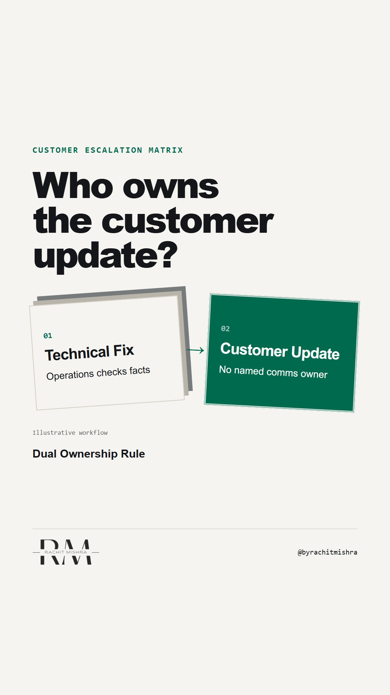

# customerescalationmatrix

**REEL** · b2b_brand · goes live **2026-11-23T08:30:00+05:30**

> Targeting: `customer escalation matrix`
>
> Claim: Separating technical resolution from customer communication gives each update commitment an explicit owner during a service disruption.
> Useful takeaway (template): Resolution owner: coordinates technical fix / Communication owner: owns customer updates / Escalation trigger: missed update window / Next update time: explicit customer commitment
> Editorial review: passed novelty, visible payoff and source-fidelity checks
>
> Proof (source): An escalation matrix separates technical resolution ownership from communication ownership across explicit severity triggers and agreed update times.
> Source: https://www.rachitmishra.in/2026/11/13/b2b-customer-escalation-matrix/
>
> Source preflight: reachable (HTTP 200)
>
> Rendered infographics: 4 — bottleneck, comparison, checklist, checklist
>
> Reel assets: image `designed_gradient` · music `bed-something (1).mp3`

## Cover



## Reel script

`reel.mp4` has been generated from this script and will publish automatically. To use your own footage instead, replace that file and delete `.generated-reel` from this folder.

| Time | On screen | Voiceover | Direction |
|---|---|---|---|
| 0:00-0:04 | **Nobody owns the next customer update.** | Nobody owns the next customer update. | Text on dark slate background showing a split internal workflow diagram. |
| 0:04-0:12 | **Separate resolution from communication.** | Separate the technical fix from customer updates. Name two explicit owners for every issue. | Diagram highlighting dual ownership roles. |
| 0:12-0:23 | **Define observable escalation triggers.** | Never rely on unhappy customers as a trigger. Use missed windows, changing impact, or repeat issues. | Text checklist overlay showing operational triggers. |
| 0:23-0:27 | **Commit to the next update time.** | Make the next update time an explicit commitment, even when the fix date is still unknown. | Graphic showing update commitment distinction. |
| 0:27-0:41 | **B2B Customer Escalation Matrix** | Record an accountable lead and backup for every severity level before confusion becomes a second crisis. | Matrix view showing roles and update commitments. |
| 0:41-0:45 | **Can the backup find the last promise?** | Can the backup find the last promise? | Rehearsal scenario graphic. |
| 0:45-0:49 | **Reputation is an operating outcome.** | Reputation is an operating outcome. Check whether your last escalated issue had a named communication owner. | Final summary slide. |

## Caption — copy from here

```
Nobody owns the next customer update.

A customer escalation matrix needs two names: who coordinates the fix, and who tells the customer what happens next.

An update time is a promise you can keep even when the repair date is uncertain. Record the last commitment where the backup contact can find it.

Full matrix: https://www.rachitmishra.in/2026/11/13/b2b-customer-escalation-matrix/

Send this to your service and account leads.

[customer escalation matrix, customer updates, service recovery]

#customerexperience #accountmanagement #serviceoperations
```

## Alt text

```
Diagram of a B2B customer escalation matrix showing separate technical and communication owners.
```

## How this post could fail

This post could land poorly if presented as generic customer service advice rather than a structural B2B governance framework with explicit role separation.

## Sources

- [Who Owns the Customer Update? A B2B Escalation Matrix](https://www.rachitmishra.in/2026/11/13/b2b-customer-escalation-matrix/)
