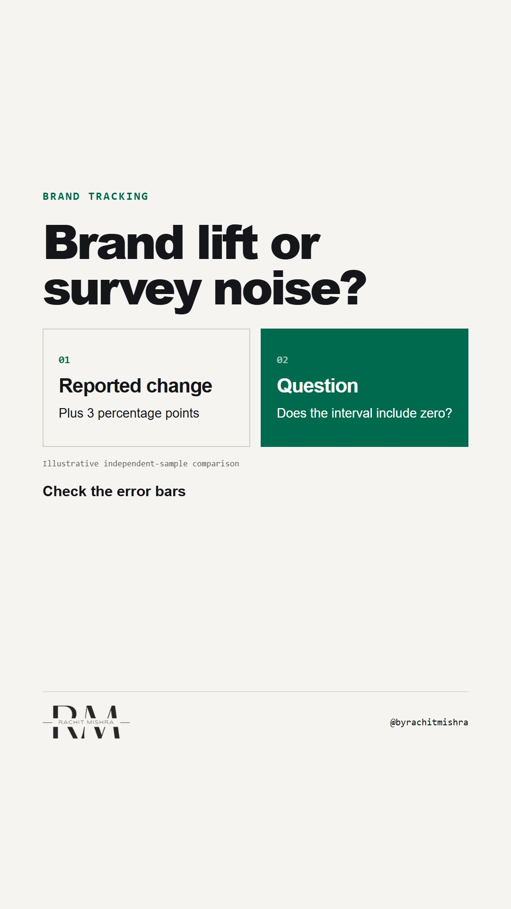

# brandtrackingmarginoferror

**REEL** · reputation · goes live **2026-11-26T13:00:00+05:30**

> Targeting: `brand tracking`
>
> Claim: A three-percentage-point change is inconclusive in the illustrated comparison of two independent random samples of 300 near 50%.
> Useful takeaway (worked_example): Are waves independent or paired? / Show uncertainty around the change / If zero is included, call it inconclusive
> Editorial review: passed novelty, visible payoff and source-fidelity checks
>
> Proof (source): Source sample-size example, with corrected interpretation: independent random samples n=300 each, proportions near 0.5, normal 95% margin on the difference = 1.96 sqrt(0.5/300), approximately 8.0 percentage points, not twice the single-wave margin.
> Source: https://www.rachitmishra.in/2026/09/04/brand-tracking-study-b2b/
>
> Source preflight: reachable (HTTP 200)
>
> Rendered infographics: 6 — comparison, comparison, checklist, checklist, comparison, checklist
>
> Reel assets: image `designed_gradient` · music `bed-something (12).mp3`

## Cover



## Reel script

`reel.mp4` has been generated from this script and will publish automatically. To use your own footage instead, replace that file and delete `.generated-reel` from this folder.

| Time | On screen | Voiceover | Direction |
|---|---|---|---|
| 0:00-0:04 | **Is a 3-point brand lift just noise?** | Is a 3-point brand lift just noise? | Readable type and bottle-green infographic on the current plain background. |
| 0:04-0:15 | **Start with the sample, not the headline.** | Start with the sample, not the headline. | Readable type and bottle-green infographic on the current plain background. |
| 0:15-0:24 | **One wave: about +/- 5.7 points.** | One wave: about +/- 5.7 points. | Readable type and bottle-green infographic on the current plain background. |
| 0:24-0:34 | **Two waves: about +/- 8.0 points.** | Two waves: about +/- 8.0 points. | Readable type and bottle-green infographic on the current plain background. |
| 0:34-0:46 | **A 3-point rise is inconclusive here.** | A 3-point rise is inconclusive here. | Readable type and bottle-green infographic on the current plain background. |
| 0:46-1:02 | **Ask these before the next tracker report.** | Ask these before the next tracker report. | Readable type and bottle-green infographic on the current plain background. |
| 1:02-1:06 | **Error bars belong beside the headline.** | Error bars belong beside the headline. | Readable type and bottle-green infographic on the current plain background. |

## Caption — copy from here

```
Is a 3-point brand lift just noise?

Brand tracking needs uncertainty beside the change. In this simplified example, two independent samples of 300 near 50% give a margin of about 8 points on their difference.

That is about 1.41 times one wave, not twice. Weighted, clustered or paired samples need a design-specific calculation. An inconclusive result does not prove no effect.

Full article: https://www.rachitmishra.in/2026/09/04/brand-tracking-study-b2b/

[brand tracking, survey design, measurement]

#brandtracking #marketresearch #marketingmeasurement
```

## Alt text

```
Split screen graph detailing margin of error calculations and B2B brand tracker sample limits.
```

## How this post could fail

If the post focuses abstractly on research philosophy rather than the worked survey arithmetic, B2B communicators will dismiss it as generic advice.

## Sources

- [Brand Tracking Study: Why Yours Hasn’t Moved in Two Years](https://www.rachitmishra.in/2026/09/04/brand-tracking-study-b2b/)
