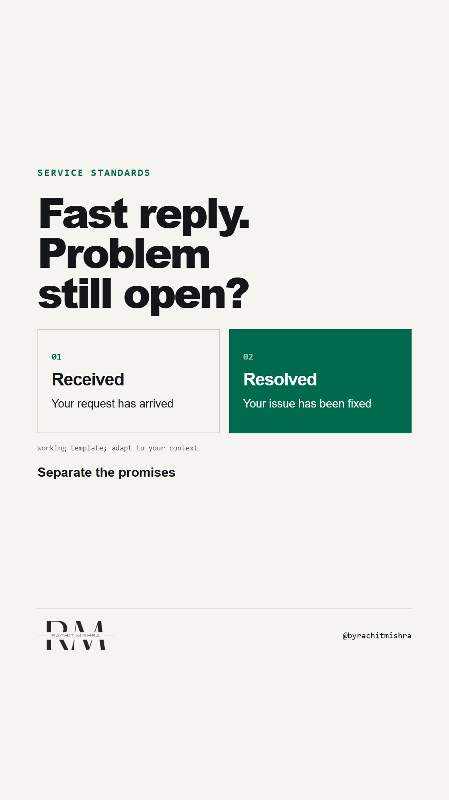

# fast reply still no resolution

**REEL** · ai_marketing · goes live **2026-11-24T19:00:00+05:30**

> Targeting: `service standards`
>
> Claim: A service promise should distinguish acknowledgment, substantive update and resolution, with explicit clock-start and operating-hour conditions.
> Useful takeaway (template): For [request], we will [observable action]. / Within [time] during [operating hours]. / If blocked, [owner] explains the next step.
> Editorial review: passed novelty, visible payoff and source-fidelity checks
>
> Proof (source): Adapted practical tool from From Brand Values to Service Standards: Make Each Promise Observable. A service promise should distinguish acknowledgment, substantive update and resolution, with explicit clock-start and operating-hour conditions.
> Source: https://www.rachitmishra.in/2026/11/10/brand-values-service-standards/
>
> Source preflight: reachable (HTTP 200)
>
> Rendered infographics: 6 — comparison, comparison, checklist, checklist, checklist, comparison
>
> Reel assets: image `designed_gradient` · music `bed-something (12).mp3`

## Cover



## Reel script

`reel.mp4` has been generated from this script and will publish automatically. To use your own footage instead, replace that file and delete `.generated-reel` from this folder.

| Time | On screen | Voiceover | Direction |
|---|---|---|---|
| 0:00-0:05 | **Fast reply. Still no resolution?** | Fast reply. Still no resolution? | Current green editorial design with a readable practical graphic. |
| 0:05-0:16 | **Define what your response promise means.** | Define what your response promise means. | Current green editorial design with a readable practical graphic. |
| 0:16-0:30 | **A receipt is not a substantive update.** | A receipt is not a substantive update. | Current green editorial design with a readable practical graphic. |
| 0:30-0:44 | **Write the conditions beside the promise.** | Write the conditions beside the promise. | Current green editorial design with a readable practical graphic. |
| 0:44-0:58 | **Try this service-standard sentence.** | Try this service-standard sentence. | Current green editorial design with a readable practical graphic. |
| 0:58-1:11 | **Pilot one request type before rollout.** | Pilot one request type before rollout. | Current green editorial design with a readable practical graphic. |
| 1:11-1:16 | **Promise the stage you can actually deliver.** | Promise the stage you can actually deliver. | Current green editorial design with a readable practical graphic. |

## Caption — copy from here

```
Fast reply. Still no resolution?

Service standards need precise definitions. A quick acknowledgment and a solved problem are different commitments.

Agree targets with the people delivering them. Make operating hours and dependencies visible before you publish a promise.

Send this to your service lead.

Full article: https://www.rachitmishra.in/2026/11/10/brand-values-service-standards/

[service standards, practical marketing, b2b marketing]

#servicestandards #customerexperience #serviceoperations
```

## Alt text

```
Practical service standards template shown in green-accented text and diagrams.
```

## How this post could fail

The tool needs adaptation to the reader's context; it must not be treated as a universal rule or a measured result.

## Sources

- [From Brand Values to Service Standards: Make Each Promise Observable](https://www.rachitmishra.in/2026/11/10/brand-values-service-standards/)
