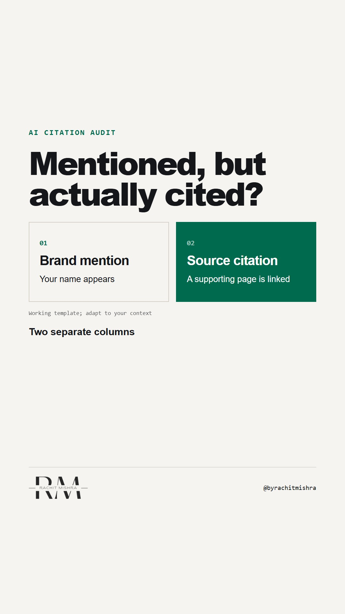

# your ai mention isnt a citation

**REEL** · reputation · goes live **2026-11-25T08:30:00+05:30**

> Targeting: `AI citation audit`
>
> Claim: Track brand mentions separately from linked citations using a fixed buyer-question set and dated, repeatable observations.
> Useful takeaway (template): Date, assistant and exact prompt / Which brands were named? / Which source URLs were linked? / Does the page support the answer?
> Editorial review: passed novelty, visible payoff and source-fidelity checks
>
> Proof (source): Adapted practical tool from Generative Engine Optimization: How Brands Actually Get Cited. Track brand mentions separately from linked citations using a fixed buyer-question set and dated, repeatable observations.
> Source: https://www.rachitmishra.in/2026/08/24/generative-engine-optimization/
>
> Source preflight: reachable (HTTP 200)
>
> Rendered infographics: 6 — comparison, comparison, checklist, checklist, checklist, comparison
>
> Reel assets: image `designed_gradient` · music `bed-something (13).mp3`

## Cover



## Reel script

`reel.mp4` has been generated from this script and will publish automatically. To use your own footage instead, replace that file and delete `.generated-reel` from this folder.

| Time | On screen | Voiceover | Direction |
|---|---|---|---|
| 0:00-0:05 | **Your AI mention isn't a citation.** | Your AI mention isn't a citation. | Current green editorial design with a readable practical graphic. |
| 0:05-0:16 | **Record two different outcomes.** | Record two different outcomes. | Current green editorial design with a readable practical graphic. |
| 0:16-0:29 | **Start with real buyer questions.** | Start with real buyer questions. | Current green editorial design with a readable practical graphic. |
| 0:29-0:42 | **Make one row for each observed answer.** | Make one row for each observed answer. | Current green editorial design with a readable practical graphic. |
| 0:42-0:55 | **Open the cited page before scoring it.** | Open the cited page before scoring it. | Current green editorial design with a readable practical graphic. |
| 0:55-1:09 | **Repeat before calling it a trend.** | Repeat before calling it a trend. | Current green editorial design with a readable practical graphic. |
| 1:09-1:14 | **Measure presence and evidence separately.** | Measure presence and evidence separately. | Current green editorial design with a readable practical graphic. |

## Caption — copy from here

```
Your AI mention isn't a citation.

An AI citation audit should separate being named from being used as a source. A brand can be mentioned while the answer links only to other sites.

Save the prompt, date and linked pages. Repeat the checks: answers change, and a small audit is a diagnostic, not a market-share estimate.

Send this to your search lead.

Full article: https://www.rachitmishra.in/2026/08/24/generative-engine-optimization/

[AI citation audit, practical marketing, b2b marketing]

#generativeengines #brandvisibility #contentstrategy
```

## Alt text

```
Practical AI citation audit template shown in green-accented text and diagrams.
```

## How this post could fail

The tool needs adaptation to the reader's context; it must not be treated as a universal rule or a measured result.

## Sources

- [Generative Engine Optimization: How Brands Actually Get Cited](https://www.rachitmishra.in/2026/08/24/generative-engine-optimization/)
