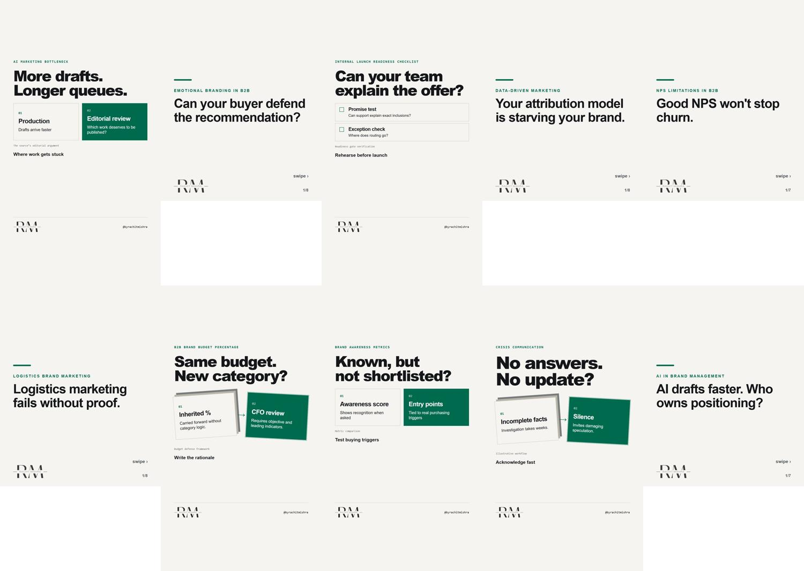

# November 30–December 6: approved batch

Ten posts: five Reels and five carousels. First slot: Monday November 30, 08:30 IST.
The green theme and scheduled slots are unchanged.

Generated by the live agent in runs 44272767498 and 44276267559. Automatic recovery
restored eight complete posts and generated only the two missing slots. PR #22
was merged on November 22. Codex reviewed and refined the copy on November 25:
qualified unsupported certainty, corrected percentage-point wording, strengthened
visible tools, removed repeated CTAs and clarified cover promises. Media was
rendered again from the corrected copy. No early publication was requested.

- [Faster drafting just built a bigger queue.](fri-0830-ai-marketing-bottleneck-review/POST.md)
- [Can your buyer defend the recommendation?](fri-1900-emotional-branding-b2b-theatre/POST.md)
- [Your launch is ready. Is support?](mon-0830-internal-readiness-checklist-before-launch/POST.md)
- [Your attribution model is starving your brand.](mon-1900-datadrivenmarketinglastclicktrap/POST.md)
- [Good NPS won't stop churn.](sat-1030-the-cx-score-trap-nps/POST.md)
- [Logistics marketing fails without proof.](sun-1030-supply-chain-marketing-proof-sequence/POST.md)
- [Why your brand budget is an inherited guess.](thu-1700-how-much-should-a-b2b-company-spend-on-brand/POST.md)
- [Awareness scores don't touch purchase moments.](tue-1900-brandawarenessiswrongmetric/POST.md)
- [Silence is read as the worst case.](wed-0830-badnewscommunicationcadence/POST.md)
- [AI drafts faster. Who owns positioning?](wed-2000-aiinbrandmanagement/POST.md)

Validation: 63 code tests passed. All ten posts passed copy, source identity, duplicate-hook/claim/CTA, schedule and JPEG checks. All five MP4s fully decoded with AAC audio and repository music; durations are 62–70 seconds. All slides, reel cards and covers were visually reviewed. [Per-post results](VALIDATION.json).
