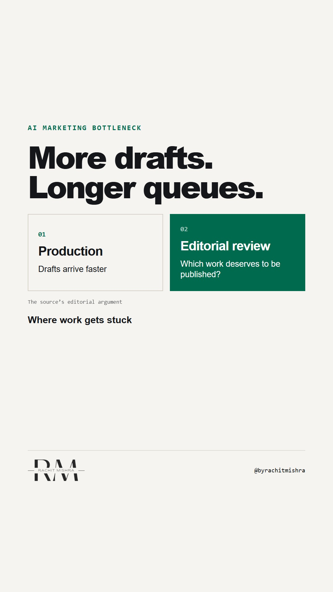

# ai_marketing_bottleneck_review

**REEL** · ai_marketing · goes live **2026-12-04T08:30:00+05:30**

> Targeting: `ai marketing bottleneck`
>
> Claim: AI accelerated content production volume but shifted the core bottleneck from generation speed to strategic judgment.
> Useful takeaway (checklist): Could a rival publish this unchanged? / Which buyer question does it answer? / Revise or drop work with no clear answer / Check whether the next test changes a decision
> Editorial review: passed novelty, visible payoff and source-fidelity checks
>
> Proof (source): An 18-month review of marketing technology shows that content generation speed outpaced expectations, shifting the primary bottleneck from production capacity to strategic judgment about what is worth producing.
> Source: https://www.rachitmishra.in/2025/01/20/future-of-marketing-ai-agility-social-media/
>
> Source preflight: reachable (HTTP 200)
>
> Rendered infographics: 7 — comparison, bottleneck, comparison, checklist, checklist, checklist, comparison
>
> Reel assets: image `designed_gradient` · music `bed-something (1).mp3`

## Cover



## Reel script

`reel.mp4` has been generated from this script and will publish automatically. To use your own footage instead, replace that file and delete `.generated-reel` from this folder.

| Time | On screen | Voiceover | Direction |
|---|---|---|---|
| 0:00-0:11 | **Faster drafting just built a bigger queue.** | Faster drafting just built a bigger queue. | Static text on screen highlighting the shift in AI marketing bottlenecks. |
| 0:11-0:22 | **Speed is solved. Judgment is scarce.** | Speed is solved. Judgment is scarce. | Transition to comparison graphic between old and new marketing constraints. |
| 0:22-0:31 | **Audit first-party data quality** | Audit first-party data quality | Displaying first checklist item for modern martech stack requirements. |
| 0:31-0:41 | **Evaluate AI output for strategy** | Evaluate AI output for strategy | Displaying second checklist item focused on originality and differentiation. |
| 0:41-0:52 | **Kill low-value assets weekly** | Kill low-value assets weekly | Displaying third checklist item on review discipline and killing unneeded work. |
| 0:52-1:02 | **Shift investment from speed to judgment.** | Shift investment from speed to judgment. | Final framing shot summarizing the core takeaway on AI tooling investments. |

## Caption — copy from here

```
Faster drafting just built a bigger queue.

The AI marketing bottleneck can move from writing capacity to editorial judgement.

Before approving another asset, ask: could a rival publish this unchanged, and which buyer question does it answer? Revise or drop work that has no clear answer. Faster production is useful only when the team can select worthwhile work and learn from its tests.

Read the source: https://www.rachitmishra.in/2025/01/20/future-of-marketing-ai-agility-social-media/

Send this to the editor managing your content approval queue.

#b2bmarketing #martech #contentstrategy
```

## Alt text

```
A comparison showing marketing bottlenecks shifting from production speed to strategic judgment.
```

## How this post could fail

Readers might mistake this for a general technology review rather than a specific operational warning about where marketing teams waste budget.

## Sources

- [What AI Actually Changed in Marketing: An 18-Month Review](https://www.rachitmishra.in/2025/01/20/future-of-marketing-ai-agility-social-media/)
