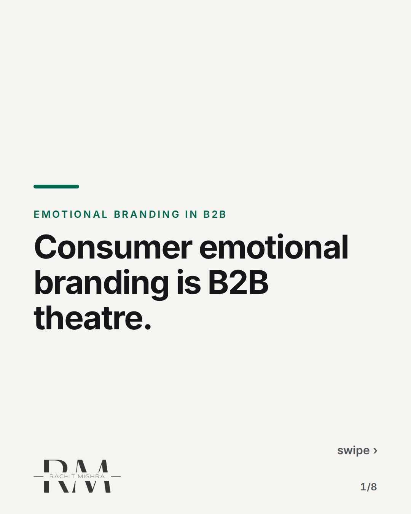
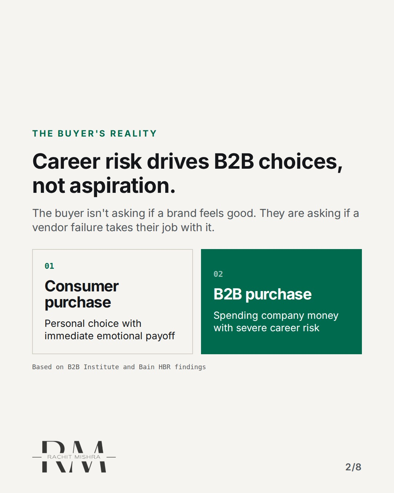
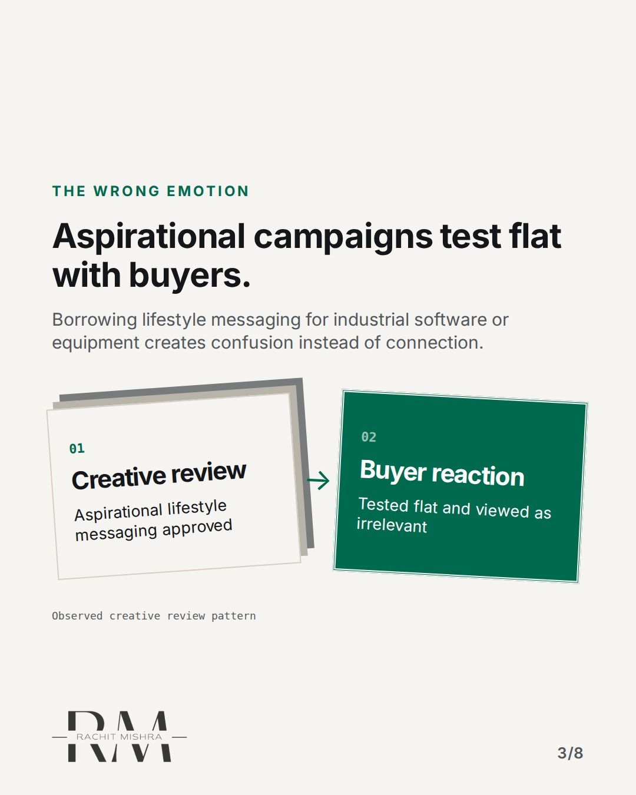
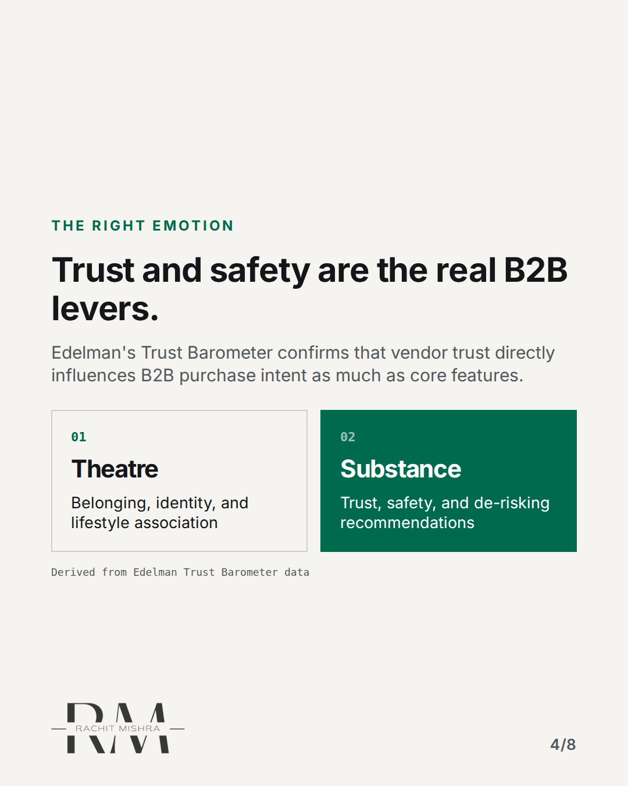
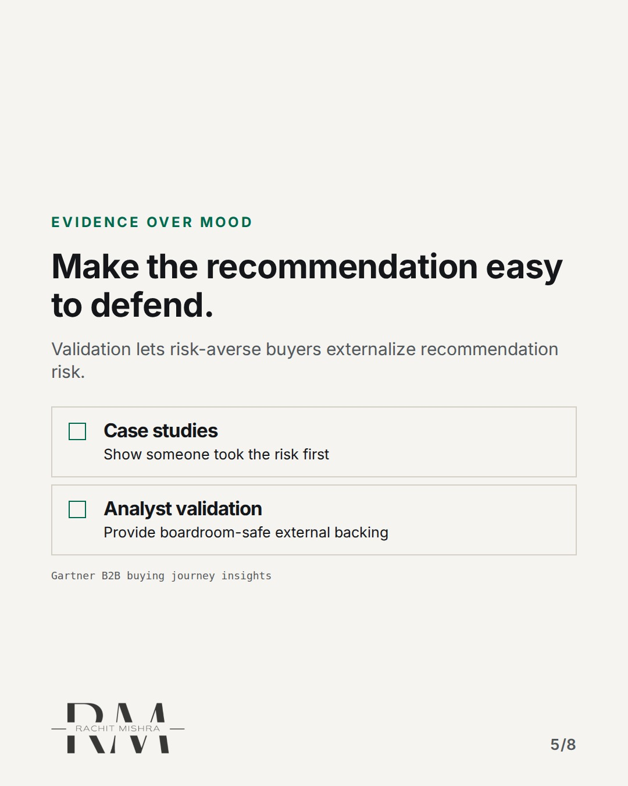
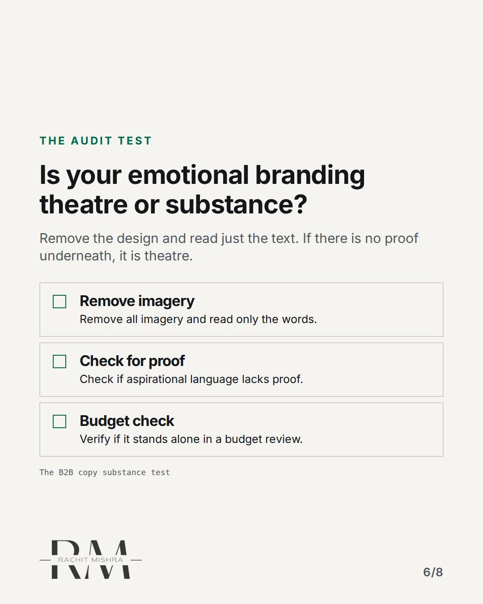
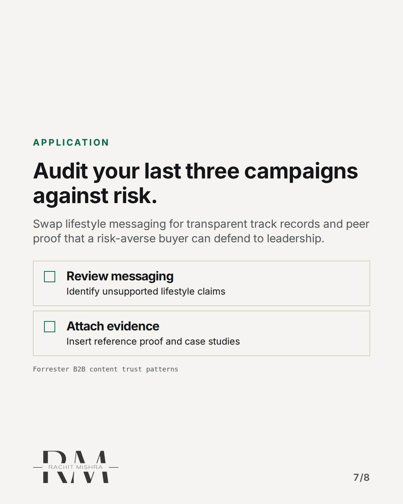
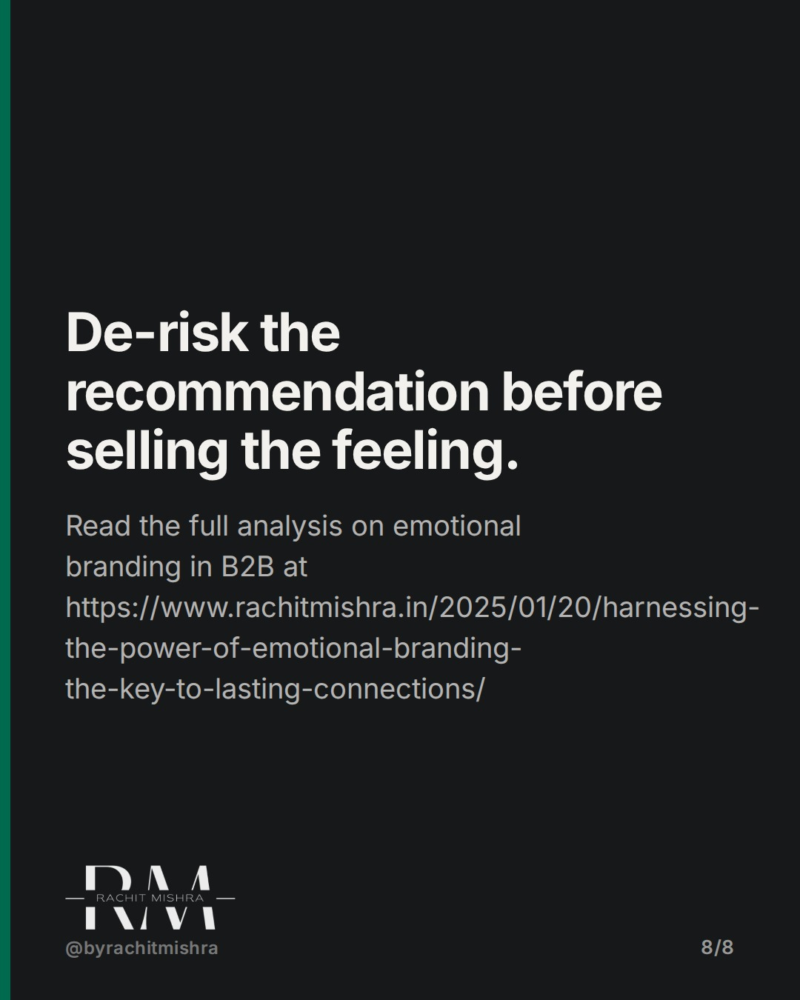

# emotional_branding_b2b_theatre

**CAROUSEL** · ai_in_practice · goes live **2026-12-04T19:00:00+05:30**

> Targeting: `emotional branding in b2b`
>
> Claim: Emotional branding in B2B fails when it copies consumer aspiration instead of addressing the buyer's career risk.
> Useful takeaway (decision_test): Remove all imagery and read only the words. / Check if aspirational language lacks proof. / Verify if it stands alone in a budget review.
> Editorial review: passed novelty, visible payoff and source-fidelity checks
>
> Proof (source): Bain's Harvard Business Review research shows reducing personal and professional risk ranks highest for B2B buyers, far above aspirational brand-image elements.
> Source: https://www.rachitmishra.in/2025/01/20/harnessing-the-power-of-emotional-branding-the-key-to-lasting-connections/
>
> Source preflight: reachable (HTTP 200)
>
> Rendered infographics: 6 — comparison, bottleneck, comparison, checklist, checklist, checklist

## Slides

8 rendered images sit in this folder — upload them in filename order.

**1.** 
### Consumer emotional branding is B2B theatre.



**2.** The Buyer's Reality
### Career risk drives B2B choices, not aspiration.
The buyer isn't asking if a brand feels good. They are asking if a vendor failure takes their job with it.



**3.** The Wrong Emotion
### Aspirational campaigns test flat with buyers.
Borrowing lifestyle messaging for industrial software or equipment creates confusion instead of connection.



**4.** The Right Emotion
### Trust and safety are the real B2B levers.
Edelman's Trust Barometer confirms that vendor trust directly influences B2B purchase intent as much as core features.



**5.** Evidence Over Mood
### Make the recommendation easy to defend.
Validation lets risk-averse buyers externalize recommendation risk.



**6.** The Audit Test
### Is your emotional branding theatre or substance?
Remove the design and read just the text. If there is no proof underneath, it is theatre.



**7.** Application
### Audit your last three campaigns against risk.
Swap lifestyle messaging for transparent track records and peer proof that a risk-averse buyer can defend to leadership.



**8.** 
### De-risk the recommendation before selling the feeling.
Read the full analysis on emotional branding in B2B at https://www.rachitmishra.in/2025/01/20/harnessing-the-power-of-emotional-branding-the-key-to-lasting-connections/



## Caption — copy from here

```
Consumer emotional branding is B2B theatre.

Using emotional branding in b2b requires focusing on career risk instead of consumer aspiration.

Most industrial marketing borrows consumer language like aspiration and belonging while ignoring that the actual buyer emotional driver is career risk.

When you build campaigns around safety and trust instead of lifestyle, pipeline quality improves because buyers can defend the choice internally.

Read the full analysis at https://www.rachitmishra.in/2025/01/20/harnessing-the-power-of-emotional-branding-the-key-to-lasting-connections/

Send this to whoever is defending the brand messaging budget this quarter.

[emotional branding in b2b, b2b marketing, brand trust, risk aversion]

#b2bmarketing #brandstrategy #industrialmarketing
```

## Alt text

```
Carousel slides explaining emotional branding in b2b.
```

## How this post could fail

Readers might mistake this for an anti-creativity argument rather than a call to target the correct emotional driver in enterprise sales.

## Sources

- [Bain's Harvard Business Review research shows reducing personal and professional risk ranks highest for B2B buyers, far above aspirational brand-image elements.](https://www.rachitmishra.in/2025/01/20/harnessing-the-power-of-emotional-branding-the-key-to-lasting-connections/)
