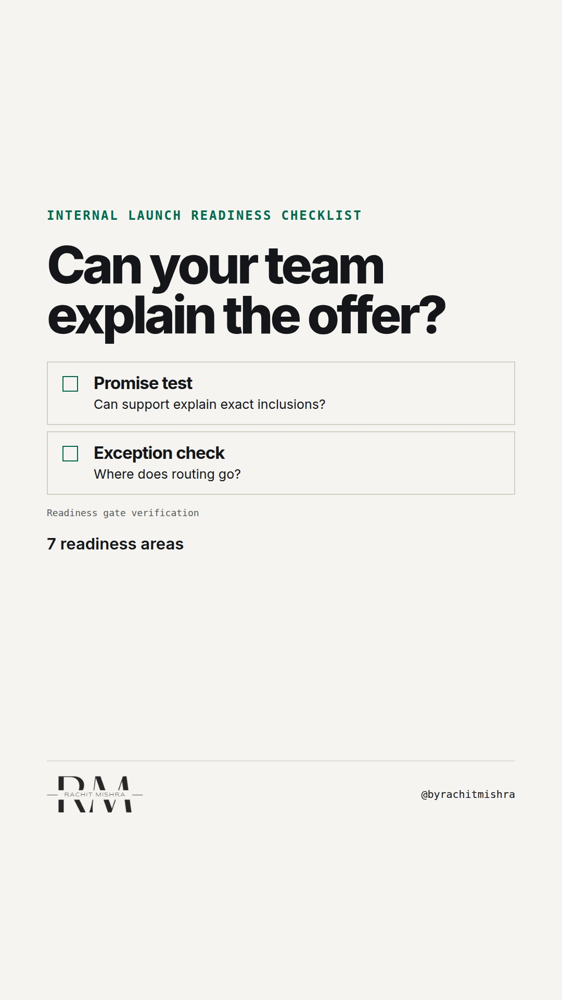

# internal readiness checklist before launch

**REEL** · b2b_brand · goes live **2026-11-30T08:30:00+05:30**

> Targeting: `internal launch readiness checklist`
>
> Claim: Testing internal readiness before a public launch exposes delivery gaps while teams can still change scope.
> Useful takeaway (checklist): Can we explain inclusions? / Where does routing go?
> Editorial review: passed novelty, visible payoff and source-fidelity checks
>
> Proof (source): An internal readiness checklist tests whether delivery teams can explain offers, fulfil conditions and handle exceptions before public announcements, exposing gaps in scope, support routing, and eligibility.
> Source: https://www.rachitmishra.in/2026/11/17/internal-launch-readiness-checklist/
>
> Source preflight: reachable (HTTP 200)
>
> Rendered infographics: 7 — checklist, bottleneck, comparison, checklist, checklist, comparison, checklist
>
> Reel assets: image `designed_gradient` · music `bed-something (1).mp3`

## Cover



## Reel script

`reel.mp4` has been generated from this script and will publish automatically. To use your own footage instead, replace that file and delete `.generated-reel` from this folder.

| Time | On screen | Voiceover | Direction |
|---|---|---|---|
| 0:00-0:11 | **Launch the website. Break the service team.** | Launch the website. Break the service team. | Static view of an unverified announcement schedule alongside an unread support guide. |
| 0:11-0:22 | **Approvals sign dates. Support gets surprised.** | Approvals sign dates. Support gets surprised. | Showing a department head approval stamp next to a local service desk queue. |
| 0:22-0:30 | **Run the four-part readiness rehearsal.** | Run the four-part readiness rehearsal. | Panning across a structured checklist template for industrial offer deployment. |
| 0:30-0:39 | **Test the exception: unlisted coverage.** | Test the exception: unlisted coverage. | Highlighting exception routing on an enquiry handling flow. |
| 0:39-0:50 | **Record states: ready, limited, or blocked.** | Record states: ready, limited, or blocked. | Marking an item as blocked with a named owner and explicit review date. |
| 0:50-1:01 | **Fix the gap before the public announcement.** | Fix the gap before the public announcement. | Closing on the published article reference and governance principle. |

## Caption — copy from here

```
Launch the website. Break the service team.

An internal launch readiness checklist tests whether teams can deliver an offer before public announcements force unhandled exceptions into the first customer call. The full article is available at https://www.rachitmishra.in/2026/11/17/internal-launch-readiness-checklist/

Department sign-offs prove little about operational capacity. Rehearsing the first customer conversation exposes missing eligibility rules, unassigned out-of-hours contacts, and outdated distributor presentations while leadership can still pause or adjust scope.

Send this to whoever is approving next quarter's product launch schedule.

[internal launch readiness checklist, b2b product launch, operational governance, industrial marketing]

#b2bmarketing #brandgovernance #operations
```

## Alt text

```
Readiness checklist showing promise, delivery, and service tests.
```

## How this post could fail

Readers might view readiness checklists as standard project management rather than a distinct commercial risk gate.

## Sources

- [An internal readiness checklist tests whether delivery teams can explain offers, fulfil conditions and handle exceptions before public announcements, exposing gaps in scope, support routing, and eligibility.](https://www.rachitmishra.in/2026/11/17/internal-launch-readiness-checklist/)
