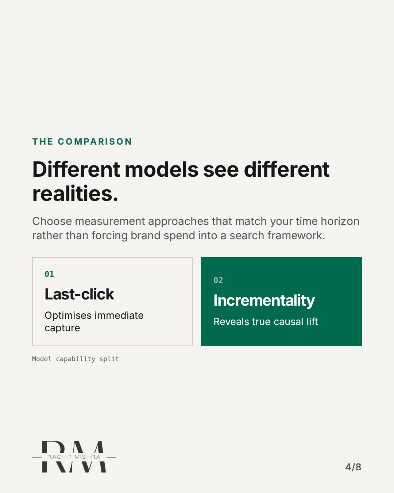
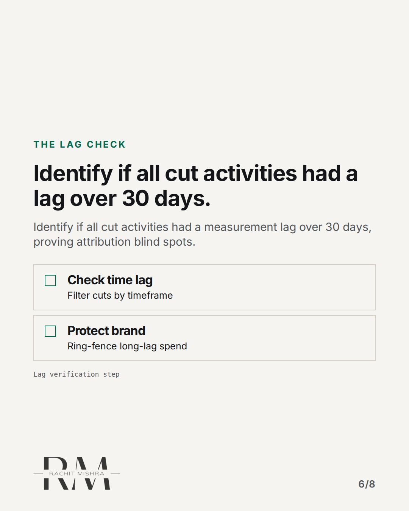
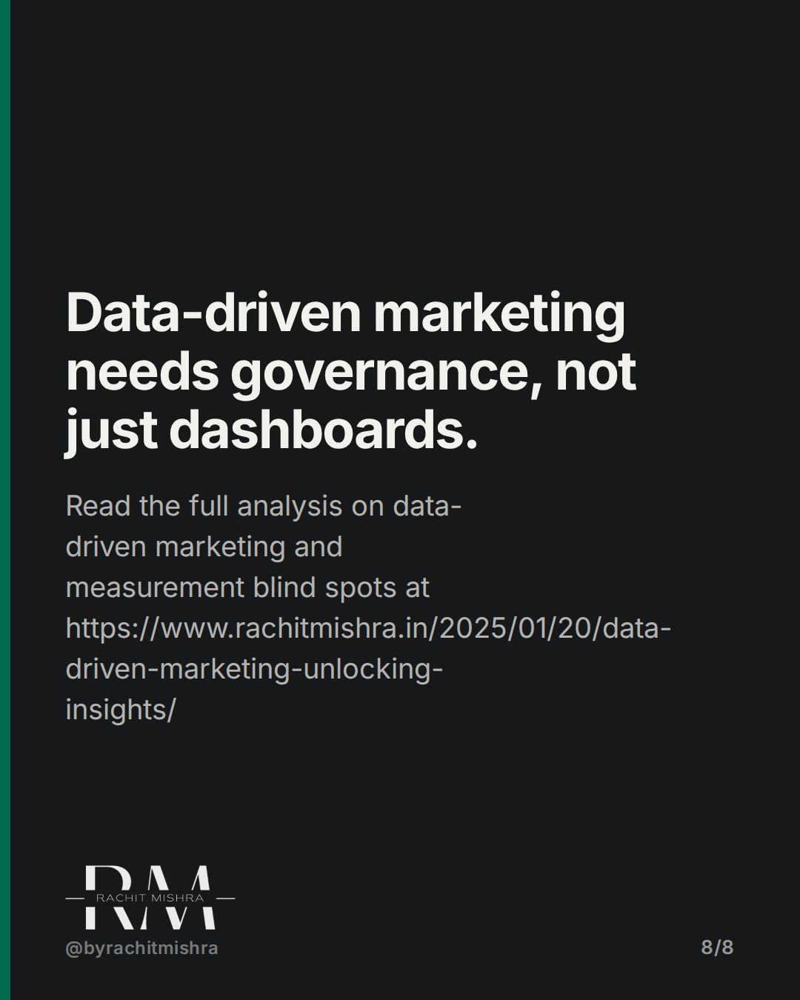

# datadrivenmarketinglastclicktrap

**CAROUSEL** · b2b_brand · goes live **2026-11-30T19:00:00+05:30**

> Targeting: `data-driven marketing`
>
> Claim: Last-click attribution models systematically starve long-term brand-building because they cannot see multi-month buying journeys.
> Useful takeaway (checklist): Audit last two quarters of budget reallocation decisions. / Identify if all cut activities had a measurement lag over 30 days. / Ring-fence brand spend before quarterly reviews.
> Editorial review: passed novelty, visible payoff and source-fidelity checks
>
> Proof (source): Data-driven last-click attribution over-rewards final touchpoints while invisible touchpoints and long-lag activity get systematically underfunded.
> Source: https://www.rachitmishra.in/2025/01/20/data-driven-marketing-unlocking-insights/
>
> Source preflight: reachable (HTTP 200)
>
> Rendered infographics: 6 — bottleneck, comparison, comparison, checklist, checklist, checklist

## Slides

8 rendered images sit in this folder — upload them in filename order.

**1.** 
### Your attribution model is starving your brand.


**2.** The measurement trap
### Last-click attribution measures only the final step.
It counts the touchpoint right before conversion, treating earlier awareness and consideration as invisible waste.


**3.** The mechanism
### AI content generation compounds the imbalance.
Generative tools make it cheaper to produce short-term retargeting assets, starving long-term brand equity further.


**4.** The comparison
### Different models see different realities.
Choose measurement approaches that match your time horizon rather than forcing brand spend into a search framework.



**5.** The audit step
### Audit last two quarters of budget reallocation.
Audit last two quarters of budget reallocation decisions to spot where attribution models cut brand investment.


**6.** The lag check
### Identify if all cut activities had a lag over 30 days.
Identify if all cut activities had a measurement lag over 30 days, proving attribution blind spots.



**7.** The governance fix
### Ring-fence brand spend before quarterly reviews.
Ring-fence brand spend before quarterly reviews so long-term investments are never left unprotected.


**8.** 
### Data-driven marketing needs governance, not just dashboards.
Read the full analysis on data-driven marketing and measurement blind spots at https://www.rachitmishra.in/2025/01/20/data-driven-marketing-unlocking-insights/



## Caption — copy from here

```
Your attribution model is starving your brand.

When teams rely on data-driven marketing models that only see last-click conversions, they quietly defund the brand-building work that drives long-term pipeline. Simplicity is not accuracy.

The fix is not abandoning data. It is recognising where your measurement stack is blind and ring-fencing brand investment before quarterly budget reallocation conversations begin.

Send this to whoever is defending the brand budget this quarter.

[data-driven marketing, attribution models, brand governance, B2B marketing]

#b2bmarketing #marketingstrategy #brandbuilding
```

## Alt text

```
Carousel slides explaining how last-click attribution starves brand-building and how to fix it.
```

## How this post could fail

Readers might dismiss this as basic marketing theory if they do not connect last-click attribution failures to their own quarterly budget cuts.

## Sources

- [Data-Driven Marketing: What It Gets Right and Where It Fails](https://www.rachitmishra.in/2025/01/20/data-driven-marketing-unlocking-insights/)
