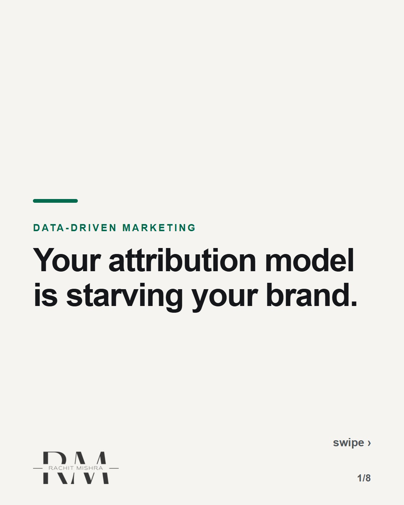
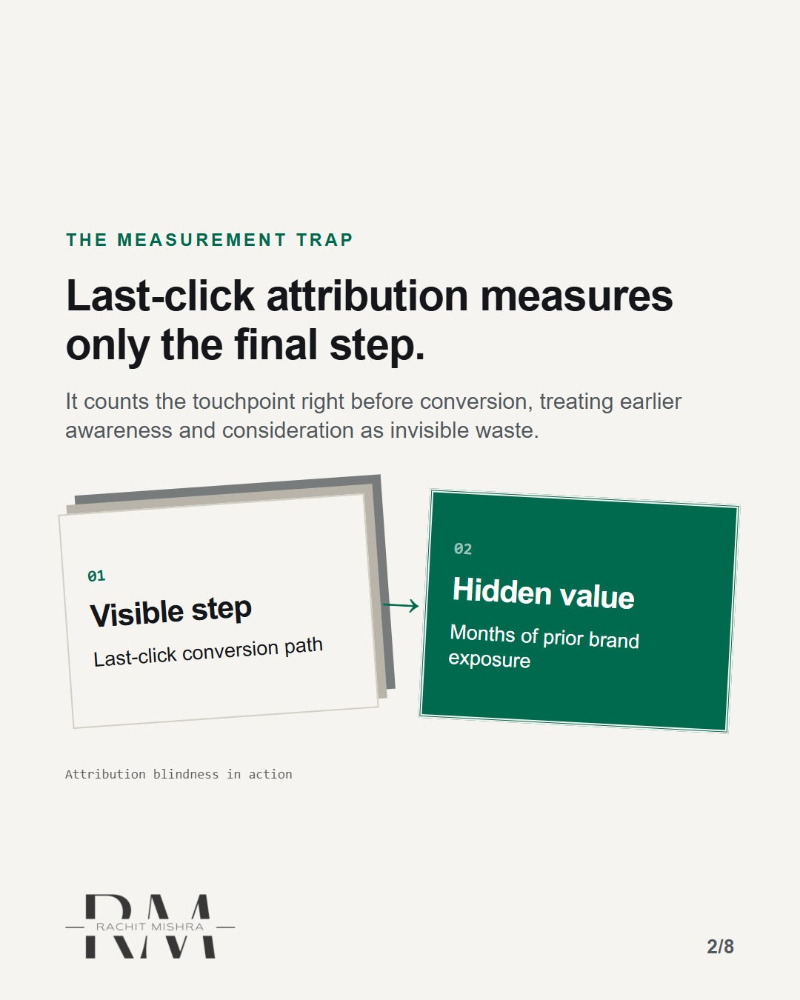
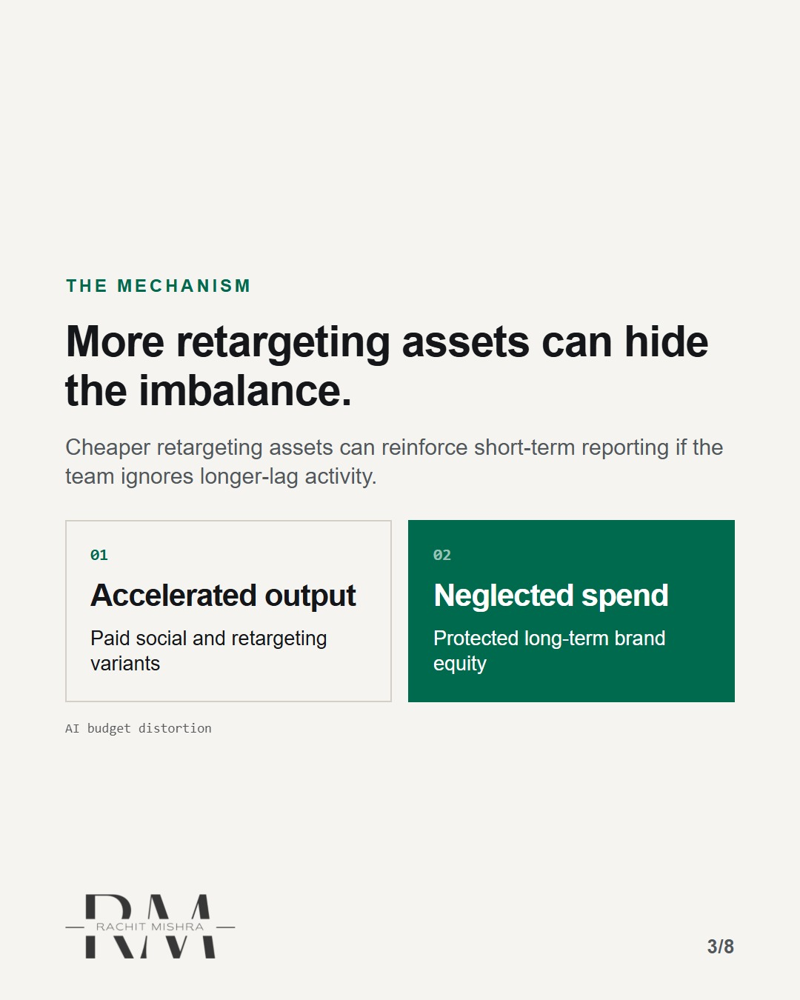
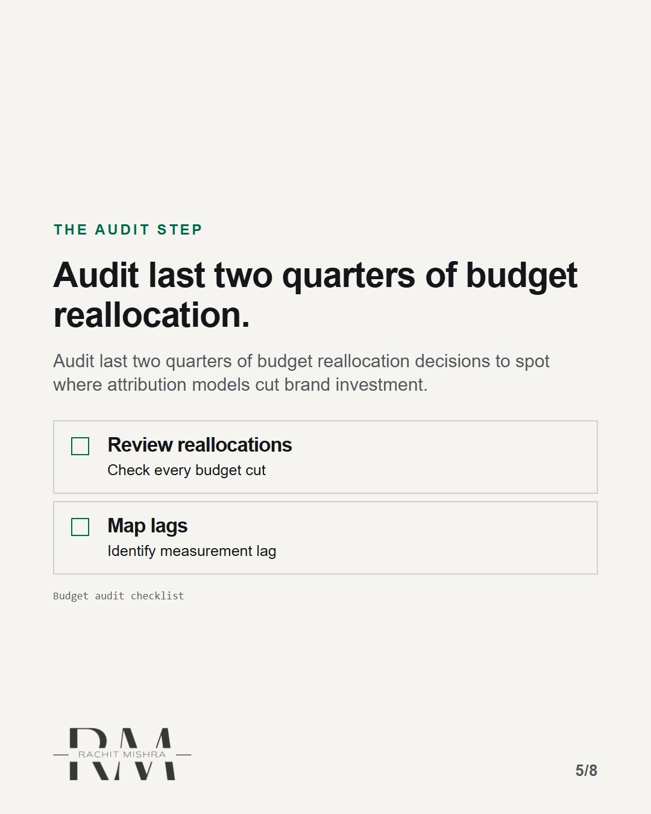
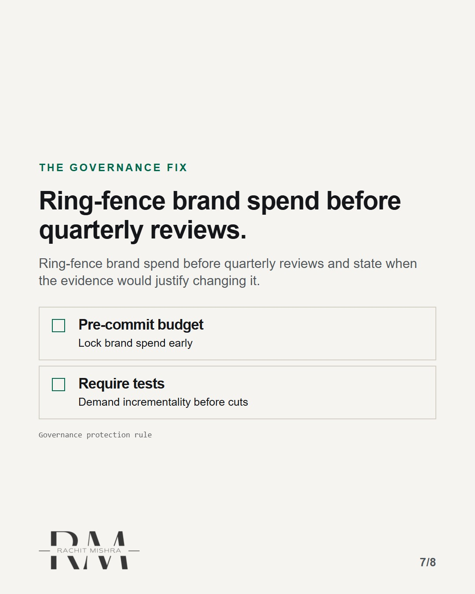

# datadrivenmarketinglastclicktrap

**CAROUSEL** · b2b_brand · goes live **2026-11-30T19:00:00+05:30**

> Targeting: `data-driven marketing`
>
> Claim: Last-click attribution models systematically starve long-term brand-building because they cannot see multi-month buying journeys.
> Useful takeaway (checklist): Audit last two quarters of budget reallocation. / Check the measurement window behind each cut. / Ring-fence brand spend before quarterly reviews.
> Editorial review: passed novelty, visible payoff and source-fidelity checks
>
> Proof (source): Data-driven last-click attribution over-rewards final touchpoints while invisible touchpoints and long-lag activity get systematically underfunded.
> Source: https://www.rachitmishra.in/2025/01/20/data-driven-marketing-unlocking-insights/
>
> Source preflight: reachable (HTTP 200)
>
> Rendered infographics: 6 — bottleneck, comparison, comparison, checklist, checklist, checklist

## Slides

8 rendered images sit in this folder — upload them in filename order.

**1.** 
### Your attribution model is starving your brand.



**2.** The measurement trap
### Last-click attribution measures only the final step.
It counts the touchpoint right before conversion, treating earlier awareness and consideration as invisible waste.



**3.** The mechanism
### More retargeting assets can hide the imbalance.
Cheaper retargeting assets can reinforce short-term reporting if the team ignores longer-lag activity.



**4.** The comparison
### Different models see different realities.
Choose measurement approaches that match your time horizon rather than forcing brand spend into a search framework.


**5.** The audit step
### Audit last two quarters of budget reallocation.
Audit last two quarters of budget reallocation decisions to spot where attribution models cut brand investment.



**6.** The lag check
### Check the measurement window behind each cut.
A lag beyond the reporting window is a reason to investigate, not proof that the activity worked.


**7.** The governance fix
### Ring-fence brand spend before quarterly reviews.
Ring-fence brand spend before quarterly reviews and state when the evidence would justify changing it.



**8.** 
### Data-driven marketing needs governance, not just dashboards.
Read the full analysis on data-driven marketing and measurement blind spots at https://www.rachitmishra.in/2025/01/20/data-driven-marketing-unlocking-insights/


## Caption — copy from here

```
Your attribution model is starving your brand.

Data-driven marketing can miss earlier brand influence when reporting only credits the final click.

Audit the last two quarters of budget cuts: what window measured each activity, and did the buying journey extend beyond it? A mismatch flags a question; it does not prove effectiveness. Use an appropriate incrementality test and agree the evidence required before reallocating spend.

Read the source: https://www.rachitmishra.in/2025/01/20/data-driven-marketing-unlocking-insights/

Send this to the analyst explaining your latest attribution report.

#b2bmarketing #marketingstrategy #brandbuilding
```

## Alt text

```
Carousel slides explaining how last-click attribution starves brand-building and how to fix it.
```

## How this post could fail

Readers might dismiss this as basic marketing theory if they do not connect last-click attribution failures to their own quarterly budget cuts.

## Sources

- [Data-Driven Marketing: What It Gets Right and Where It Fails](https://www.rachitmishra.in/2025/01/20/data-driven-marketing-unlocking-insights/)
