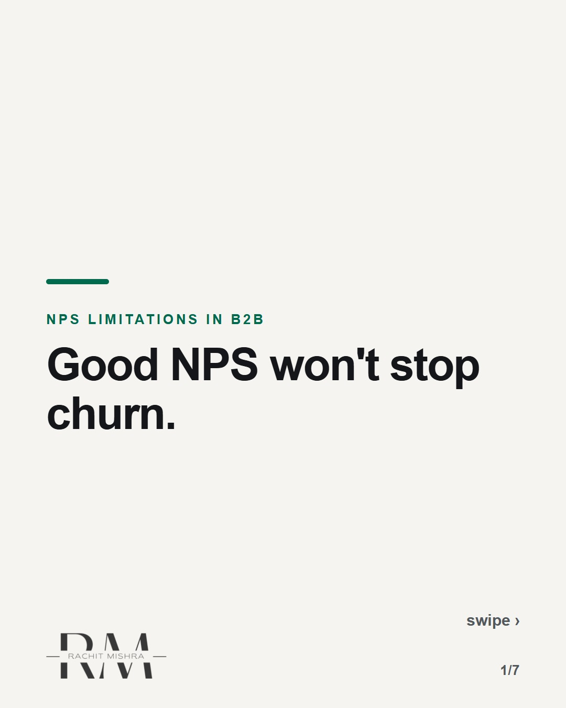
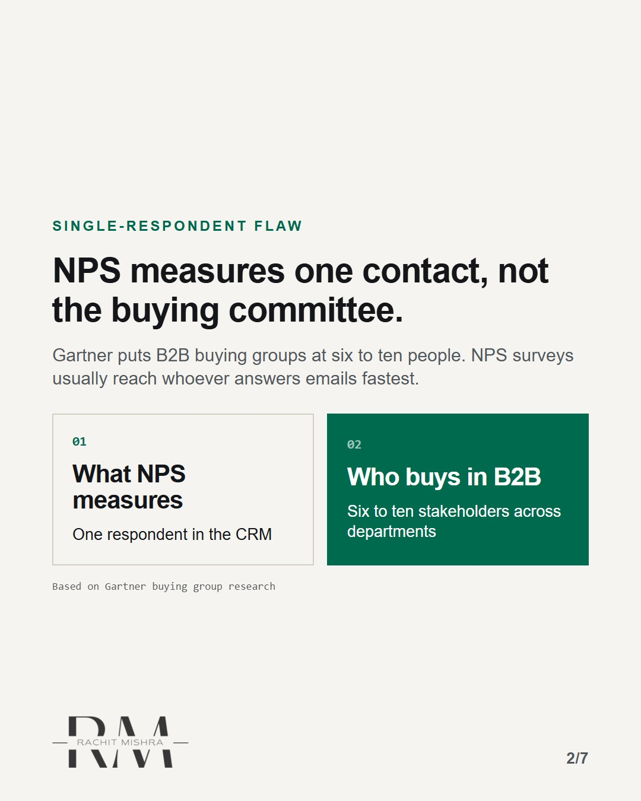
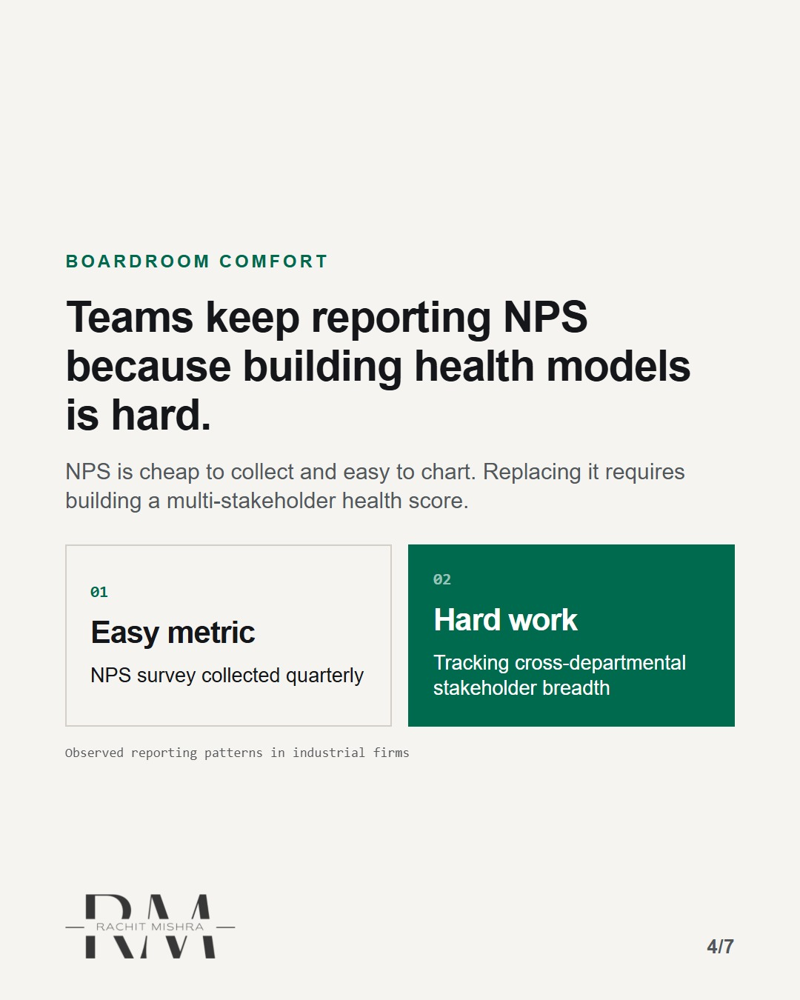
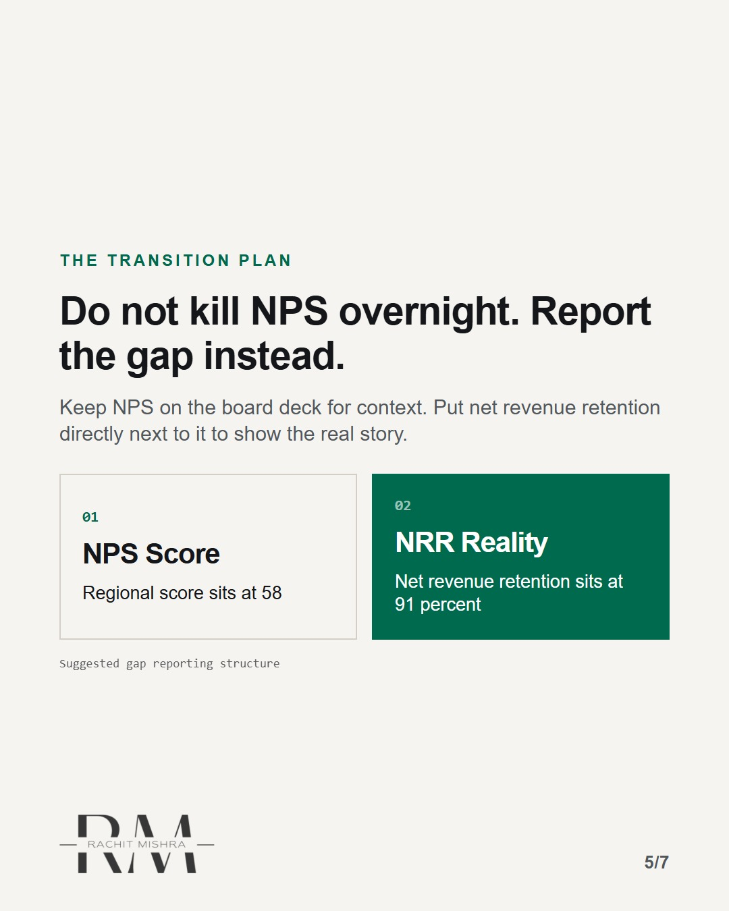

# the cx score trap nps

**CAROUSEL** · inside_the_org · goes live **2026-12-05T10:30:00+05:30**

> Targeting: `nps limitations in b2b`
>
> Claim: A single contact’s NPS response cannot reliably represent every stakeholder or predict an account renewal.
> Useful takeaway (checklist): Review the last two renewal cycles / Count people contacted in the last 90 days / Record their current concerns separately / Read NRR as a lagging outcome
> Editorial review: passed novelty, visible payoff and source-fidelity checks
>
> Proof (source): Gartner's research puts the average B2B buying group at six to ten people, while NPS surveys typically reach one friendly contact in the CRM.
> Source: https://www.rachitmishra.in/2026/07/27/nps-limitations-b2b/
>
> Source preflight: reachable (HTTP 200)
>
> Rendered infographics: 5 — comparison, bottleneck, comparison, comparison, checklist

## Slides

7 rendered images sit in this folder — upload them in filename order.

**1.** 
### Good NPS won't stop churn.



**2.** Single-Respondent Flaw
### NPS measures one contact, not the buying committee.
Gartner puts B2B buying groups at six to ten people. NPS surveys usually reach whoever answers emails fastest.



**3.** The Missing Signal
### A high score can miss a changing buying group.
Champions leave, procurement leads change, and silent accounts drop contracts while the quarterly dashboard shows a 58.


**4.** Boardroom Comfort
### Teams keep reporting NPS because building health models is hard.
NPS is cheap to collect and easy to chart. Replacing it requires building a multi-stakeholder health score.



**5.** The Transition Plan
### Do not kill NPS overnight. Report the gap instead.
Keep NPS on the board deck for context. Put net revenue retention directly next to it to show the real story.



**6.** Account Health Audit
### Replace single-score dashboards with four account signals.
Track retention, the last two renewal cycles, stakeholder contact in 90 days and the executive sponsor’s view.


**7.** 
### Read the score alongside account signals.
Read the long version and methodology notes on https://www.rachitmishra.in/2026/07/27/nps-limitations-b2b/


## Caption — copy from here

```
Good NPS won't stop churn.

NPS limitations in B2B begin with the gap between one respondent and a whole buying group.

Keep the score for context. Alongside it, review revenue retention, the last two renewal cycles, stakeholder contact over 90 days and the executive sponsor’s concerns. These signals add context; none is a guaranteed churn forecast. Make the account view broader than the easiest person to survey.

Read the source: https://www.rachitmishra.in/2026/07/27/nps-limitations-b2b/

Send this to the account owner preparing the next renewal review.

#b2bmarketing #customerexperience #b2bstrategy
```

## Alt text

```
Carousel slides explaining why NPS fails in B2B accounts and what to track instead.
```

## How this post could fail

Readers might dismiss this as anti-survey cynicism if they don't implement the four-part account health check.

## Sources

- [Gartner's research puts the average B2B buying group at six to ten people, while NPS surveys typically reach one friendly contact in the CRM.](https://www.rachitmishra.in/2026/07/27/nps-limitations-b2b/)
