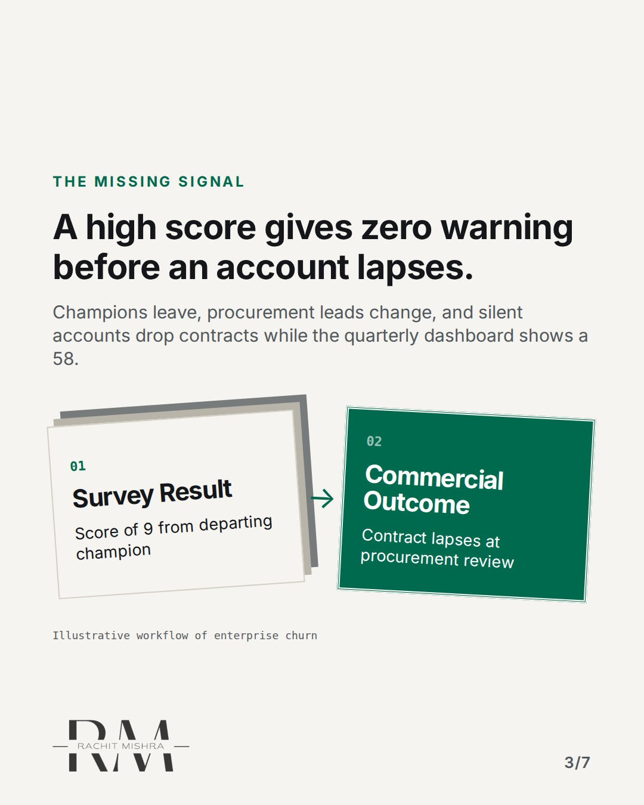
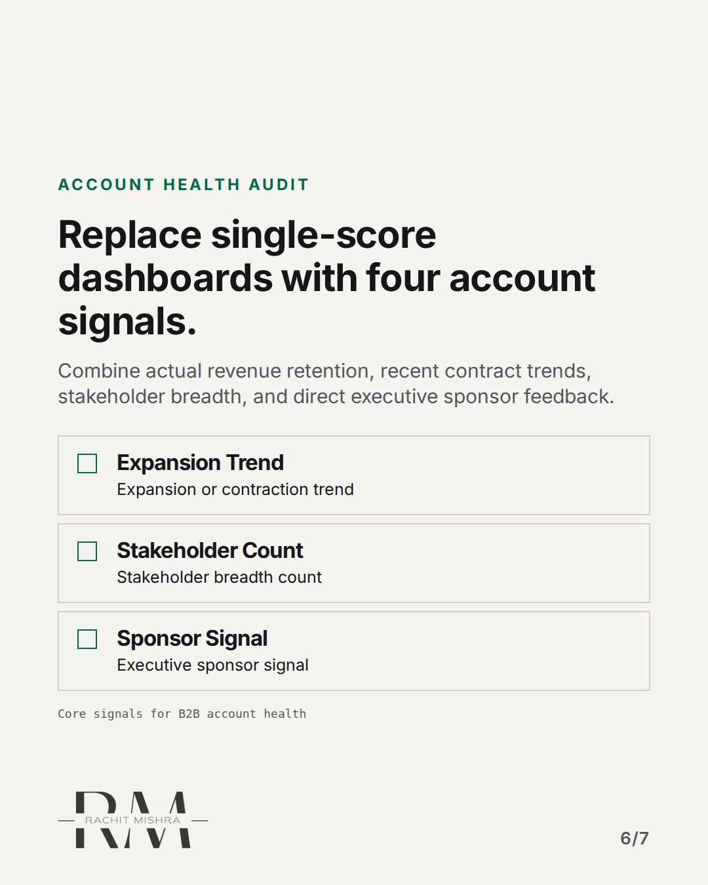
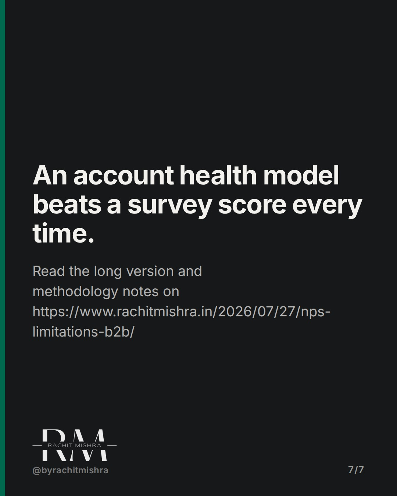

# the cx score trap nps

**CAROUSEL** · inside_the_org · goes live **2026-12-05T10:30:00+05:30**

> Targeting: `nps limitations in b2b`
>
> Claim: An NPS of 62 measures an individual respondent's mood on a Tuesday rather than predicting whether a multi-stakeholder B2B account will renew.
> Useful takeaway (checklist): Net revenue retention / Expansion or contraction trend / Stakeholder breadth count / Executive sponsor signal
> Editorial review: passed novelty, visible payoff and source-fidelity checks
>
> Proof (source): Gartner's research puts the average B2B buying group at six to ten people, while NPS surveys typically reach one friendly contact in the CRM.
> Source: https://www.rachitmishra.in/2026/07/27/nps-limitations-b2b/
>
> Source preflight: reachable (HTTP 200)
>
> Rendered infographics: 5 — comparison, bottleneck, comparison, comparison, checklist

## Slides

7 rendered images sit in this folder — upload them in filename order.

**1.** 
### Good NPS won't stop churn.


**2.** Single-Respondent Flaw
### NPS measures one contact, not the buying committee.
Gartner puts B2B buying groups at six to ten people. NPS surveys usually reach whoever answers emails fastest.


**3.** The Missing Signal
### A high score gives zero warning before an account lapses.
Champions leave, procurement leads change, and silent accounts drop contracts while the quarterly dashboard shows a 58.



**4.** Boardroom Comfort
### Teams keep reporting NPS because building health models is hard.
NPS is cheap to collect and easy to chart. Replacing it requires building a multi-stakeholder health score.


**5.** The Transition Plan
### Do not kill NPS overnight. Report the gap instead.
Keep NPS on the board deck for context. Put net revenue retention directly next to it to show the real story.


**6.** Account Health Audit
### Replace single-score dashboards with four account signals.
Combine actual revenue retention, recent contract trends, stakeholder breadth, and direct executive sponsor feedback.



**7.** 
### An account health model beats a survey score every time.
Read the long version and methodology notes on https://www.rachitmishra.in/2026/07/27/nps-limitations-b2b/



## Caption — copy from here

```
Good NPS won't stop churn.

Understanding nps limitations in b2b starts with accepting that a single survey response tells you nothing about procurement committees or upcoming contract renewals.

When a friendly day-to-day contact scores you a 9 and then changes teams, your dashboard records a win while the account quietly lapses. The score wasn't fake; it was just measuring someone who no longer had a vote in the buying committee.

Building an honest account-health model takes operational work that standard CX dashboards avoid.

Send this to whoever is defending the quarterly customer satisfaction metrics to the board.

[nps limitations, b2b customer experience, account health score, net revenue retention]

#b2bmarketing #customerexperience #b2bstrategy
```

## Alt text

```
Carousel slides explaining why NPS fails in B2B accounts and what to track instead.
```

## How this post could fail

Readers might dismiss this as anti-survey cynicism if they don't implement the four-part account health check.

## Sources

- [Gartner's research puts the average B2B buying group at six to ten people, while NPS surveys typically reach one friendly contact in the CRM.](https://www.rachitmishra.in/2026/07/27/nps-limitations-b2b/)
