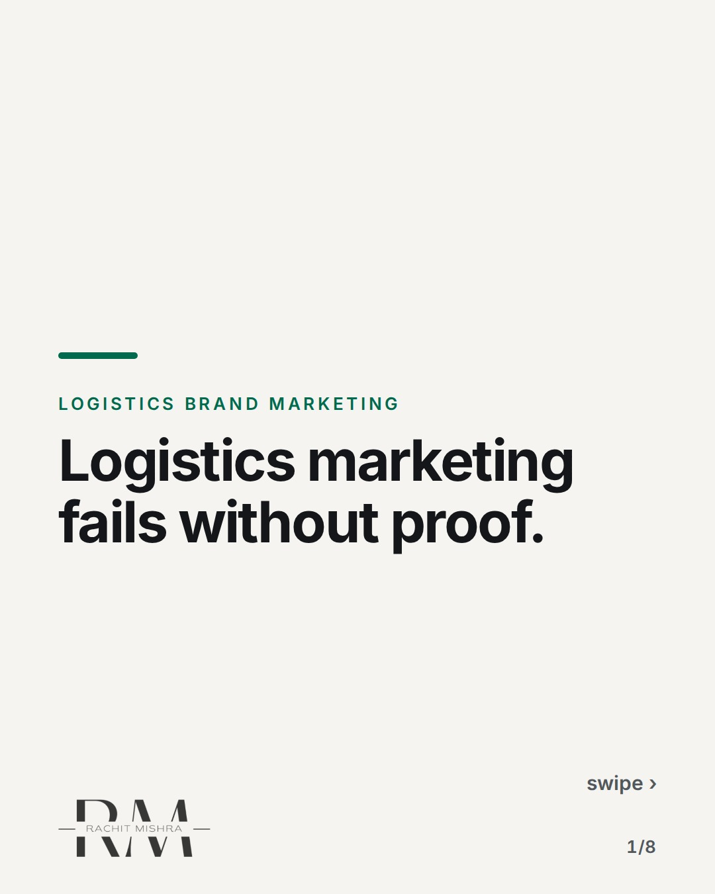
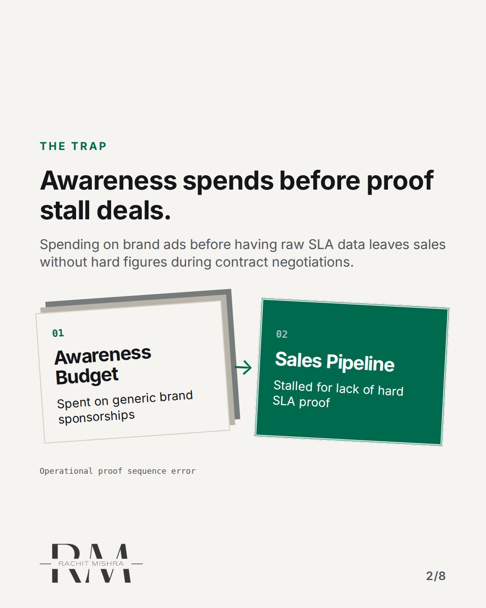
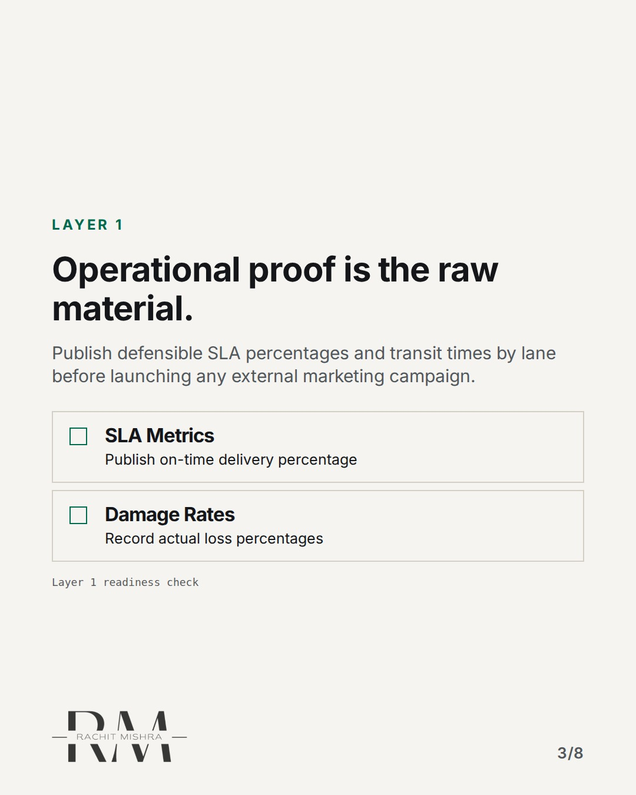
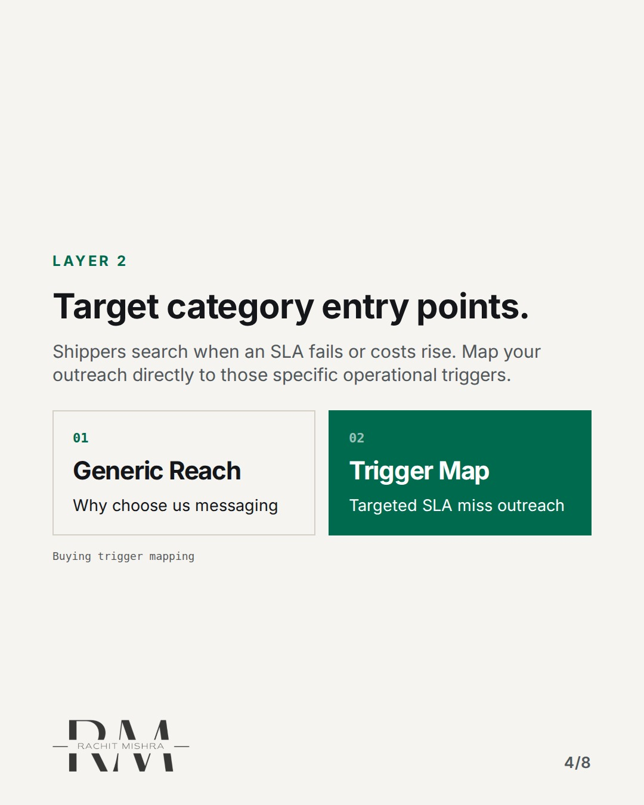
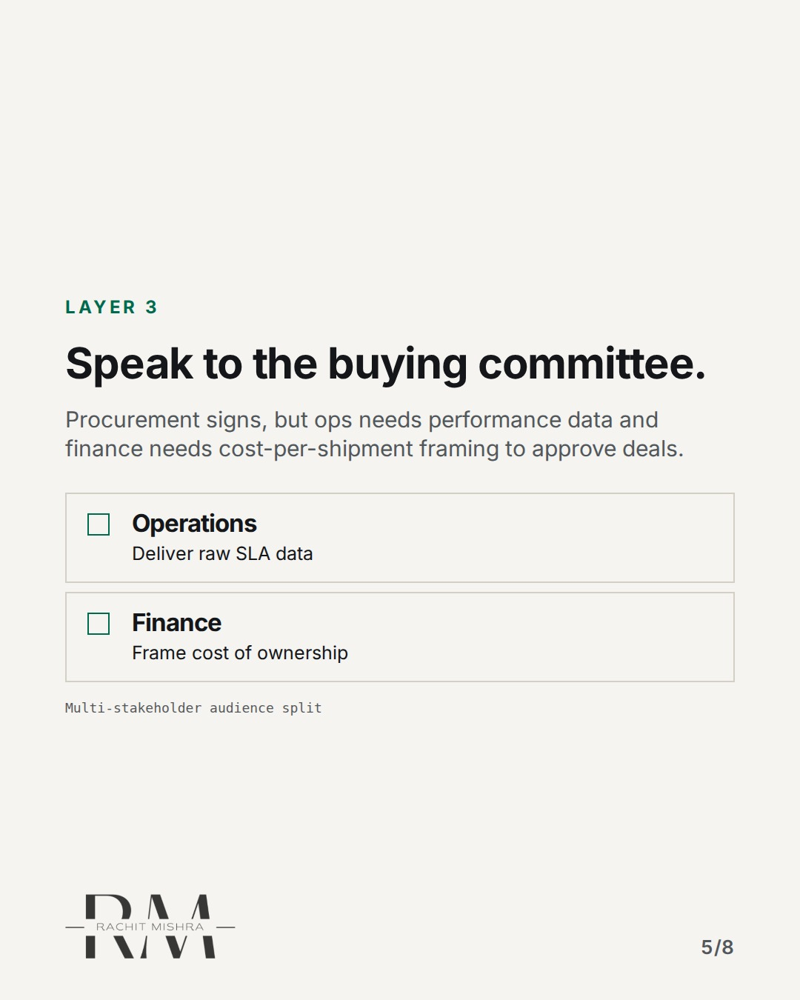
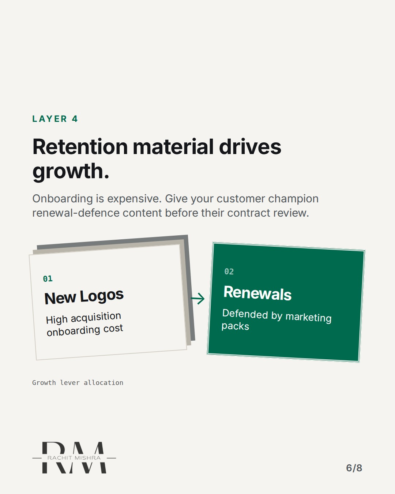
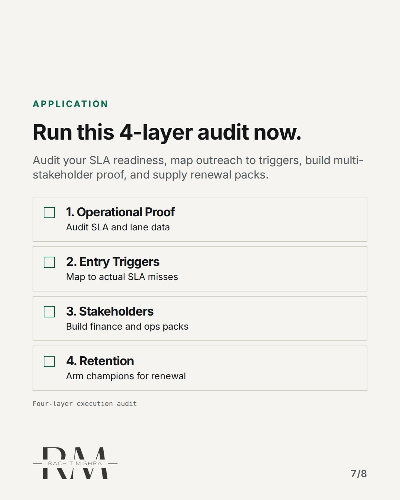
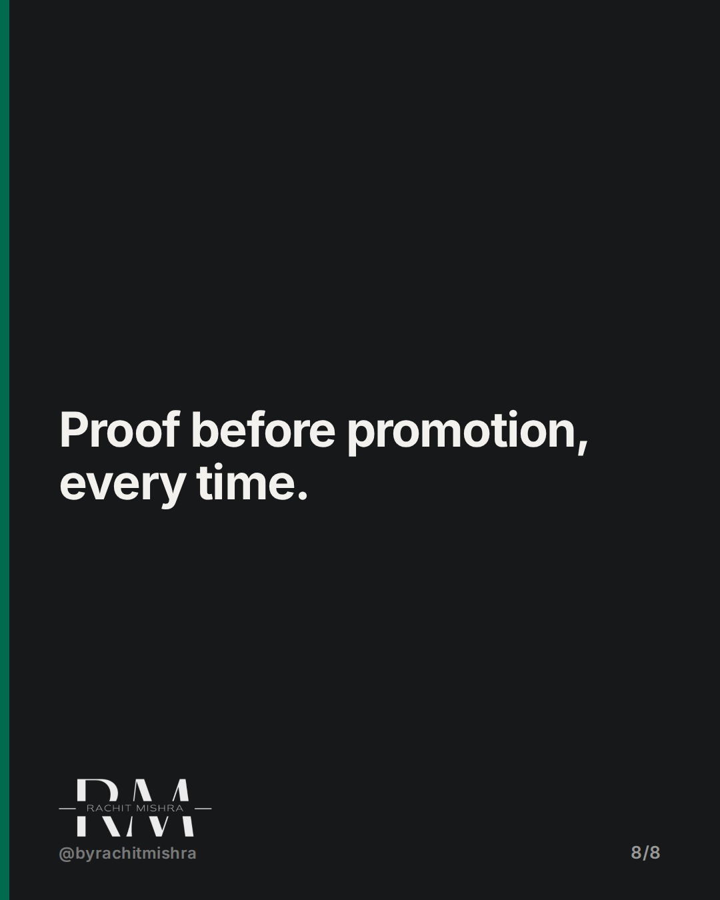

# supply_chain_marketing_proof_sequence

**CAROUSEL** · inside_the_org · goes live **2026-12-06T10:30:00+05:30**

> Targeting: `logistics brand marketing`
>
> Claim: Logistics marketing fails when it spends budget on generic awareness before building sales-ready operational proof.
> Useful takeaway (checklist): 1. Operational Proof: Audit SLA and lane data / 2. Entry Triggers: Map to actual SLA misses / 3. Stakeholders: Build finance and ops packs / 4. Retention: Arm champions for renewal
> Editorial review: passed novelty, visible payoff and source-fidelity checks
>
> Proof (source): Spent a quarter's budget on awareness before proving our operational metrics, leading to stalled deals when sales lacked hard SLA data.
> Source: https://www.rachitmishra.in/2023/05/23/marketing-alchemy-supply-chain-innovation/
>
> Source preflight: reachable (HTTP 200)
>
> Rendered infographics: 6 — bottleneck, checklist, comparison, checklist, bottleneck, checklist

## Slides

8 rendered images sit in this folder — upload them in filename order.

**1.** 
### Logistics marketing fails without proof.



**2.** The Trap
### Awareness spends before proof stall deals.
Spending on brand ads before having raw SLA data leaves sales without hard figures during contract negotiations.



**3.** Layer 1
### Operational proof is the raw material.
Publish defensible SLA percentages and transit times by lane before launching any external marketing campaign.



**4.** Layer 2
### Target category entry points.
Shippers search when an SLA fails or costs rise. Map your outreach directly to those specific operational triggers.



**5.** Layer 3
### Speak to the buying committee.
Procurement signs, but ops needs performance data and finance needs cost-per-shipment framing to approve deals.



**6.** Layer 4
### Retention material drives growth.
Onboarding is expensive. Give your customer champion renewal-defence content before their contract review.



**7.** Application
### Run this 4-layer audit now.
Audit your SLA readiness, map outreach to triggers, build multi-stakeholder proof, and supply renewal packs.



**8.** 
### Proof before promotion, every time.



## Caption — copy from here

```
Logistics marketing fails without proof.

Effective logistics brand marketing requires sales-ready operational proof. Running awareness campaigns before your sales team has SLA data leaves deals stranded when procurement asks for numbers. Differentiation requires an operating model that backs every promise.

Read the complete practitioner's breakdown on logistics marketing at https://www.rachitmishra.in/2023/05/23/marketing-alchemy-supply-chain-innovation/

Proof beats promotion every single time.

Send this to whoever is defending the supply chain marketing budget this quarter.

[supply chain marketing, logistics marketing, operational proof, procurement committee, b2b brand strategy]

#supplychain #b2bmarketing #logistics
```

## Alt text

```
Carousel slides outlining the four-layer logistics brand marketing framework.
```

## How this post could fail

Readers might mistake this for general B2B lead generation advice instead of supply-chain specific operational sequencing.

## Sources

- [Spent a quarter's budget on awareness before proving our operational metrics, leading to stalled deals when sales lacked hard SLA data.](https://www.rachitmishra.in/2023/05/23/marketing-alchemy-supply-chain-innovation/)
