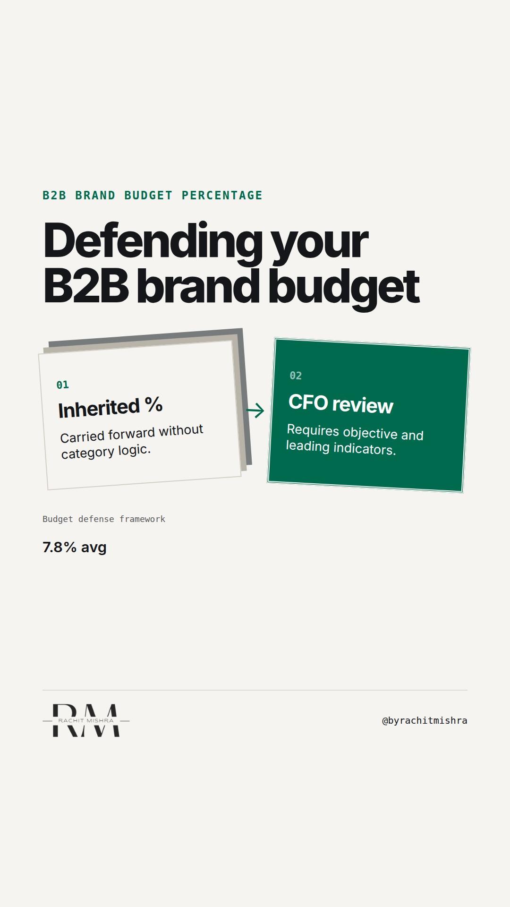

# how_much_should_a_b2b_company_spend_on_brand

**REEL** · reputation · goes live **2026-12-03T17:00:00+05:30**

> Targeting: `b2b brand budget percentage`
>
> Claim: B2B brand spend is a calculated formula tied to category maturity, not an inherited percentage or a zero-sum fight against demand generation.
> Useful takeaway (checklist): Assess category maturity stage / Benchmark against Gartner and IPA splits / Attach a leading indicator / Defend objective over percentage
> Editorial review: passed novelty, visible payoff and source-fidelity checks
>
> Proof (source): Gartner's 2026 CMO Spend Survey puts average marketing budgets at 7.8% of revenue, with brand spend running around a third of that. The IPA and LinkedIn's B2B Institute point to a balanced brand-to-activation split.
> Source: https://www.rachitmishra.in/2026/07/30/b2b-brand-marketing-budget-percentage/
>
> Source preflight: reachable (HTTP 200)
>
> Rendered infographics: 7 — bottleneck, bottleneck, comparison, checklist, checklist, checklist, checklist
>
> Reel assets: image `designed_gradient` · music `bed-something (11).mp3`

## Cover



## Reel script

`reel.mp4` has been generated from this script and will publish automatically. To use your own footage instead, replace that file and delete `.generated-reel` from this folder.

| Time | On screen | Voiceover | Direction |
|---|---|---|---|
| 0:00-0:12 | **Why your brand budget is an inherited guess.** | Why your brand budget is an inherited guess. | Static shot of a blank corporate spreadsheet budget tab. |
| 0:12-0:24 | **Gartner: Marketing averages 7.8% revenue.** | Gartner's 2026 CMO Spend Survey puts average marketing budgets at 7.8% of company revenue across large enterprises. | Zoom in on survey metric callout. |
| 0:24-0:33 | **Assess category maturity stage** | A percentage rule treats every company the same, but category maturity dictates your actual required spend. | Display category stage breakdown table. |
| 0:33-0:43 | **Benchmark against Gartner and IPA splits** | Treating brand and demand generation as a zero-sum fight guarantees brand loses because demand-gen has a shorter attribution story. | Side-by-side comparison of budget allocation arguments. |
| 0:43-0:52 | **Attach a leading indicator** | When defending to a CFO, lead with the objective, attach the percentage as a mechanism, and report on leading indicators. | Highlighting a one-page budgetary rationale. |
| 0:52-1:01 | **Defend objective over percentage** | Tie your brand budget logic to category maturity so it survives a board conversation. | Final summary slide showing the complete formula. |

## Caption — copy from here

```
Why your brand budget is an inherited guess.

Setting a b2b brand budget percentage requires category logic and benchmarks rather than an inherited guess.

When finance asks why marketing needs capital, quoting top-line awareness guarantees a budget cut. You have to anchor the number in category maturity and leading indicators instead of a blind percentage.

The complete breakdown on building a defensible industrial marketing budget is on my site: https://www.rachitmishra.in/2026/07/30/b2b-brand-marketing-budget-percentage/

Send this to whoever is defending the brand budget this quarter.

[b2b brand budget percentage, marketing budget allocation, b2b marketing strategy, cfo stakeholder management]

#b2bmarketing #brandstrategy #marketingbudget
```

## Alt text

```
An industrial enterprise budget spreadsheet showing brand versus demand generation.
```

## How this post could fail

Readers might assume the Gartner benchmark applies equally to early-stage startups and established manufacturers without adjusting for category maturity.

## Sources

- [How Much Should a B2B Company Spend on Brand?](https://www.rachitmishra.in/2026/07/30/b2b-brand-marketing-budget-percentage/)
