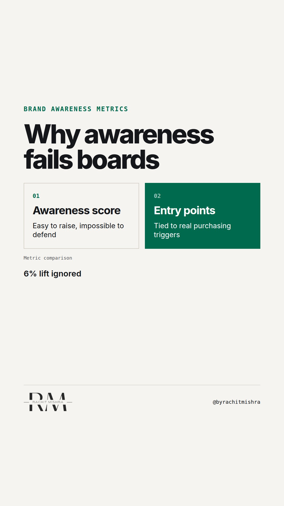

# brandawarenessiswrongmetric

**REEL** · ai_marketing · goes live **2026-12-01T19:00:00+05:30**

> Targeting: `brand awareness metrics`
>
> Claim: Brand awareness scores fail as primary KPIs because they measure name recognition instead of retrieval at the exact moment of need.
> Useful takeaway (checklist): Pick five to eight buying triggers / Test unprompted brand recall for each / Pair leading indicator with win rates / Drop top-line awareness from board decks
> Editorial review: passed novelty, visible payoff and source-fidelity checks
>
> Proof (source): Ehrenberg-Bass Institute research shows purchase is predicted by mental availability linked to category entry points, not abstract name recognition.
> Source: https://www.rachitmishra.in/2026/08/05/b2b-brand-awareness-metrics/
>
> Source preflight: reachable (HTTP 200)
>
> Rendered infographics: 7 — comparison, bottleneck, comparison, comparison, checklist, checklist, comparison
>
> Reel assets: image `designed_gradient` · music `bed-something (10).mp3`

## Cover



## Reel script

`reel.mp4` has been generated from this script and will publish automatically. To use your own footage instead, replace that file and delete `.generated-reel` from this folder.

| Time | On screen | Voiceover | Direction |
|---|---|---|---|
| 0:00-0:12 | **Awareness scores don't touch purchase moments.** | Awareness scores don't touch purchase moments. | Static view of a standard marketing KPI dashboard slide showing an awareness percentage lift. |
| 0:12-0:24 | **Recognition is not recall at moment of need.** | Recognition is not recall at moment of need. | Close-up on a split comparison graphic illustrating recognition versus category retrieval. |
| 0:24-0:35 | **Ninety-five percent are not shopping today.** | Ninety-five percent are not shopping today. | Graphic showing the 95-5 rule proportion across a standard B2B buying cycle. |
| 0:35-0:47 | **Pick five to eight buying triggers** | Pick five to eight buying triggers | Checklist graphic showing operational setup steps. |
| 0:47-0:59 | **Pair leading indicator with win rates** | Pair leading indicator with win rates | Checklist graphic displaying board reporting steps. |
| 0:59-1:09 | **Track entry points instead.** | Track entry points instead. | Final display showing the two-part board story combining leading and lagging metrics. |

## Caption — copy from here

```
Awareness scores don't touch purchase moments.

Brand awareness metrics are easy to inflate and impossible to defend.

When you present a six-point awareness lift to a commercial committee, the first question is whether sales moved. Brand awareness metrics fail when pipeline stalls because they measure recognition rather than retrieval during an actual buying trigger.

Read the full breakdown on the site: https://www.rachitmishra.in/2026/08/05/b2b-brand-awareness-metrics/

Metrics should survive the second question in the room.

Send this to whoever is defending the brand budget this quarter.

[b2b brand awareness metrics, industrial marketing, mental availability, category entry points, B2B KPIs]

#b2bmarketing #brandstrategy #industrialmarketing
```

## Alt text

```
Comparison chart showing B2B awareness versus entry points.
```

## How this post could fail

Readers may dismiss the shift from awareness to entry points as academic if they lack the qualitative research budget to map buying triggers.

## Sources

- [Why B2B Brand Awareness Is the Wrong Metric to Track](https://www.rachitmishra.in/2026/08/05/b2b-brand-awareness-metrics/)
