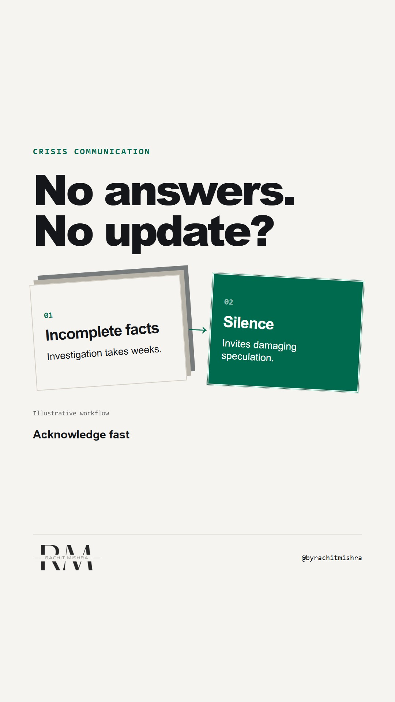

# badnewscommunicationcadence

**REEL** · reputation · goes live **2026-12-02T08:30:00+05:30**

> Targeting: `crisis communication`
>
> Claim: Waiting for complete information during a corporate crisis backfires because silence is filled with speculation, making an early honest holding update essential.
> Useful takeaway (checklist): Acknowledge fast without full facts / Commit to a next-update date / Update on schedule even when nothing is new
> Editorial review: passed novelty, visible payoff and source-fidelity checks
>
> Proof (source): Edelman Trust Barometer research shows that communicating early and honestly during a crisis affects trust recovery more than the severity of the incident itself.
> Source: https://www.rachitmishra.in/2025/01/20/the-art-of-effective-communication-unlocking-the-power-of-connection/
>
> Source preflight: reachable (HTTP 200)
>
> Rendered infographics: 7 — bottleneck, bottleneck, checklist, comparison, checklist, comparison, checklist
>
> Reel assets: image `designed_gradient` · music `bed-something (17).mp3`

## Cover



## Reel script

`reel.mp4` has been generated from this script and will publish automatically. To use your own footage instead, replace that file and delete `.generated-reel` from this folder.

| Time | On screen | Voiceover | Direction |
|---|---|---|---|
| 0:00-0:10 | **Silence is read as the worst case.** | Silence is read as the worst case. Waiting for complete information during a crisis backfires because stakeholders fill the gap with speculation. | Static view of an unlit meeting room table with a printed memo. |
| 0:10-0:22 | **Acknowledge fast without full facts** | The first statement does not explain everything. It confirms awareness and active investigation. | Close-up of a hand highlighting a drafted holding statement. |
| 0:22-0:32 | **Commit to a next-update date** | Instead of a premature conclusion you might have to walk back, set a concrete time for the next update. | Shot of a calendar invite set for a scheduled status release. |
| 0:32-0:44 | **Update on schedule even when nothing is new** | If the deadline arrives and investigations continue, state that explicitly. Going quiet again destroys credibility. | Flipping through a project status tracker showing repeated checkpoints. |
| 0:44-0:54 | **Separate legal risk from human tone.** | Legal reviews for liability exposure. Communications owns whether the statement sounds like it was written by an accountable person. | Flipping a printed document between two reviewers. |
| 0:54-1:04 | **Discipline builds trust before a crisis hits.** | The organisations that build a reputation for straight talk on routine bad news are the ones whose crisis communication gets believed. | Closing shot of a governance playbook open on a desk. |

## Caption — copy from here

```
Silence is read as the worst case.

Crisis communication needs a reliable update cadence, even when the facts are incomplete.

State what is known, distinguish what remains under review, and give a specific time for the next update. Meet that commitment even if the update is that the investigation continues. Have legal review factual and liability risks while communications checks clarity and tone.

Read the source: https://www.rachitmishra.in/2025/01/20/the-art-of-effective-communication-unlocking-the-power-of-connection/

Send this to the communications owner drafting a holding update.

#crisiscommunication #corporatereputation #internalcomms
```

## Alt text

```
Close-up of a crisis communication plan document with marked checklist items on a dark wooden desk.
```

## How this post could fail

Readers might assume this only applies to major corporate scandals rather than routine commercial bad news like delayed launches or missed targets.

## Sources

- [Corporate Communication When the News Is Bad](https://www.rachitmishra.in/2025/01/20/the-art-of-effective-communication-unlocking-the-power-of-connection/)
