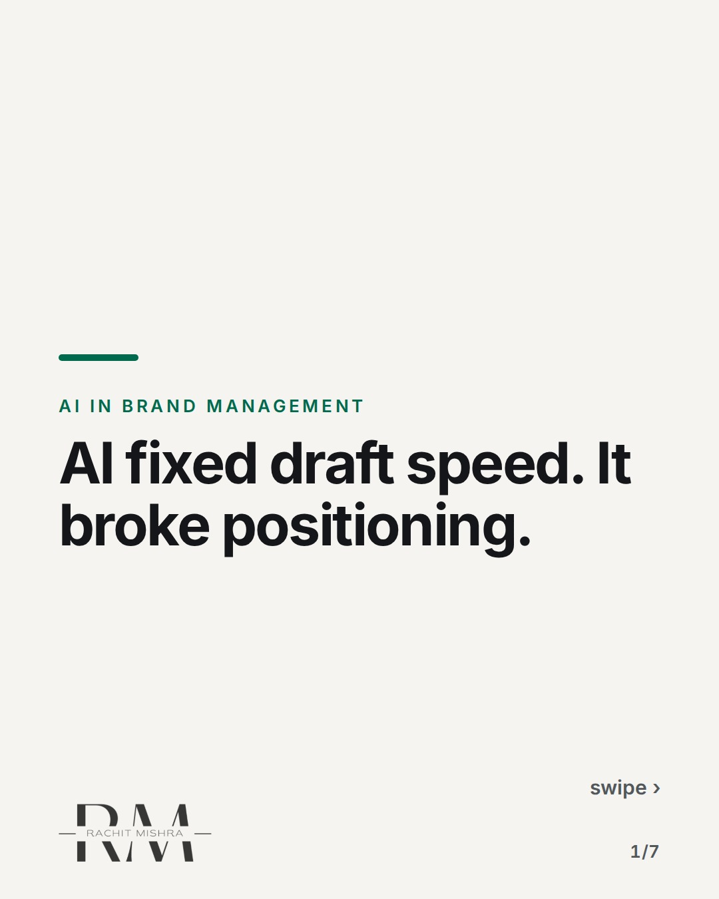
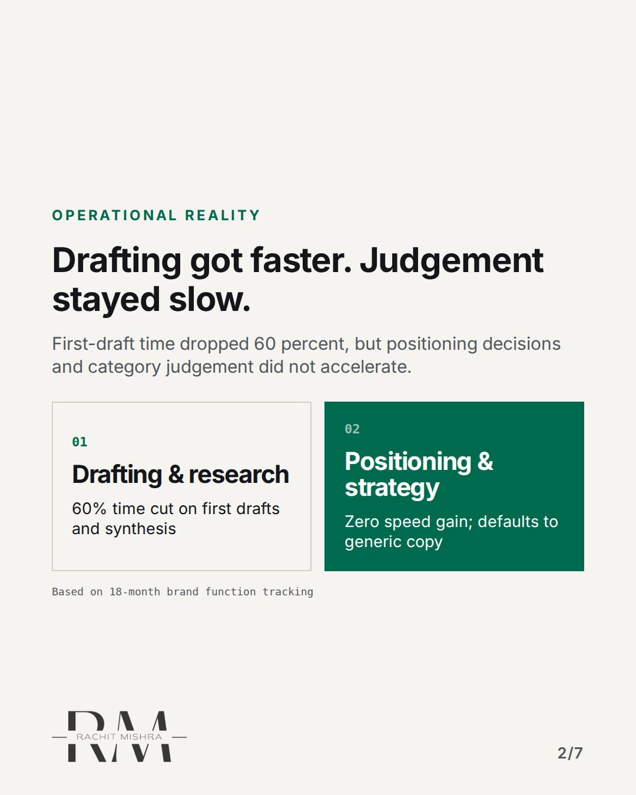
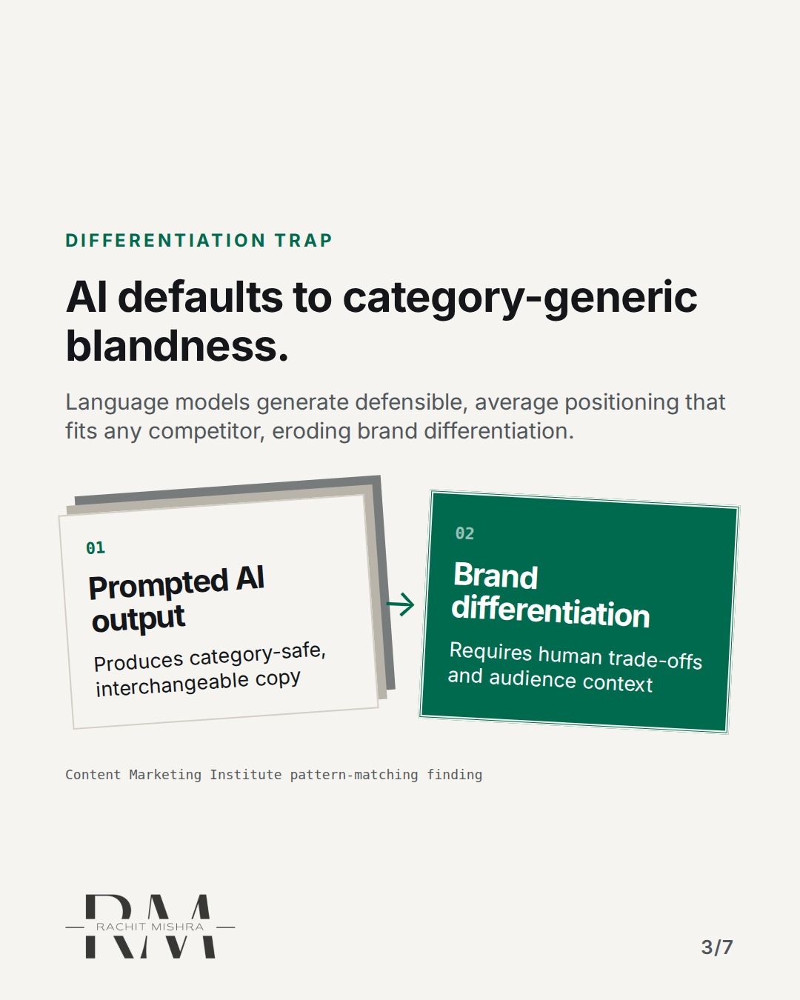
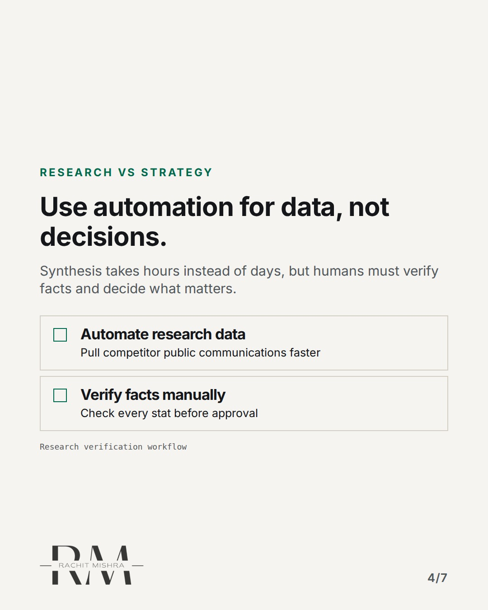
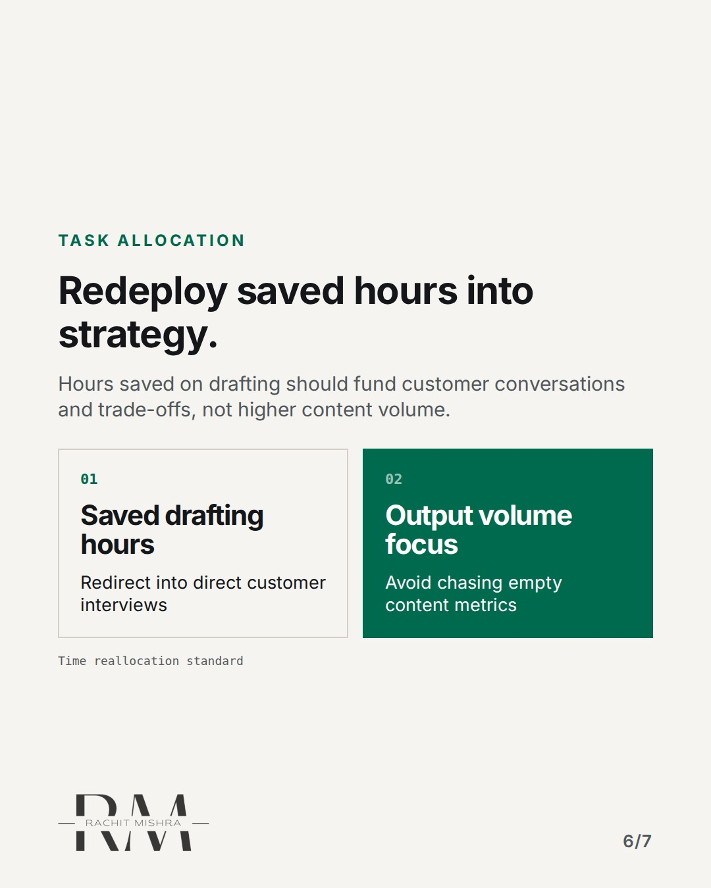
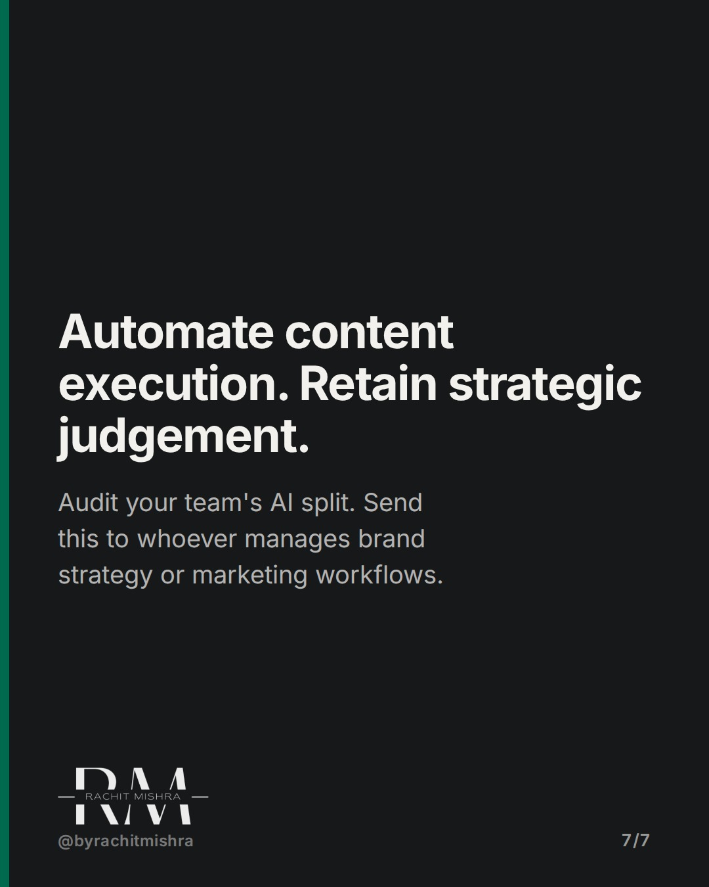

# aiinbrandmanagement

**CAROUSEL** · ai_in_practice · goes live **2026-12-02T20:00:00+05:30**

> Targeting: `ai in brand management`
>
> Claim: Generative AI speeds up content drafting and research synthesis but fails at strategic positioning and category judgement.
> Useful takeaway (checklist): Automate research data Pull competitor public communications faster / Verify facts manually Check every stat before approval
> Editorial review: passed novelty, visible payoff and source-fidelity checks
>
> Proof (source): McKinsey 2024 and Gartner studies show generative AI productivity gains cluster in execution and synthesis, while strategic positioning and category judgement remain strictly human bottlenecks.
> Source: https://www.rachitmishra.in/2026/08/02/ai-in-brand-management/
>
> Source preflight: reachable (HTTP 200)
>
> Rendered infographics: 5 — comparison, bottleneck, checklist, checklist, comparison

## Slides

7 rendered images sit in this folder — upload them in filename order.

**1.** 
### AI fixed draft speed. It broke positioning.



**2.** OPERATIONAL REALITY
### Drafting got faster. Judgement stayed slow.
First-draft time dropped 60 percent, but positioning decisions and category judgement did not accelerate.



**3.** DIFFERENTIATION TRAP
### AI defaults to category-generic blandness.
Language models generate defensible, average positioning that fits any competitor, eroding brand differentiation.



**4.** RESEARCH VS STRATEGY
### Use automation for data, not decisions.
Synthesis takes hours instead of days, but humans must verify facts and decide what matters.



**5.** THE AI BRAND AUDIT
### Audit your brand team's AI workload.
Separate high-volume execution tasks from strategic brand governance before deploying automated tools.


**6.** TASK ALLOCATION
### Redeploy saved hours into strategy.
Hours saved on drafting should fund customer conversations and trade-offs, not higher content volume.



**7.** 
### Automate content execution. Retain strategic judgement.
Audit your team's AI split. Send this to whoever manages brand strategy or marketing workflows.



## Caption — copy from here

```
AI fixed draft speed. It broke positioning.

Using ai in brand management speeds up initial drafting by 60%, but it cannot replace category judgement.

When you ask a model to position a brand, it defaults to the average of your entire category. The copy sounds safe, defensible, and identical to three of your competitors.

The real risk of generative tools isn't poor grammar; it's brand erosion through generic messaging.

Hold the line on strategy, trade-offs, and final signoff. Automate the drafting, not the thinking. Full article details: https://www.rachitmishra.in/2026/08/02/ai-in-brand-management/

Send this to whoever manages brand strategy or marketing workflows on your team.

[ai in brand management, b2b marketing, brand governance, generative ai]

#b2bmarketing #brandstrategy #aiinmarketing
```

## Alt text

```
Infographic showing which brand tasks can be automated with AI and which require human judgement.
```

## How this post could fail

If read superficially, this post might sound like a generic warning against AI rather than a clear operational division between execution speed and strategic judgement.

## Sources

- [What AI Actually Changed in Brand Work, and What It Didn’t](https://www.rachitmishra.in/2026/08/02/ai-in-brand-management/)
