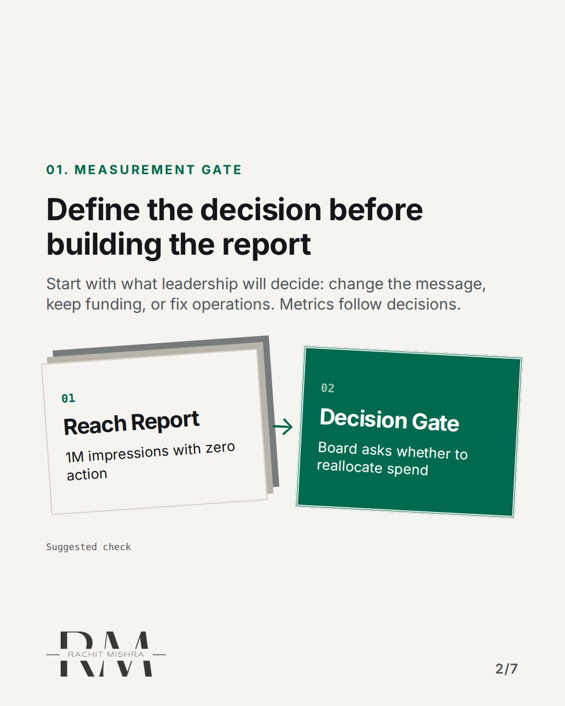
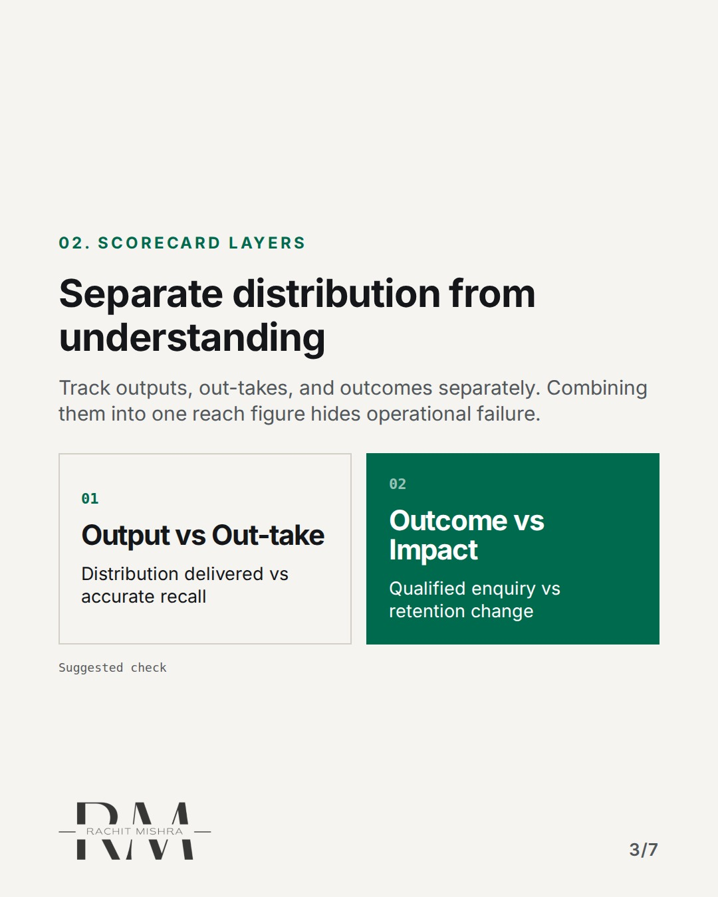
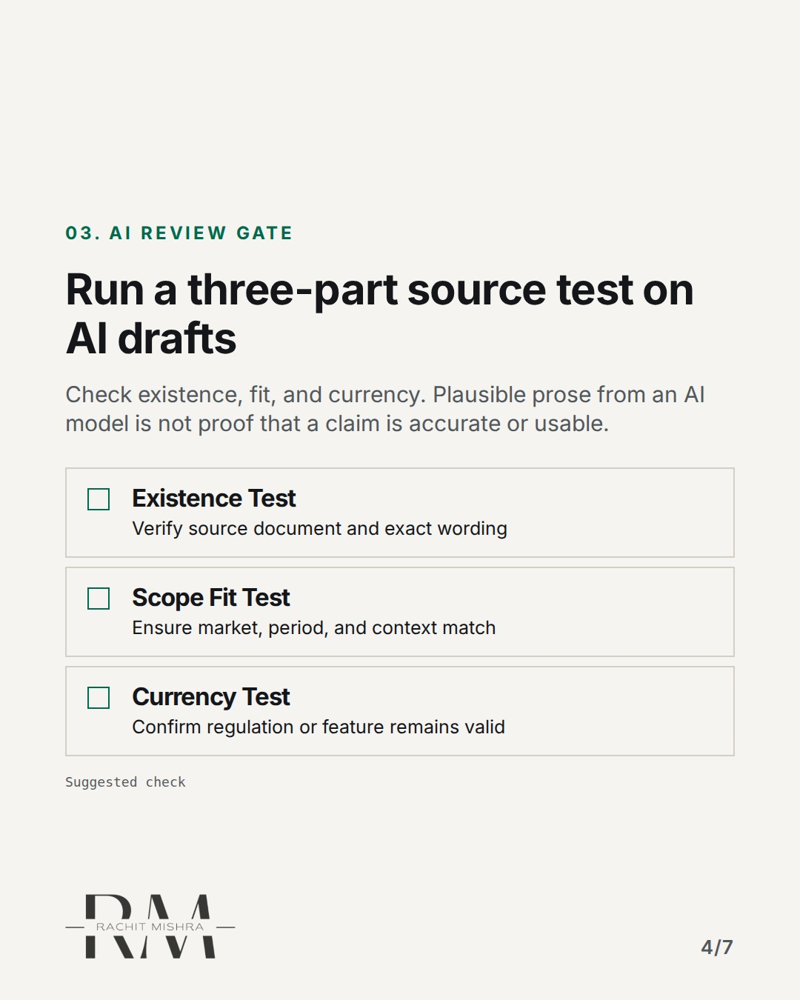
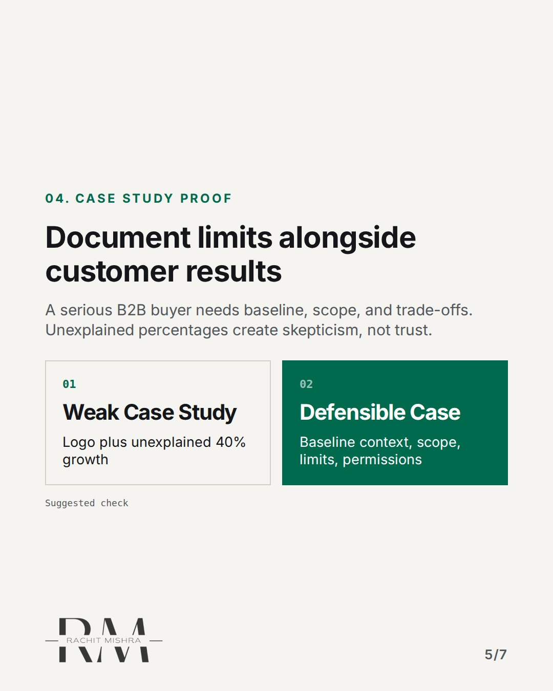
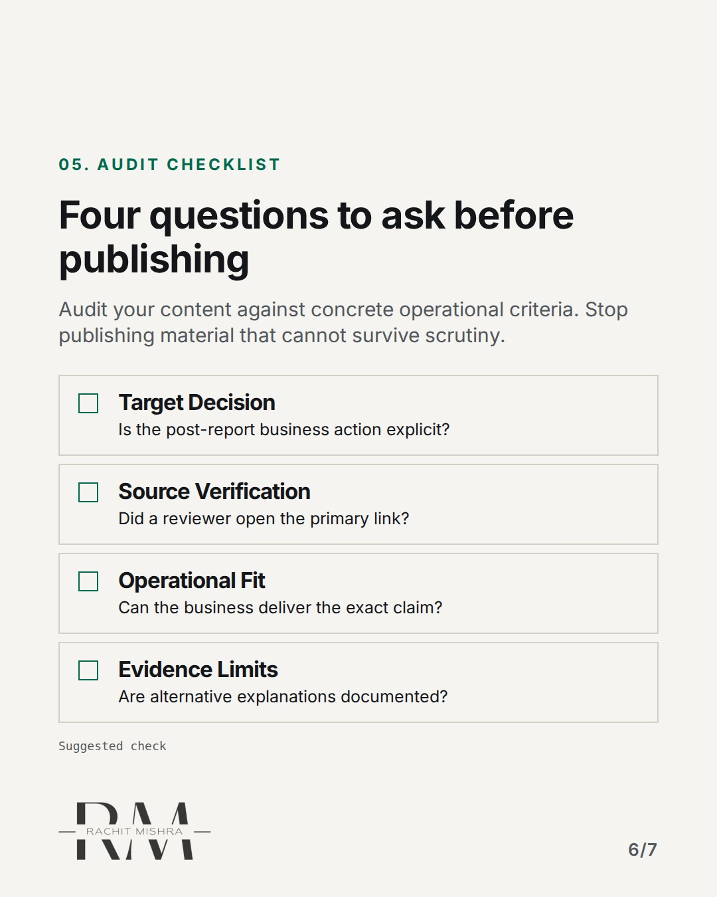
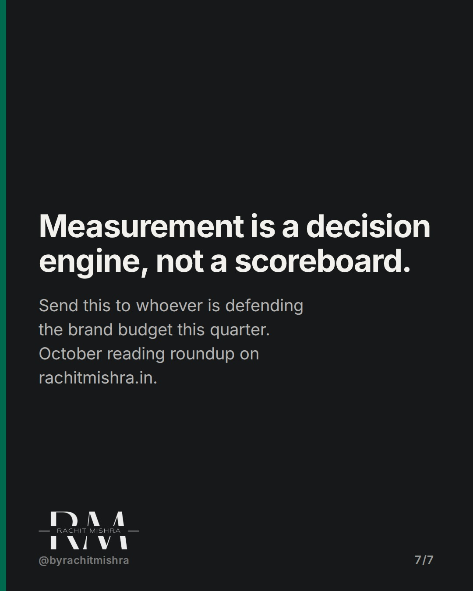

# october_2026_reading_roundup_frameworks

**CAROUSEL** · inside_the_org · goes live **2026-11-05T19:30:00+05:30**

> Targeting: `defending a marketing budget`
>
> Claim: Marketing measurement must connect to specific organisational decisions rather than aggregate reach metrics.
>
> Proof (framework): A 4-tier communication scorecard separating outputs, out-takes, outcomes, and impact combined with a 3-part source review test published in October 2026.
>
> Rendered infographics: 5 — bottleneck, comparison, checklist, comparison, checklist

## Slides

7 rendered images sit in this folder — upload them in filename order.

**1.** 
### Impressions do not defend a marketing budget.


**2.** 01. MEASUREMENT GATE
### Define the decision before building the report
Start with what leadership will decide: change the message, keep funding, or fix operations. Metrics follow decisions.



**3.** 02. SCORECARD LAYERS
### Separate distribution from understanding
Track outputs, out-takes, and outcomes separately. Combining them into one reach figure hides operational failure.



**4.** 03. AI REVIEW GATE
### Run a three-part source test on AI drafts
Check existence, fit, and currency. Plausible prose from an AI model is not proof that a claim is accurate or usable.



**5.** 04. CASE STUDY PROOF
### Document limits alongside customer results
A serious B2B buyer needs baseline, scope, and trade-offs. Unexplained percentages create skepticism, not trust.



**6.** 05. AUDIT CHECKLIST
### Four questions to ask before publishing
Audit your content against concrete operational criteria. Stop publishing material that cannot survive scrutiny.



**7.** 
### Measurement is a decision engine, not a scoreboard.
Send this to whoever is defending the brand budget this quarter. October reading roundup on rachitmishra.in.



## Caption — copy from here

```
Impressions do not defend a marketing budget.

When defending a marketing budget, reach figures alone will not convince leadership. The October reading roundup highlights three practical frameworks on rachitmishra.in for in-house teams.

First, separate reach from understanding. Distribution metrics only show material was delivered; out-takes verify whether the buyer retained the core message.

Second, verify claims before publishing. Plausible AI output still requires human confirmation of existence, fit, and currency against primary sources.

Third, share limits in customer stories. B2B buying committees ignore unexplained growth percentages that hide baseline context and operational trade-offs.

A report that only shows numbers went up is an unfinished report.

Send this to whoever is defending the brand budget this quarter.

[defending a marketing budget, in-house marketing, brand governance, marketing leadership]

#marketingleadership #inhousemarketing #brandgovernance
```

## Alt text

```
Carousel detailing brand measurement frameworks, AI review checks, and B2B evidence criteria.
```

## How this post could fail

It could be mistaken for a simple headline roundup if the reader skims past the visual scorecards and source tests.

## Sources

- [Communication Measurement Framework: From Reach to Decisions](https://www.rachitmishra.in/2026/10/20/communication-measurement-framework/)
- [AI Content Review Checklist: What a Human Must Verify Before Publishing](https://www.rachitmishra.in/2026/10/27/ai-content-review-checklist/)
- [B2B Case Study Template: Build Buyer Confidence With Evidence](https://www.rachitmishra.in/2026/10/30/b2b-case-study-template/)
