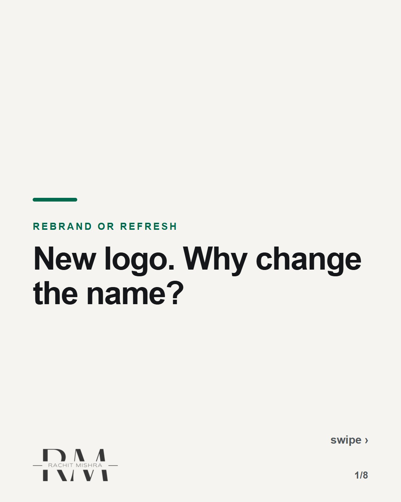
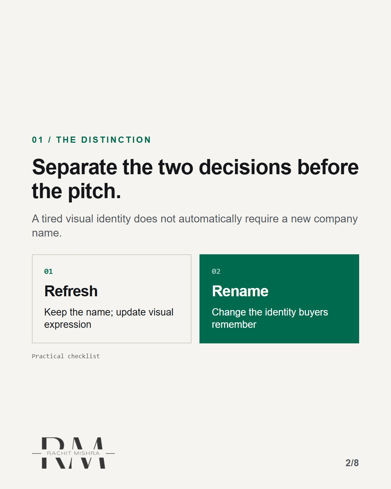
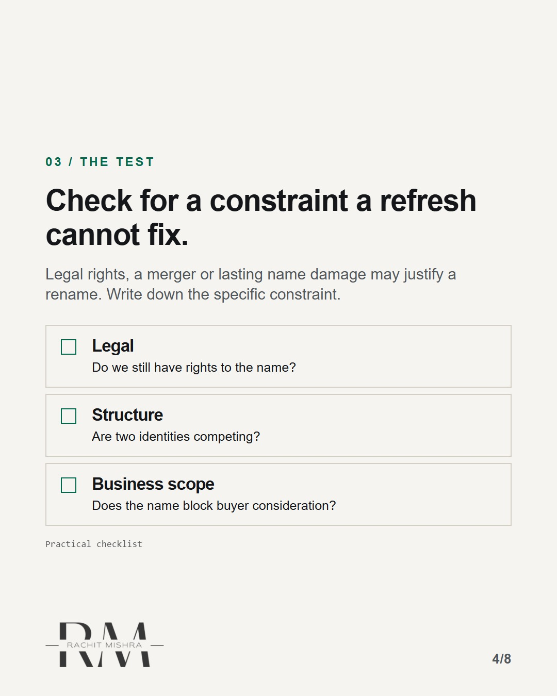
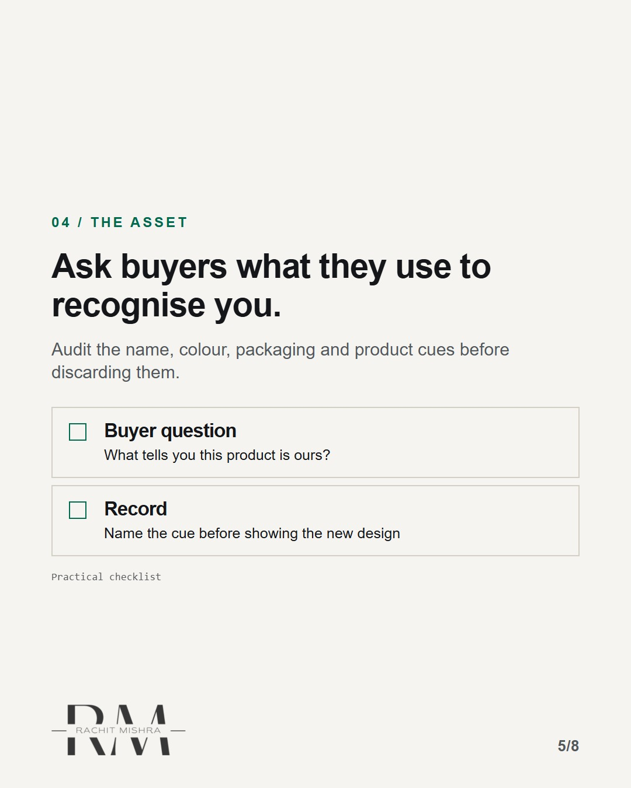
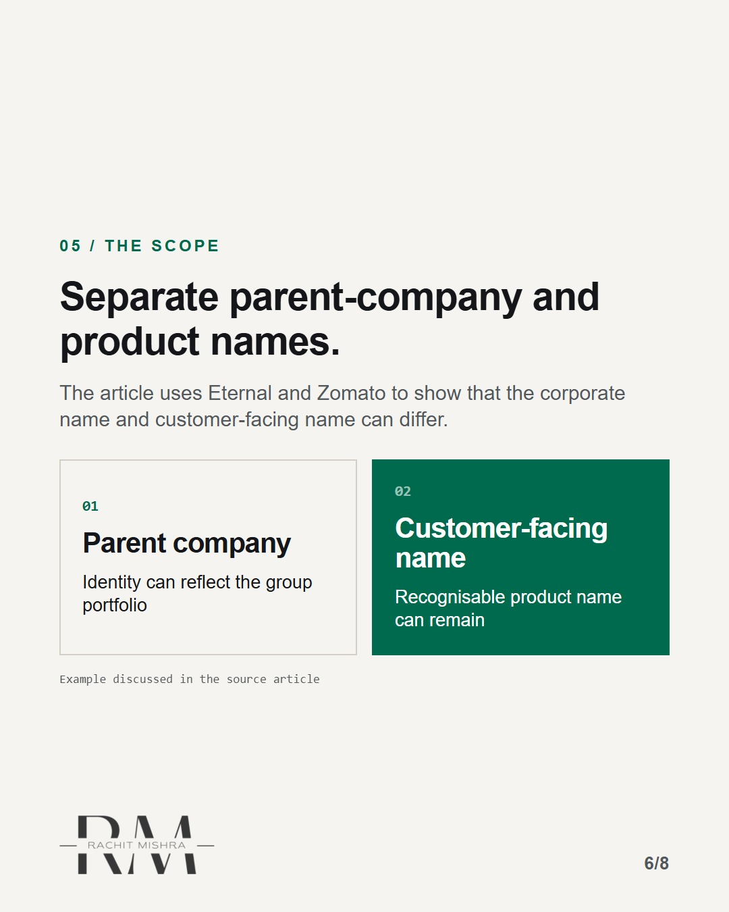
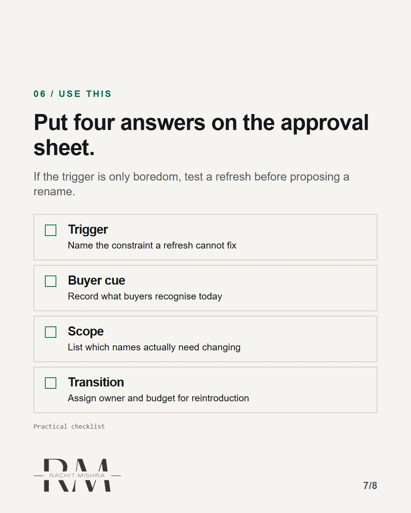
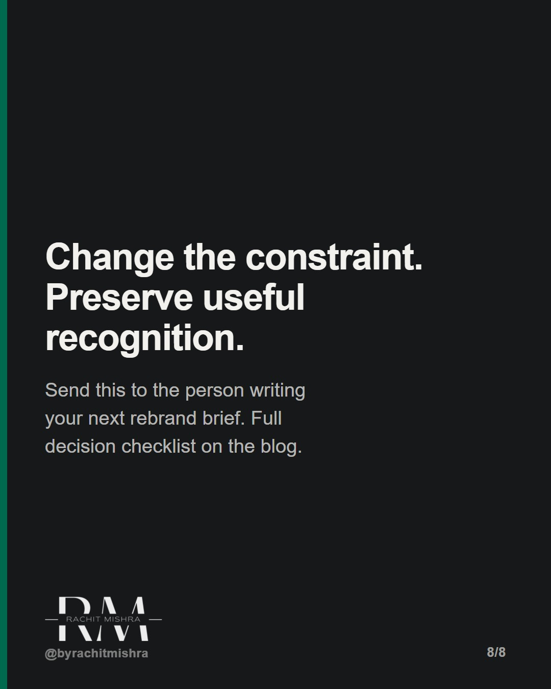

# when_to_rebrand_a_company

**CAROUSEL** · b2b_brand · goes live **2026-11-23T19:00:00+05:30**

> Targeting: `rebrand or refresh`
>
> Claim: Distinguish a structural reason to rename from an identity refresh, then audit the recognition cues buyers use.
> Useful takeaway (decision_test): Name the constraint a refresh cannot fix / Record what buyers recognise today / List which names actually need changing / Assign owner and budget for reintroduction
> Editorial review: passed novelty, visible payoff and source-fidelity checks
>
> Proof (source): The article separates four structural rename triggers from aesthetic fatigue and proposes a distinctive-asset audit.
> Source: https://www.rachitmishra.in/2026/08/29/when-to-rebrand-a-company/
>
> Source preflight: reachable (HTTP 200)
>
> Rendered infographics: 6 — comparison, comparison, checklist, checklist, comparison, checklist

## Slides

8 rendered images sit in this folder — upload them in filename order.

**1.** 
### New logo. Why change the name?



**2.** 01 / THE DISTINCTION
### Separate the two decisions before the pitch.
A tired visual identity does not automatically require a new company name.



**3.** 02 / THE TRIGGER
### Write the trigger without the word modern.
What becomes possible after the name changes that is impossible today?


**4.** 03 / THE TEST
### Check for a constraint a refresh cannot fix.
Legal rights, a merger or lasting name damage may justify a rename. Write down the specific constraint.



**5.** 04 / THE ASSET
### Ask buyers what they use to recognise you.
Audit the name, colour, packaging and product cues before discarding them.



**6.** 05 / THE SCOPE
### Separate parent-company and product names.
The article uses Eternal and Zomato to show that the corporate name and customer-facing name can differ.



**7.** 06 / USE THIS
### Put four answers on the approval sheet.
If the trigger is only boredom, test a refresh before proposing a rename.



**8.** 
### Change the constraint. Preserve useful recognition.
Send this to the person writing your next rebrand brief. Full decision checklist on the blog.



## Caption — copy from here

```
New logo. Why change the name?

A rebrand or refresh starts with a scope decision. A parent-company rename need not erase a familiar product name.

Ask the sponsor to finish this sentence: our current name prevents us from ___. If the answer is only that it feels dated, test a visual refresh first.

Full checklist: https://www.rachitmishra.in/2026/08/29/when-to-rebrand-a-company/

Send this to whoever is writing the rebrand brief.

[rebrand or refresh, brand identity, brand architecture]

#brandstrategy #brandidentity #brandarchitecture
```

## Alt text

```
A rebrand-versus-refresh decision checklist with structural triggers and buyer recognition cues.
```

## How this post could fail

Readers might confuse a corporate rename with a minor logo update and miss the structural distinction.

## Sources

- [When to Rebrand a Company: The Case for Not Doing It](https://www.rachitmishra.in/2026/08/29/when-to-rebrand-a-company/)
