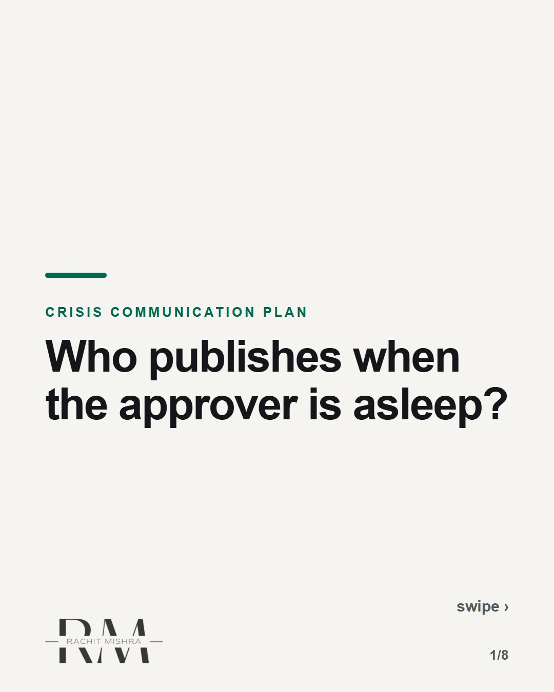
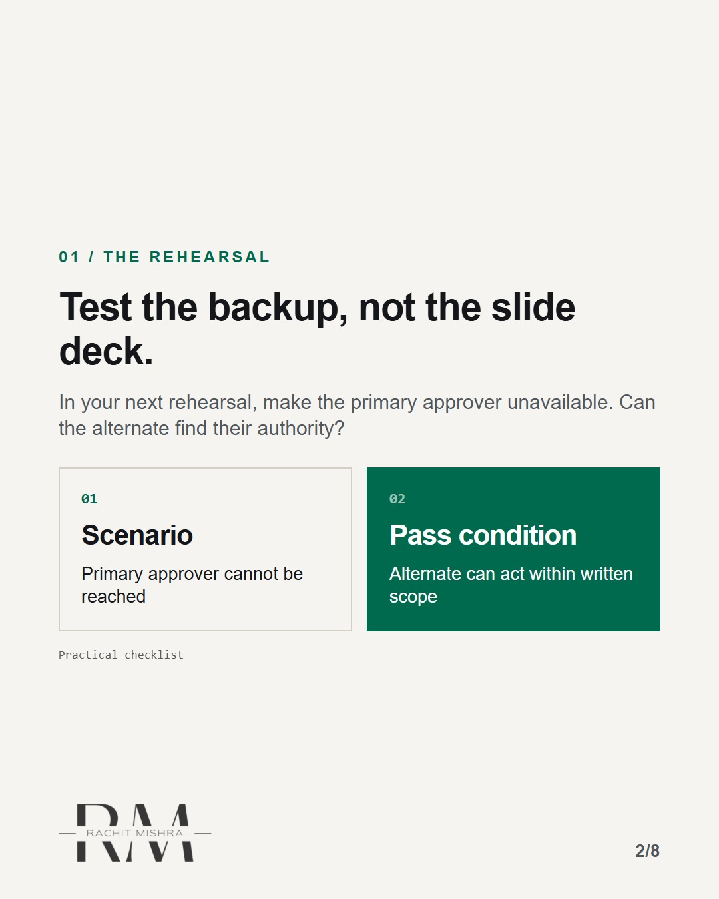
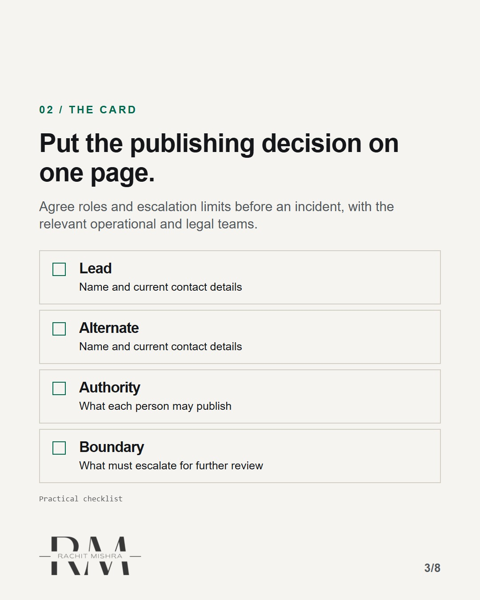
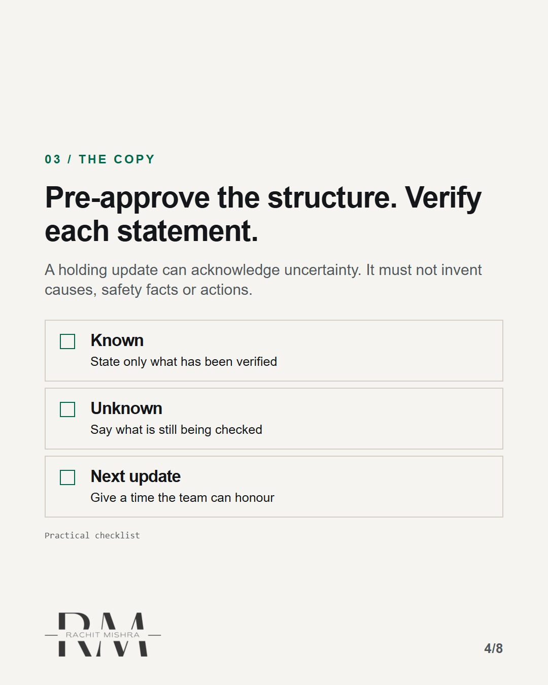
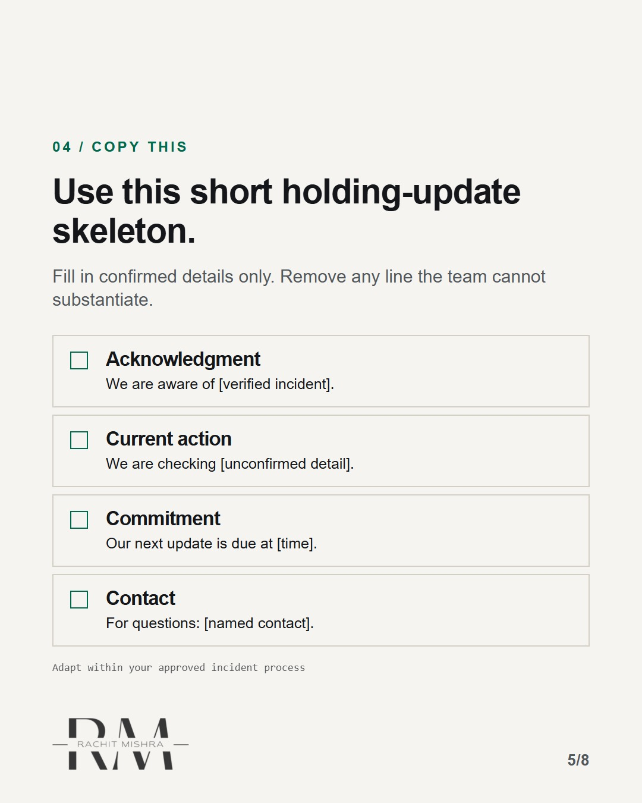
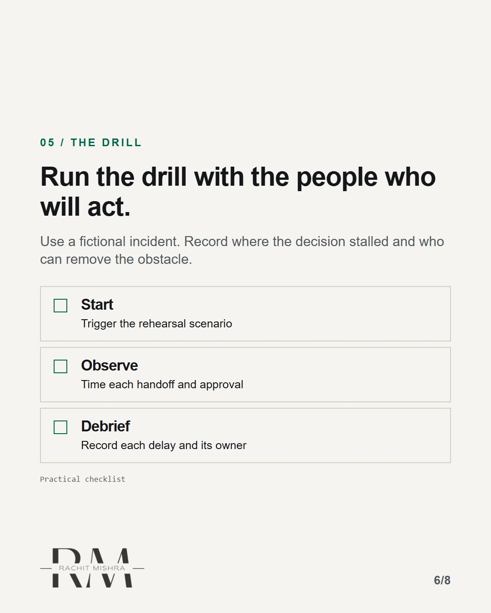
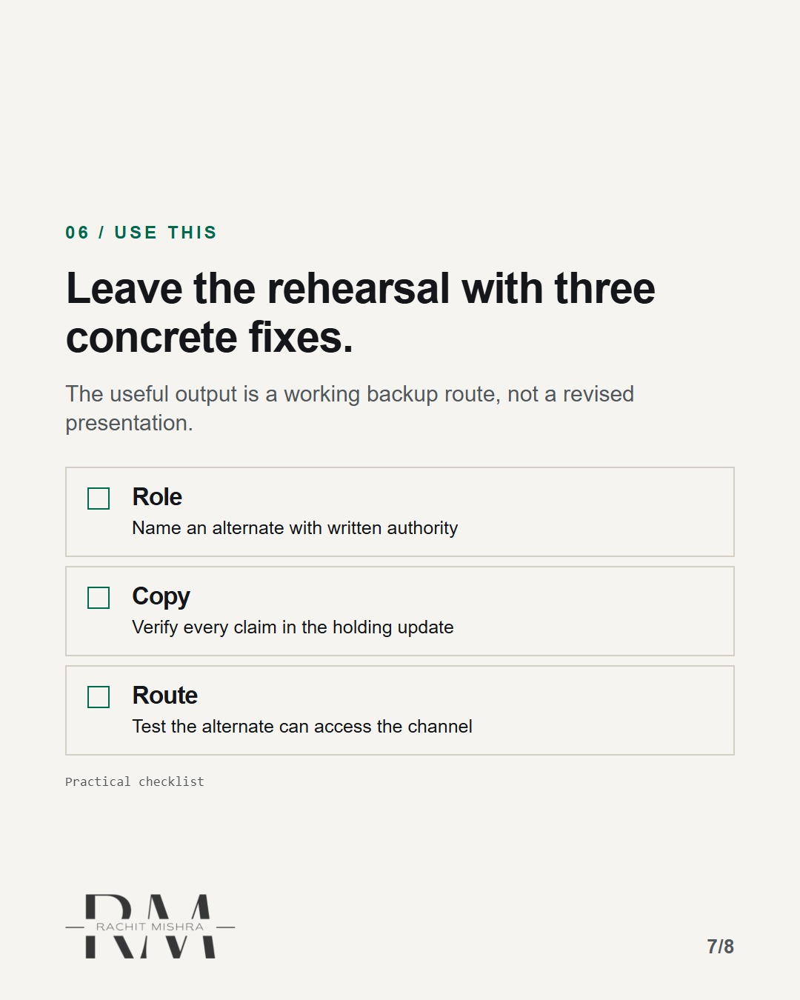
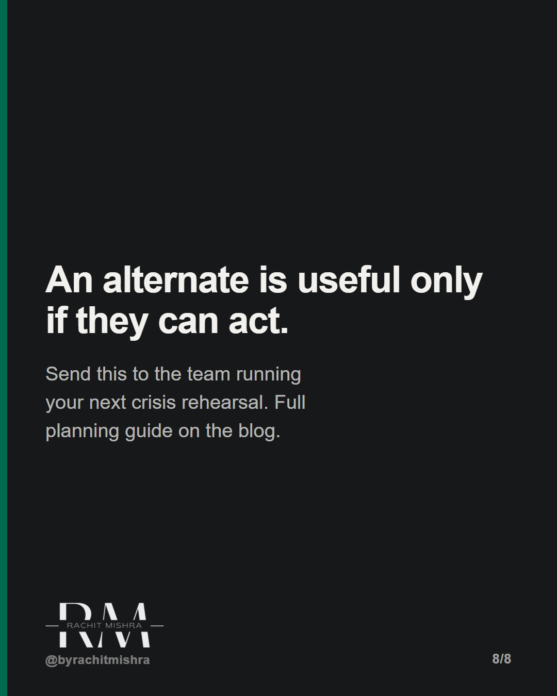

# firstsixtyminutesprotocol

**CAROUSEL** · inside_the_org · goes live **2026-11-28T10:30:00+05:30**

> Targeting: `crisis communication plan`
>
> Claim: A practical crisis rehearsal should test whether a named alternate can publish a verified holding update when the primary approver is unreachable.
> Useful takeaway (template): We are aware of [verified incident]. / Our next update is due at [time]. / Name an alternate with written authority / Test the alternate can access the channel
> Editorial review: passed novelty, visible payoff and source-fidelity checks
>
> Proof (source): The article calls for a named lead and alternate, written authority, pre-approved holding copy, an employee route and a live rehearsal.
> Source: https://www.rachitmishra.in/2026/09/02/crisis-communication-plan/
>
> Source preflight: reachable (HTTP 200)
>
> Rendered infographics: 6 — comparison, checklist, checklist, checklist, checklist, checklist

## Slides

8 rendered images sit in this folder — upload them in filename order.

**1.** 
### Who publishes when the approver is asleep?



**2.** 01 / THE REHEARSAL
### Test the backup, not the slide deck.
In your next rehearsal, make the primary approver unavailable. Can the alternate find their authority?



**3.** 02 / THE CARD
### Put the publishing decision on one page.
Agree roles and escalation limits before an incident, with the relevant operational and legal teams.



**4.** 03 / THE COPY
### Pre-approve the structure. Verify each statement.
A holding update can acknowledge uncertainty. It must not invent causes, safety facts or actions.



**5.** 04 / COPY THIS
### Use this short holding-update skeleton.
Fill in confirmed details only. Remove any line the team cannot substantiate.



**6.** 05 / THE DRILL
### Run the drill with the people who will act.
Use a fictional incident. Record where the decision stalled and who can remove the obstacle.



**7.** 06 / USE THIS
### Leave the rehearsal with three concrete fixes.
The useful output is a working backup route, not a revised presentation.



**8.** 
### An alternate is useful only if they can act.
Send this to the team running your next crisis rehearsal. Full planning guide on the blog.



## Caption — copy from here

```
Who publishes when the approver is asleep?

A crisis communication plan needs a working alternate. Test that person in a rehearsal with the primary approver unavailable.

A short holding update may acknowledge uncertainty; it must still be accurate. Do not claim a cause, safety outcome or action you have not verified.

Guide: https://www.rachitmishra.in/2026/09/02/crisis-communication-plan/

Send this to whoever runs your next rehearsal.

[crisis communication plan, holding statement, incident rehearsal]

#crisiscommunication #corporatecommunications #crisisplanning
```

## Alt text

```
Crisis communication 60-minute protocol framework diagram showing five timed decision boxes.
```

## How this post could fail

Readers might confuse a factless holding statement with avoiding accountability, missing the distinction between confirming operational oversight and stating unverified facts.

## Sources

- [Crisis Communication Plan: The First 60 Minutes](https://www.rachitmishra.in/2026/09/02/crisis-communication-plan/)
