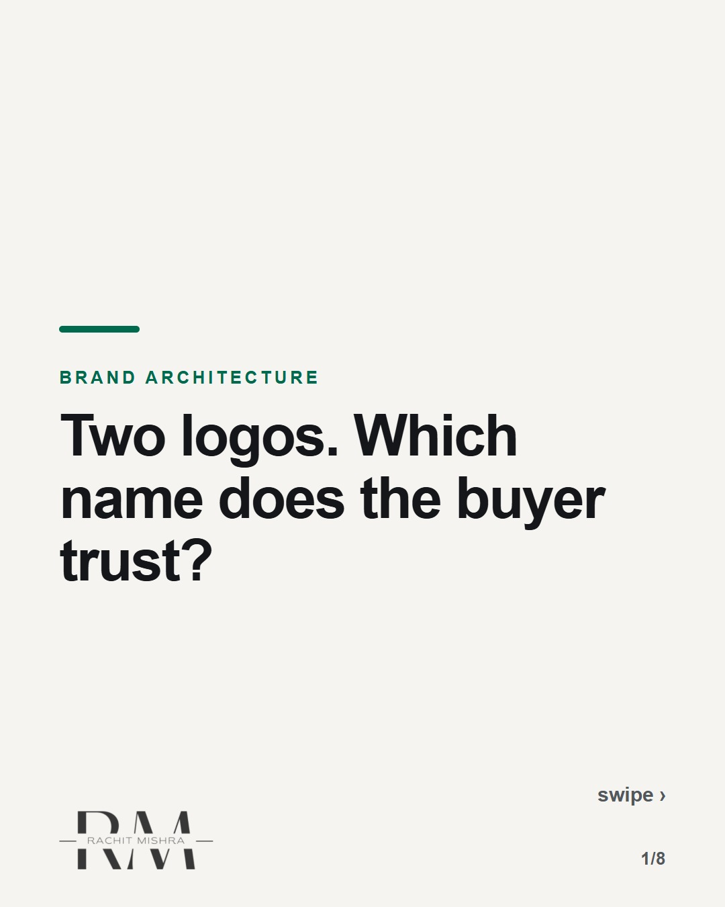
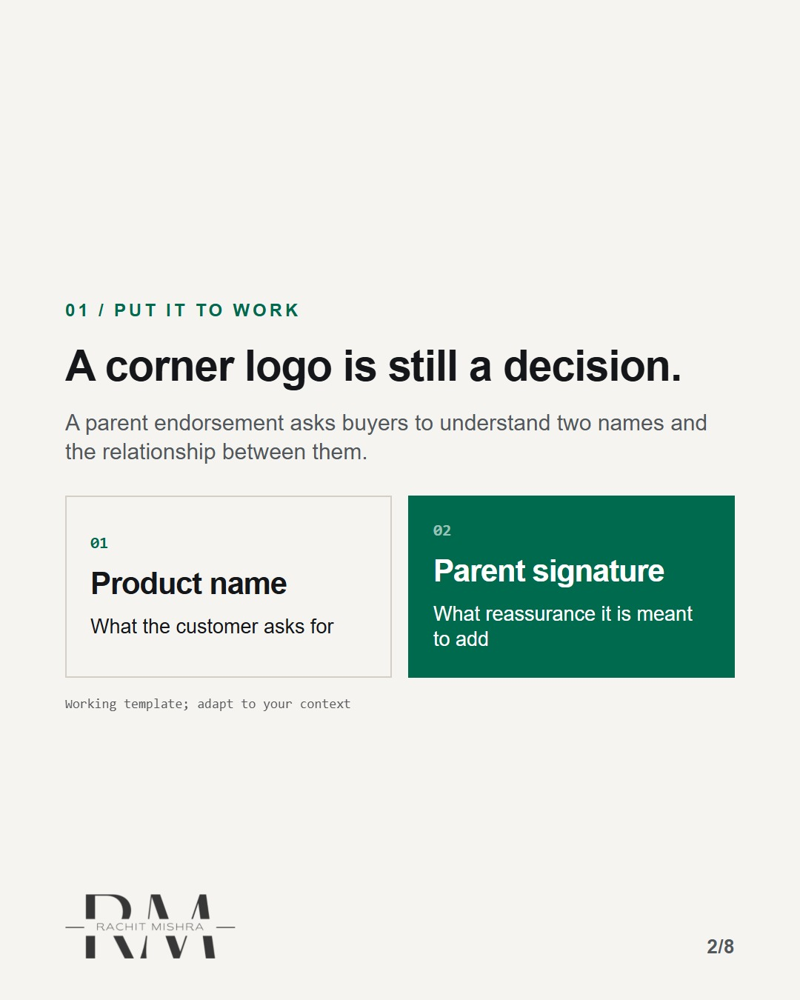
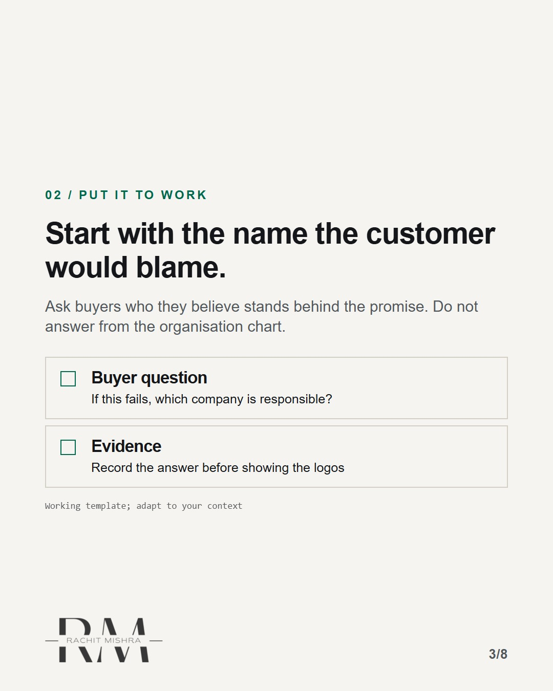
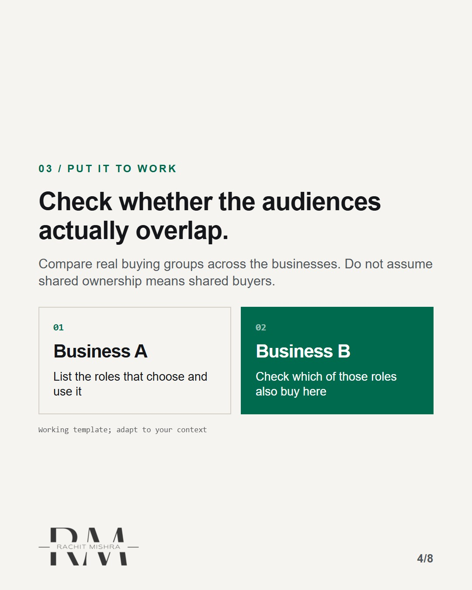
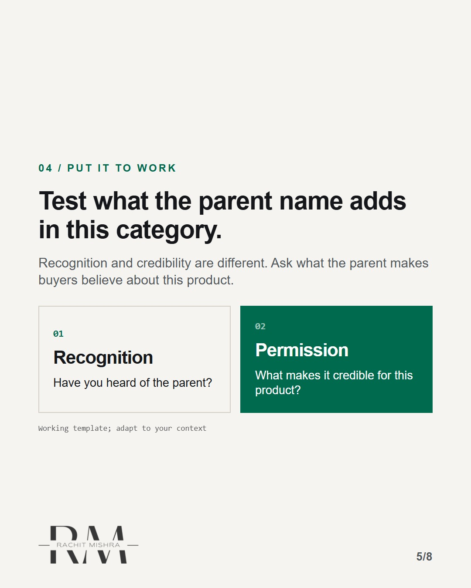
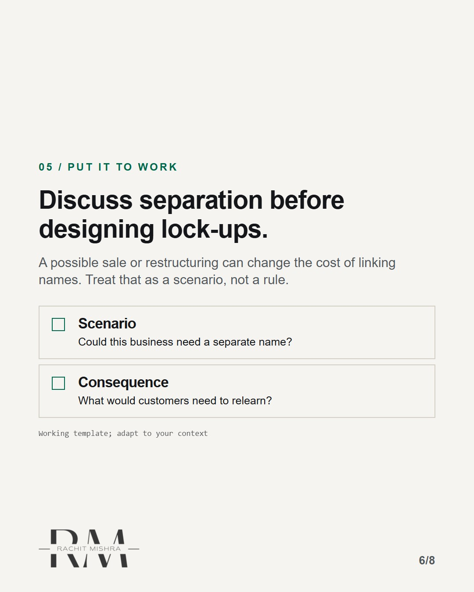
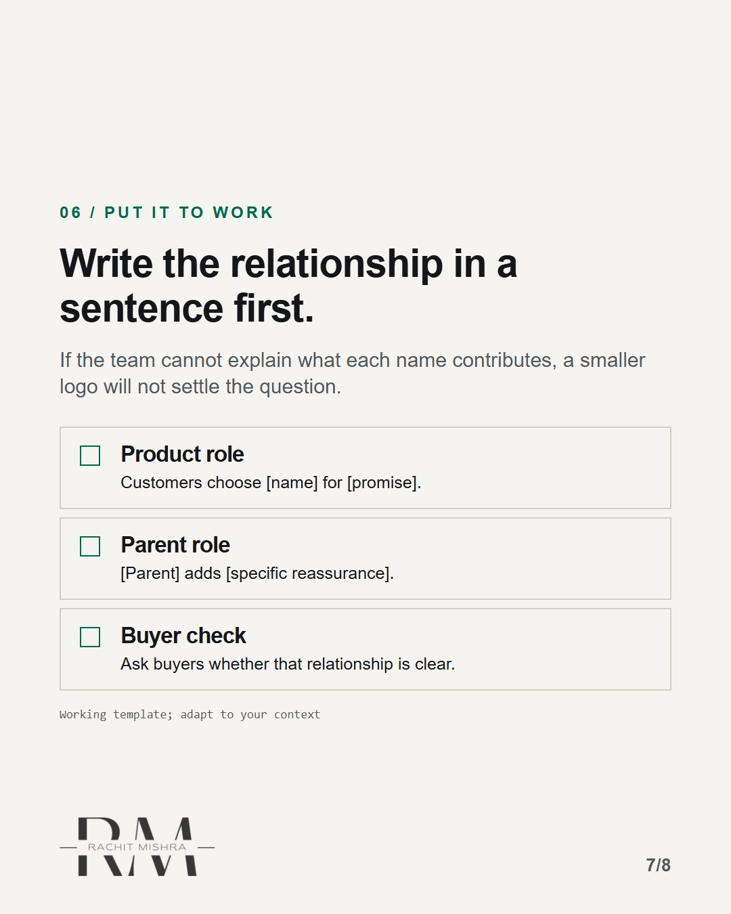
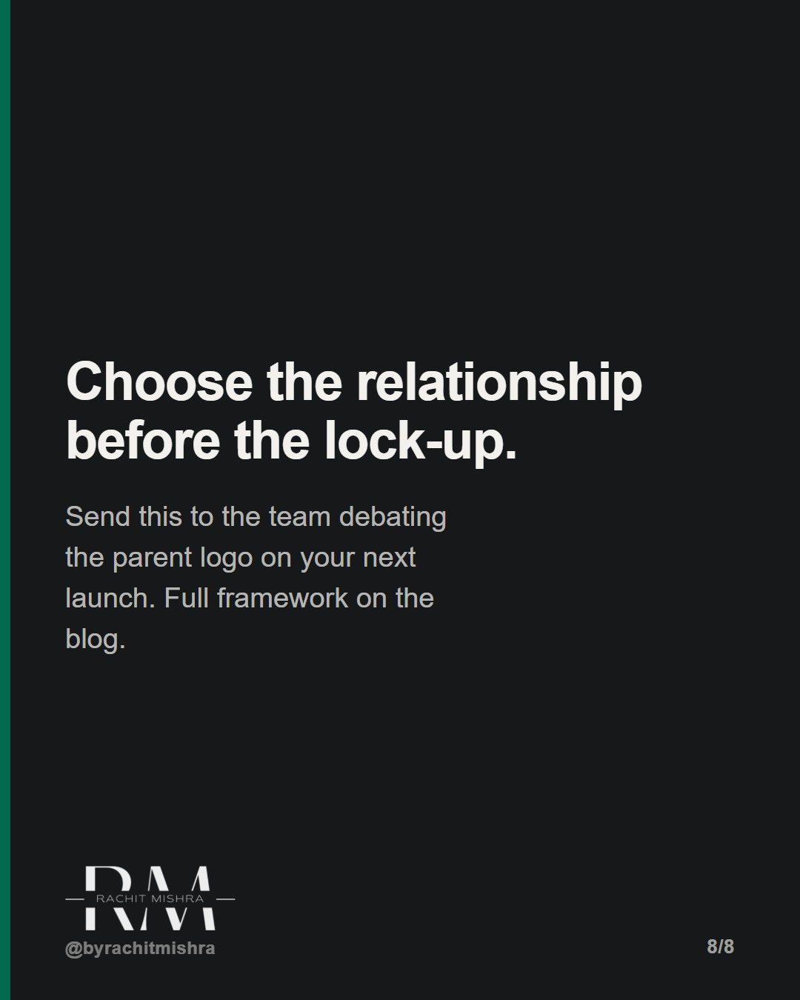

# two logos which name does the buyer trust

**CAROUSEL** · inside_the_org · goes live **2026-11-29T10:30:00+05:30**

> Targeting: `brand architecture`
>
> Claim: Before choosing a parent endorsement, test which name buyers hold accountable, whether audiences overlap, and whether the parent has category credibility.
> Useful takeaway (template): Customers choose [name] for [promise]. / [Parent] adds [specific reassurance]. / Ask buyers whether that relationship is clear.
> Editorial review: passed novelty, visible payoff and source-fidelity checks
>
> Proof (source): Adapted practical tool from Brand Architecture Framework: The Five Layers That Matter. Before choosing a parent endorsement, test which name buyers hold accountable, whether audiences overlap, and whether the parent has category credibility.
> Source: https://www.rachitmishra.in/2026/08/07/brand-architecture-framework/
>
> Source preflight: reachable (HTTP 200)
>
> Rendered infographics: 6 — comparison, checklist, comparison, comparison, checklist, checklist

## Slides

8 rendered images sit in this folder — upload them in filename order.

**1.** 
### Two logos. Which name does the buyer trust?



**2.** 01 / PUT IT TO WORK
### A corner logo is still a decision.
A parent endorsement asks buyers to understand two names and the relationship between them.



**3.** 02 / PUT IT TO WORK
### Start with the name the customer would blame.
Ask buyers who they believe stands behind the promise. Do not answer from the organisation chart.



**4.** 03 / PUT IT TO WORK
### Check whether the audiences actually overlap.
Compare real buying groups across the businesses. Do not assume shared ownership means shared buyers.



**5.** 04 / PUT IT TO WORK
### Test what the parent name adds in this category.
Recognition and credibility are different. Ask what the parent makes buyers believe about this product.



**6.** 05 / PUT IT TO WORK
### Discuss separation before designing lock-ups.
A possible sale or restructuring can change the cost of linking names. Treat that as a scenario, not a rule.



**7.** 06 / PUT IT TO WORK
### Write the relationship in a sentence first.
If the team cannot explain what each name contributes, a smaller logo will not settle the question.



**8.** 
### Choose the relationship before the lock-up.
Send this to the team debating the parent logo on your next launch. Full framework on the blog.



## Caption — copy from here

```
Two logos. Which name does the buyer trust?

Brand architecture is easier to discuss when each name has a job. A parent endorsement may help, but it needs evidence of useful reassurance.

This is a buyer test, not a rule that every business should consolidate its names. Check customer overlap, category credibility and future separation needs.

Send this to the launch team debating logo sizes.

Full article: https://www.rachitmishra.in/2026/08/07/brand-architecture-framework/

[brand architecture, practical marketing, b2b marketing]

#brandarchitecture #brandstrategy #brandmanagement
```

## Alt text

```
Practical brand architecture template shown in green-accented text and diagrams.
```

## How this post could fail

The tool needs adaptation to the reader's context; it must not be treated as a universal rule or a measured result.

## Sources

- [Brand Architecture Framework: The Five Layers That Matter](https://www.rachitmishra.in/2026/08/07/brand-architecture-framework/)
