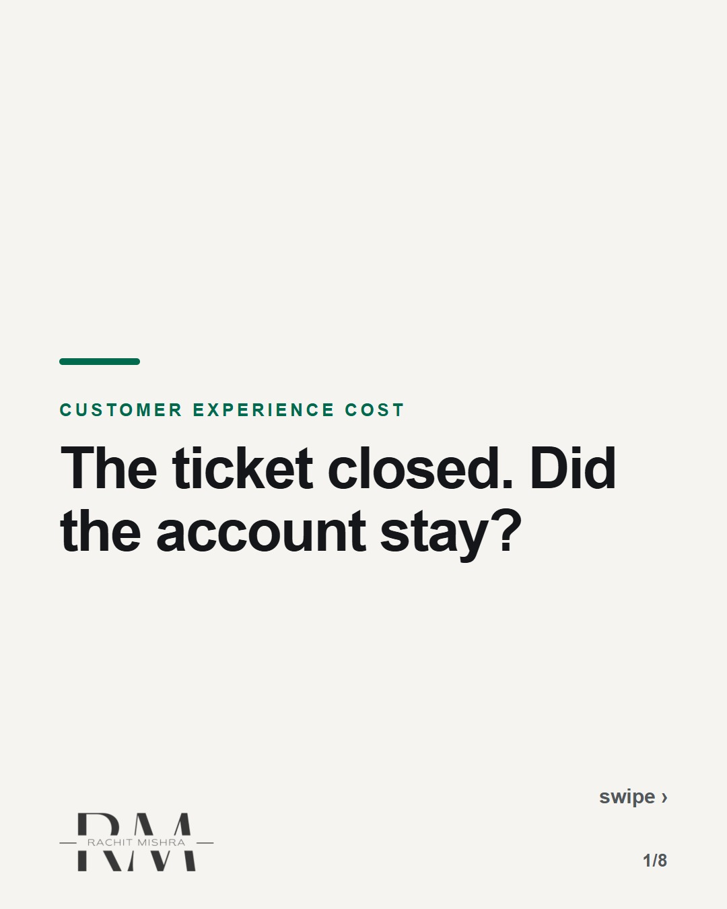
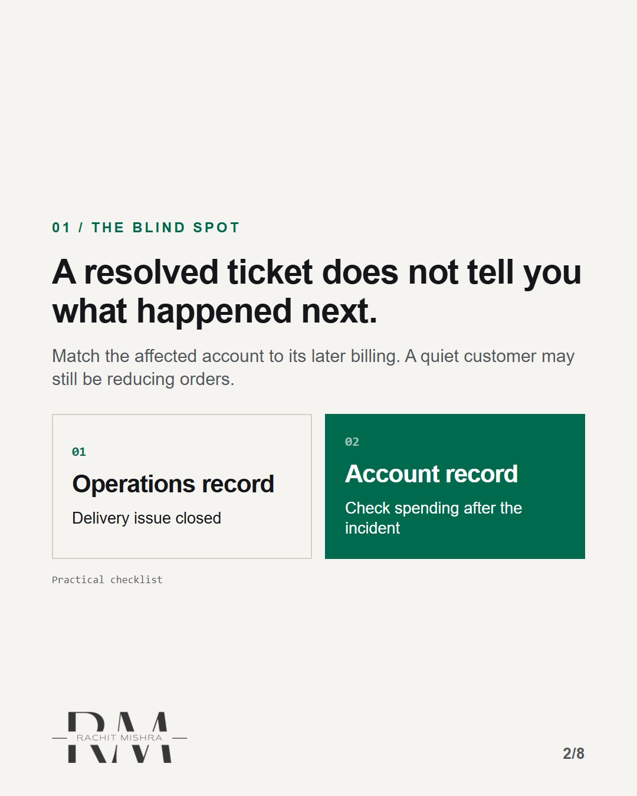
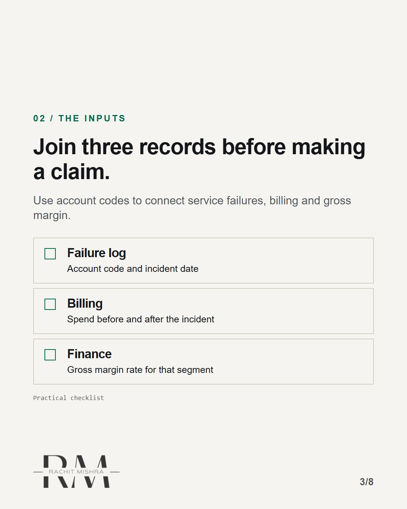
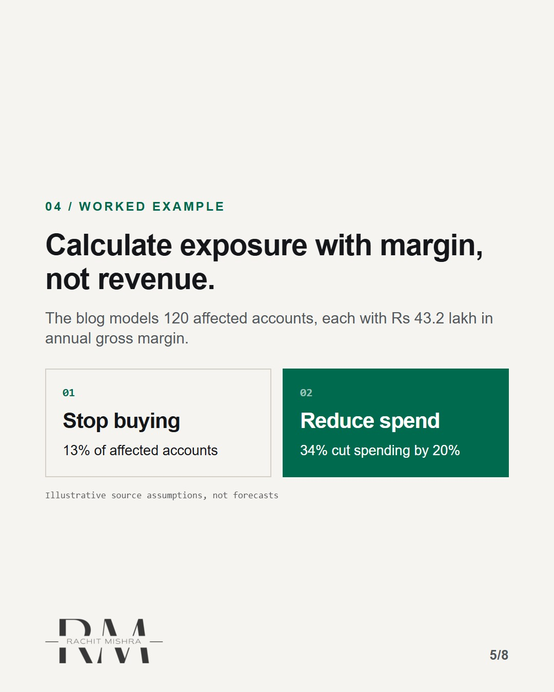
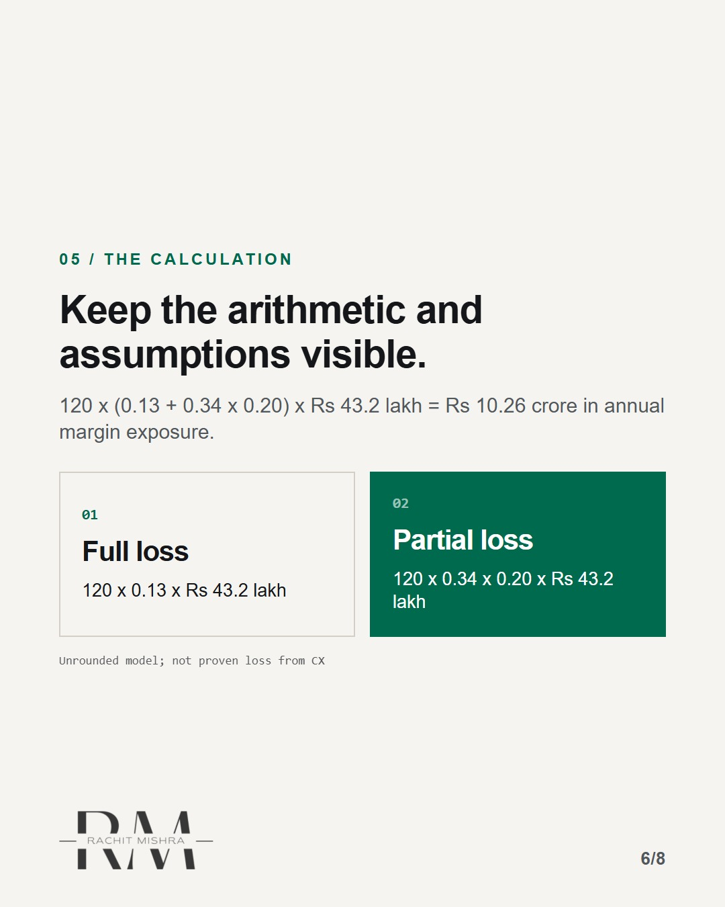
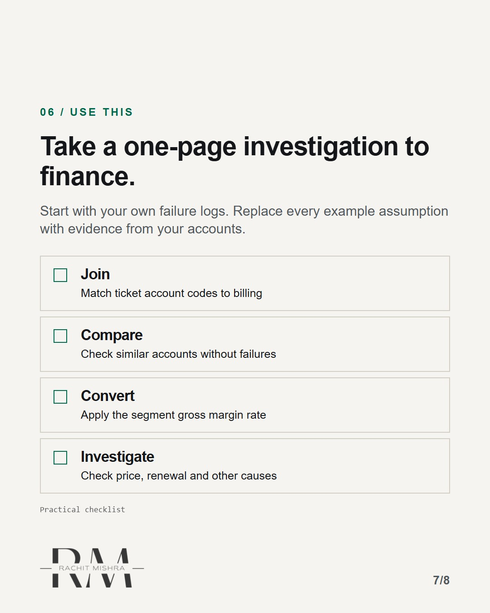
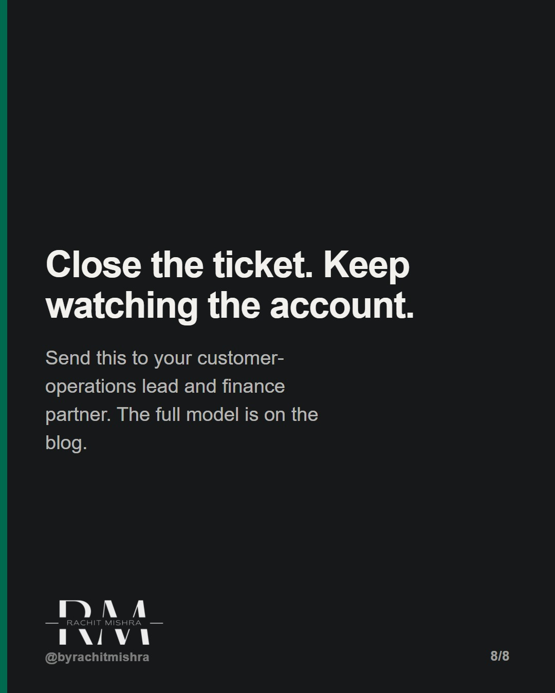

# costofpoorcustomerexperienceb2b

**CAROUSEL** · ai_in_practice · goes live **2026-11-25T20:00:00+05:30**

> Targeting: `customer experience cost`
>
> Claim: Match closed service tickets to later account spending to estimate margin exposure, then investigate alternative causes.
> Useful takeaway (worked_example): Match ticket account codes to billing / Check similar accounts without failures / Apply the segment gross margin rate / Check price, renewal and other causes
> Editorial review: passed novelty, visible payoff and source-fidelity checks
>
> Proof (source): Source worked example: 120 affected accounts, 13% stop, 34% reduce spending by 20%, annual margin Rs 43.2 lakh per account. Unrounded calculation gives Rs 10.26 crore exposure; this is illustrative, not measured loss.
> Source: https://www.rachitmishra.in/2026/09/06/poor-customer-experience-cost/
>
> Source preflight: reachable (HTTP 200)
>
> Rendered infographics: 6 — comparison, checklist, comparison, comparison, comparison, checklist

## Slides

8 rendered images sit in this folder — upload them in filename order.

**1.** 
### The ticket closed. Did the account stay?



**2.** 01 / THE BLIND SPOT
### A resolved ticket does not tell you what happened next.
Match the affected account to its later billing. A quiet customer may still be reducing orders.



**3.** 02 / THE INPUTS
### Join three records before making a claim.
Use account codes to connect service failures, billing and gross margin.



**4.** 03 / THE CHECK
### Use the same time window for both groups.
Compare affected accounts with similar unaffected accounts. Check renewal timing and seasonality.


**5.** 04 / WORKED EXAMPLE
### Calculate exposure with margin, not revenue.
The blog models 120 affected accounts, each with Rs 43.2 lakh in annual gross margin.



**6.** 05 / THE CALCULATION
### Keep the arithmetic and assumptions visible.
120 x (0.13 + 0.34 x 0.20) x Rs 43.2 lakh = Rs 10.26 crore in annual margin exposure.



**7.** 06 / USE THIS
### Take a one-page investigation to finance.
Start with your own failure logs. Replace every example assumption with evidence from your accounts.



**8.** 
### Close the ticket. Keep watching the account.
Send this to your customer-operations lead and finance partner. The full model is on the blog.



## Caption — copy from here

```
The ticket closed. Did the account stay?

Customer experience cost becomes useful when you can trace it to accounts, dates and margin.

A drop after a failure is a signal to investigate, not proof that the failure caused it. Price changes, renewals and seasonality also matter.

The example uses unrounded inputs; replace them with your own data.

Full model: https://www.rachitmishra.in/2026/09/06/poor-customer-experience-cost/

Send this to your CX lead and finance partner.

[customer experience cost, account retention, gross margin]

#customerexperience #customerretention #b2bmarketing
```

## Alt text

```
Carousel breakdown of calculating B2B customer retention loss using internal margin figures.
```

## How this post could fail

If the post focuses too much on general CX theories rather than the specific financial calculation model, it will read like standard marketing advice instead of a practical B2B operational audit.

## Sources

- [The Cost of Poor Customer Experience, in Numbers](https://www.rachitmishra.in/2026/09/06/poor-customer-experience-cost/)
